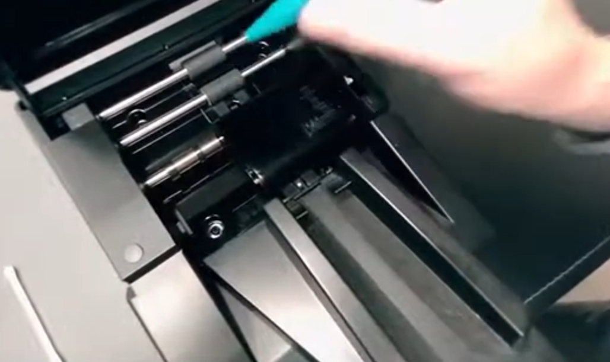
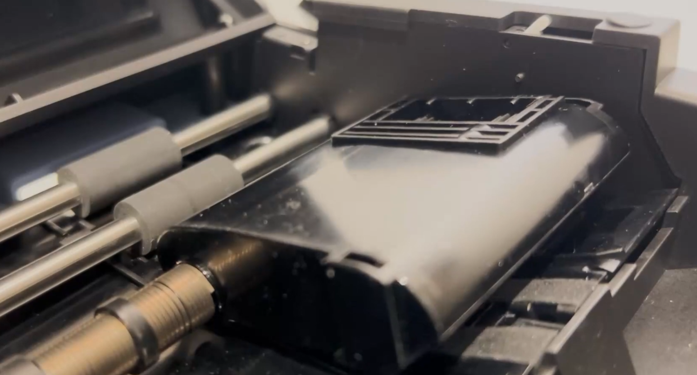
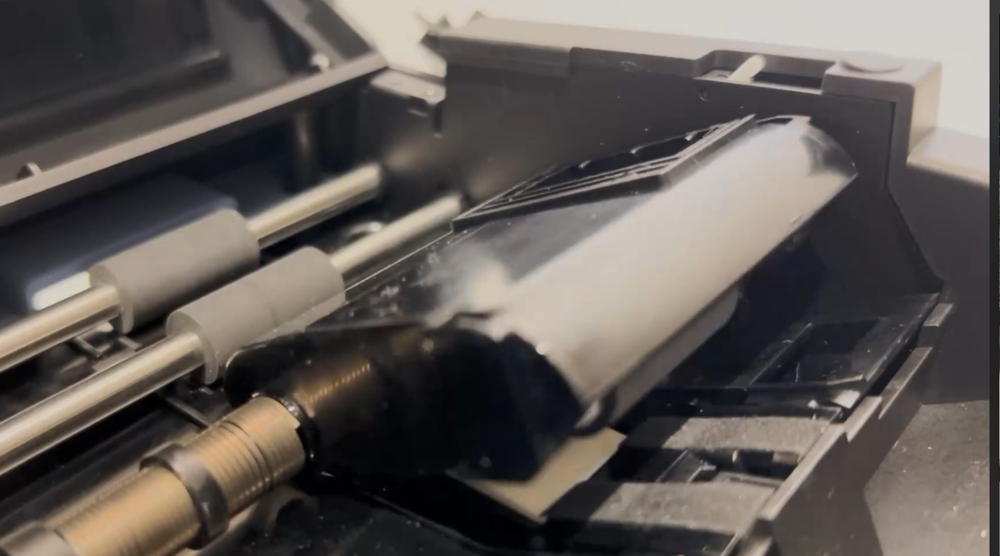
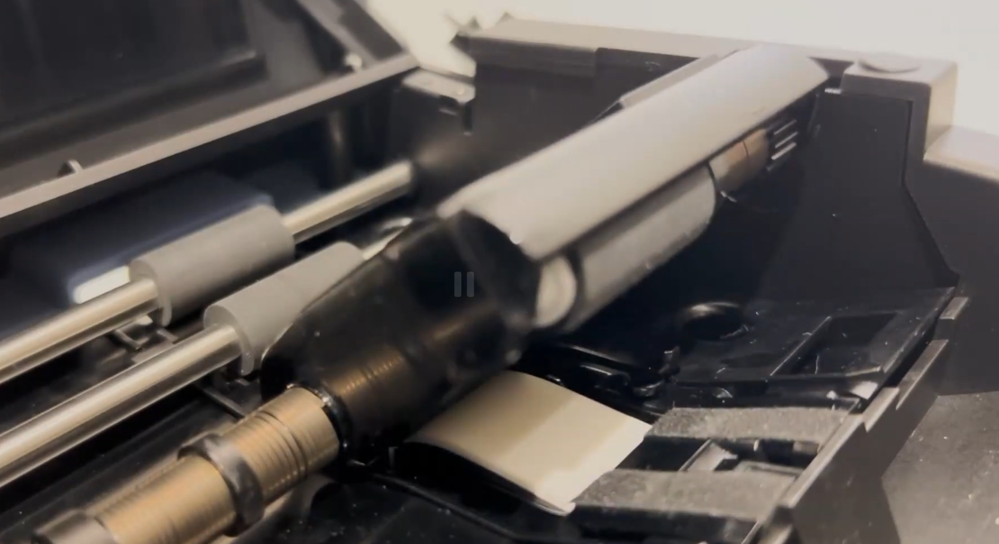
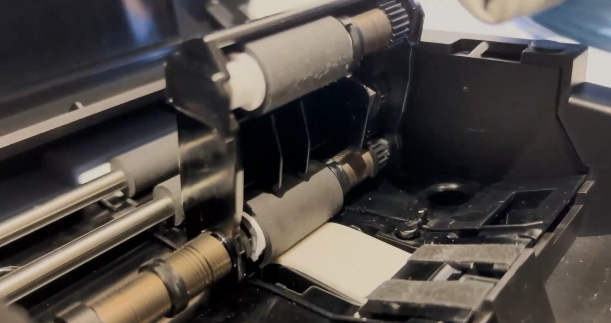
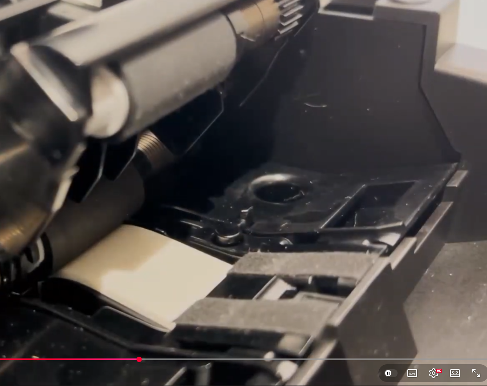
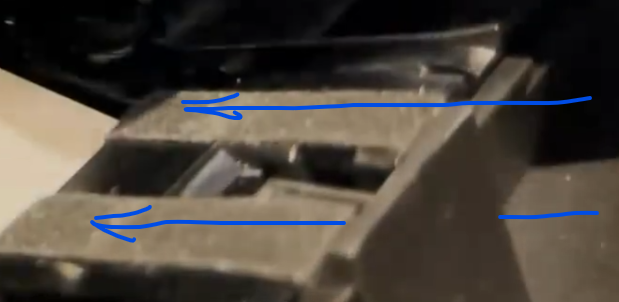
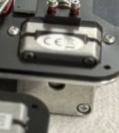
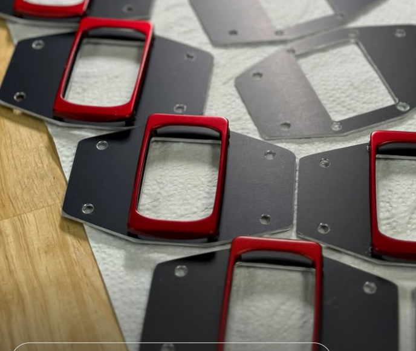

# Visuals & Mechanical Concepts

**Status: WIP — Illustrations, observations and hypotheses**

Visual exploration of possible mechanisms for automatic batch feeding of 35mm film strips, including single-frame negatives.

Diagrams should distinguish **observed components**, **hypothesized functions**, and **proposed designs**.

## 1. Passive strip separation

**Priority: High — First illustration**

Inspired by the [Pacific Image PowerFilm Plus](https://youtu.be/FA9UKOKTuyk?t=82).

Visible components:

- Upper rubber pickup roller.
- Two felt-like supports beneath the film stack.
- Angled retaining edge near the film entrance.

**Hypothesis:** The supports are spring-loaded, pressing the stack against the roller. Friction and the angled edge retain the remaining strips while the top strip is extracted.

**Illustration:** Side-view cross-section showing the stack, roller, felt supports, angled lip, film movement and proposed forces.

_Unverified: spring mechanism, actual separation principle and double-feed prevention._

## 2. Two-stage roller separation

Alternative based on initial manual experiments.

A rubber roller advances the outermost strip from a tilted stack. A second roller takes over once the strip protrudes sufficiently.

**Illustration:** Side view showing roller positions, adjustable angles, film trajectories and the potential scratching point where the trailing edge contacts the next strip.

## 3. Continuous-belt film carrier

Inspired by [SlideSnap Strip](https://slidesnap.com/).

Two synchronized rubber belts run along the perforated film edges, maintaining transport control even for single-frame negatives.

**Illustration:** Top view showing belts, pulleys, film perforations and scanning aperture.

## 4. Film flattening mechanism

Proposed clamping plates press the film edges against the transport belts. The clamped assemblies move slightly outwards, applying lateral tension before capture.

**Illustration:** Cross-section and top view showing clamping forces and outward movement.

Related: [Kodak patent EP0660170A1](https://patents.google.com/patent/EP0660170A1/en).

## 5. Complete system

Overview of the proposed workflow:

Future additions: sensors, double-feed detection, motor control and error recovery.

## Reference images

### Pacific Image PowerFilm Plus

*Feed chute from above. The guide channel leads toward several rollers mounted on parallel shafts.*

*Pickup assembly in the lowered position. Its black cover sits over the feed entrance, beside two gray rollers on parallel shafts.*

*Pickup assembly partway open. Lifting the cover exposes part of the white pad and the guides beneath it.*

*Pickup assembly raised farther. The upper gray roller is visible beneath the cover, above the white pad in the feed path.*

*Pickup assembly upright. The upper and lower gray rollers are both visible, along with gears at their right ends.*

*Feed entrance close-up. Two felt-like strips sit on the entrance guides beside a white pad below the rollers.*

*Annotated crop of the feed entrance. Blue arrows highlight the two felt-like strips discussed in the passive separation hypothesis. Their material and mechanical role remain unverified.*

### Film transport and gates

*Filmomat Autocarrier motor. The motor is mounted on a dark plate, with two electrical terminals visible above the housing.*

*Film gate holders. Several plates have red clamp frames around the scanning aperture. Bare plates show the cutouts and mounting holes.*

## Illustration guidelines

- Use SVG for editable mechanical diagrams.
- Show film dimensions and moving parts where relevant.
- Distinguish observations from hypotheses using labels or line styles.
- Mark unknown dimensions rather than inventing measurements.
- Prefer original illustrations over third-party screenshots.

Store illustrations in `assets/visuals/` and embed them here as they are completed.
