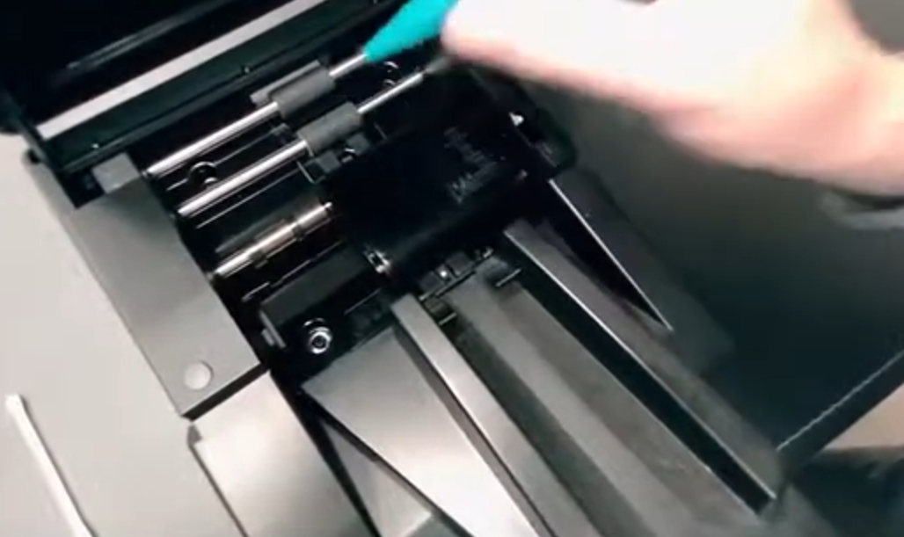
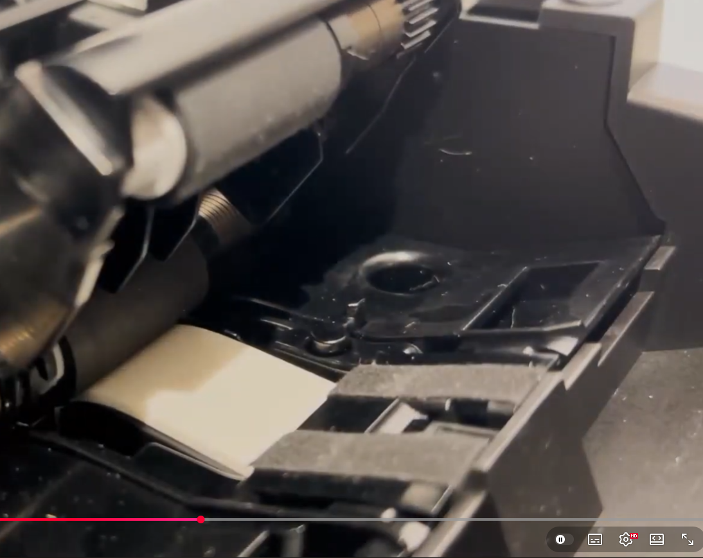

# 1. Film stack

[Overview](../README.md#overview) · Next [Pickup & separation](2-pickup-and-separation.md)

The magazine presents loose 35 mm strips to the pickup point as the stack empties. The input includes both single frames and longer strips, with varying curl.

| Concept | Evidence and trade-offs |
| --- | --- |
| Shallow chute with felt-like supports | The PowerFilm Plus feed chute has a guide channel, two felt-like supports beneath the stack, and an angled retaining lip. [Feed chute photos](#powerfilm-plus-feed-chute) · [How the supports may assist pickup](2-pickup-and-separation.md#passive-separation-inspired-by-powerfilm-plus) |
| Slightly inclined, near-vertical stack | Stand the strips nearly vertical and tilt them slightly toward the feed direction, with the glossy, convex base side facing the pickup roller. Registration as the stack empties and clearance around the trailing edge remain open. [Manual trial and side-view sketch](2-pickup-and-separation.md#two-stage-roller-pickup) |

## PowerFilm Plus feed chute

*Feed chute from above. The guide channel leads toward several rollers mounted on parallel shafts.*

*Feed entrance close-up. Two felt-like strips sit on the entrance guides beside a white pad below the rollers.*

## Open questions and experiments

- On an adjustable rig, vary inclination, stack size and curvature. Check whether the first and last strips reach the pickup roller, including when the active piece is a single frame.
- Compare how each arrangement keeps film aligned and whether any part of the image area rubs the magazine or adjacent film.

## References

- [PowerFilm Plus feeding footage at 1:22](https://youtu.be/FA9UKOKTuyk?t=82)
- [Gretag hopper and suction pickup](2-pickup-and-separation.md#closest-published-design-for-loose-strips)

---

[Overview](../README.md#overview) · Next [Pickup & separation](2-pickup-and-separation.md)
