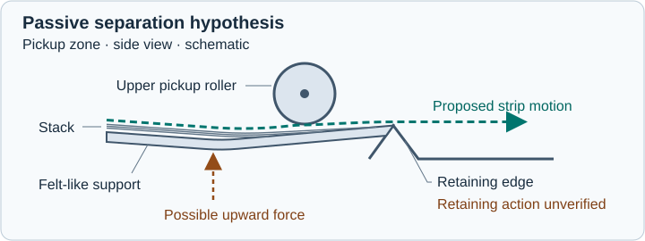
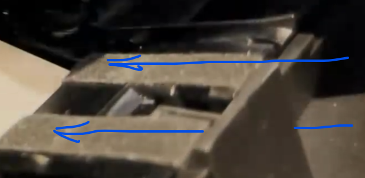
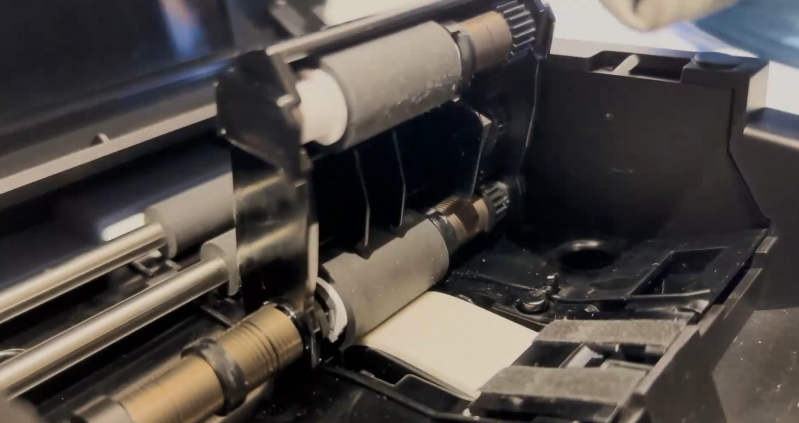
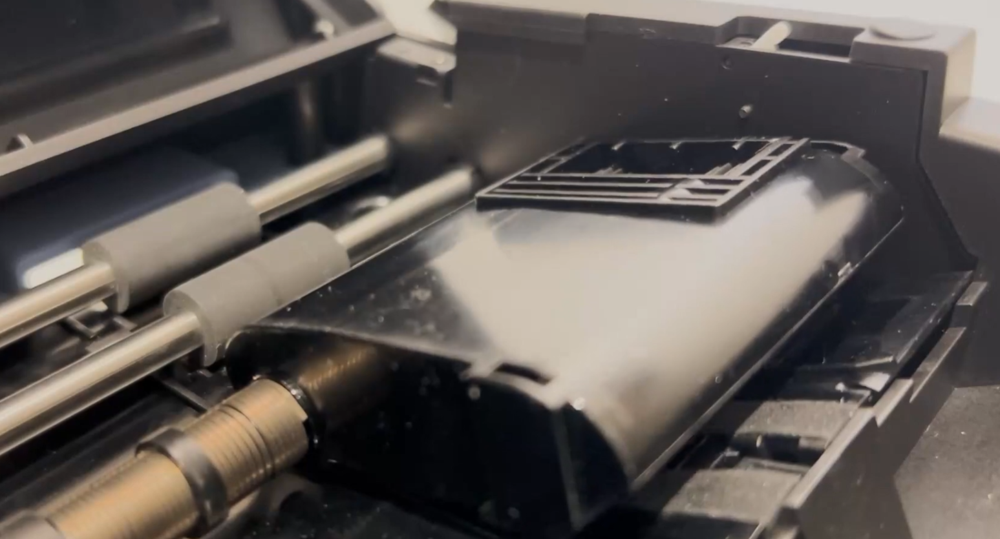
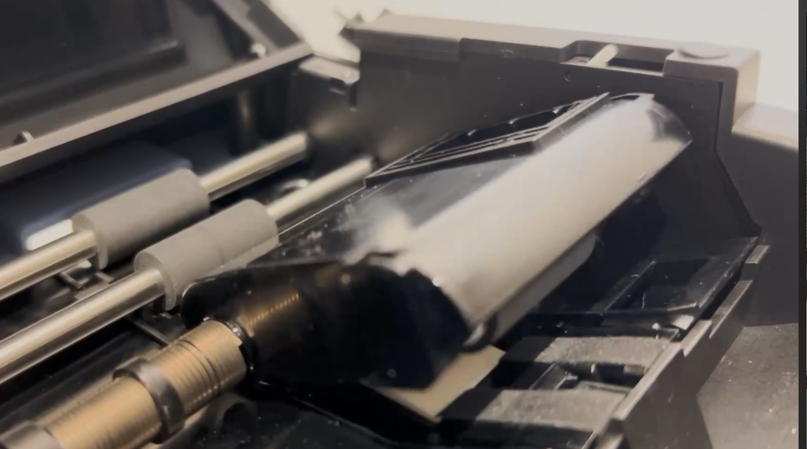
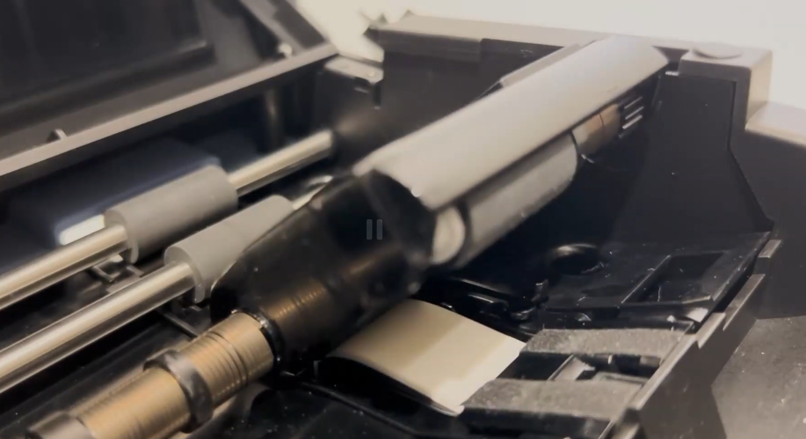
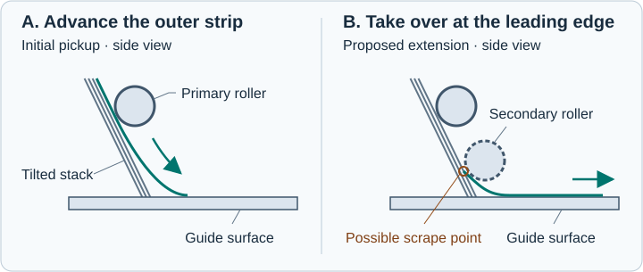

# 2. Pickup & separation

[Overview](../README.md#overview) · Previous [Film stack](1-film-stack.md) · Next [Transport](3-transport.md)

Extract one strip, clear it from the stack and hand it off to transport. A loose single frame has to stay under control through the same transition as longer strips.

## Passive separation inspired by PowerFilm Plus

**Observed in footage.** Two initial rubber rollers rotate through a mechanical link. Their housing lifts for cleaning. The entrance shows two felt-like supports below the stack, an angled entrance with a retaining edge, and further rollers inside near the scanner sensor.

**Unverified hypothesis.** The supports spring upward and press the stack against the upper pickup roller. The angled edge and friction retain the remaining strips while the roller advances the top strip. The supports could take up the difference as the stack empties. The support material, spring action and actual separation mechanism remain open.

**Potential advantage.** Passive stack-height compensation could keep the next strip in pickup position. **Risks.** Retention and pickup force may vary with stack size and curl. A short strip may fail to reach the downstream grip, and relative motion could abrade adjacent film.

### PowerFilm Plus pickup photos

The [feed chute and entrance photos](1-film-stack.md#powerfilm-plus-feed-chute) show the guides leading to the roller assembly.

_Annotated crop of the feed entrance. Blue arrows highlight the two felt-like strips discussed in the passive separation hypothesis. Their material and mechanical role remain unverified._

_Pickup assembly upright. The upper and lower gray rollers are both visible, along with gears at their right ends._

Pickup housing opening sequence

_Pickup assembly in the lowered position. Its black cover sits over the feed entrance, beside two gray rollers on parallel shafts._

_Pickup assembly partway open. Lifting the cover exposes part of the white pad and the guides beneath it._

_Pickup assembly raised farther. The upper gray roller is visible beneath the cover, above the white pad in the feed path._

## Two-stage roller pickup

**Manual observation.** A rubber roller contacted the glossy, convex base side of the outer strip. The roller advanced that strip, which changed angle relative to the rest of the stack. [Near-vertical stack setup](1-film-stack.md)

**Proposed extension.** The primary roller feeds the strip downward onto a flat guide surface. A second roller above the guide catches the leading edge and completes extraction as the strip slides along the surface. The primary roller must be positioned to grip even a single frame. The main risk is scraping the next strip with the departing strip's trailing edge.

## Closest published design for loose strips

Gretag Imaging's photographic reorder patent describes a hopper that feeds loose negative strips one at a time into a track for a digital camera. Figures 4A and 4B show a spring-biased plate that squares the stack and a pivoting suction cup that hands each strip to a driven exit roller and a movable pinch roller. The patent gives a direct mechanical precedent for stack pickup. It provides no performance data for batches of loose single frames. [US Patent 6,556,276](https://www.freepatentsonline.com/6556276.html)

## Handoff to transport

For both roller concepts, check that downstream traction begins before upstream traction is lost, even for the shortest strip. Test the exit into the [edge-belt transport](3-transport.md) for skew, buckling from competing drive speeds, and contact with the adjacent strip during extraction. The spacing and grip at this interface remain open.

## Open questions and experiments

1. Build a hand-operated adjustable rig. Vary stack angle, pickup height and pressure, support compliance and lip position for the passive concept, and secondary roller position for the two-stage concept.
2. Run mixed test film from single frames to longer strips across different stack sizes and curvatures. Handle misses, double feeds, jams, handoff failures and new scratches. Inspect both the extracted piece and the next strip before and after runs and make sure there won't be any scratches.
3. Aim for say "**100 consecutive successful feeds**" with one strip handed off per attempt, without intervention or introduced scratches. In separate fault trials, verify detection and recovery from a double feed. Motorize after the manual rig trials.

## References

- [PowerFilm Plus feeding footage at 1:22](https://youtu.be/FA9UKOKTuyk?t=82)
- [PowerFilm Plus roller cleaning and internal view](https://www.youtube.com/watch?v=_j4d6bKq0QE)
- [Xerox separator patent](https://patents.google.com/patent/EP1721846B1/en)
- [Brother scanner separation pad](https://store.brother.se/accessories/scanners/sp2001c) (probably not film though)

---

[Overview](../README.md#overview) · Previous [Film stack](1-film-stack.md) · Next [Transport](3-transport.md)
