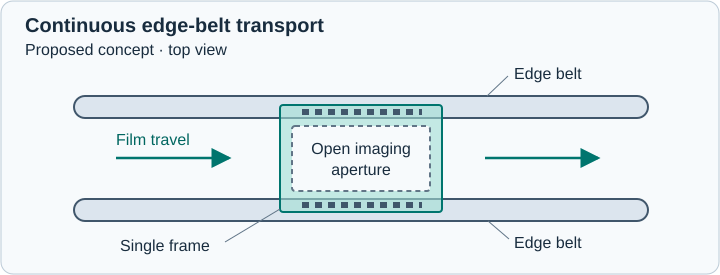

# 3. Transport

[Overview](../README.md#overview) · Previous [Pickup & separation](2-pickup-and-separation.md) · Next [Flattening & capture](4-flattening-and-capture.md)

## Proposed continuous edge belts

Two smooth rubber belts run along the perforated edges, keeping a single frame under drive through the gate. Both belts need synchronized motion. A shared motor and transmission are one option. The SlideSnap Strip inspired this approach and accepts loose single frames. [SlideSnap Strip](https://slidesnap.com/product/slidesnap-strip/)

The proposed contact pattern leaves the image area clear. A speed difference or uneven grip between edges could skew the film. Smooth belt contact across the perforations looks plausible and needs a snagging test.

## Alternative

Synchronized edge rollers offer discrete grip points. The toneCarrier 35 mm grips the film from both sides and specifies strips of four or more frames. Check whether closer roller spacing can maintain grip across an open gate for a single frame. [toneCarrier 35 mm](https://tonephotographic.com/products/tonecarrier-35-mm)

## Open questions and experiments

- Hand-feed flat and curled test single frames through a mock gate. Check left-to-right registration, slip, perforation snagging and image-area contact.
- Test the [entry handoff](2-pickup-and-separation.md#handoff-to-transport) and whether drive resumes cleanly after the clamps release.

---

[Overview](../README.md#overview) · Previous [Pickup & separation](2-pickup-and-separation.md) · Next [Flattening & capture](4-flattening-and-capture.md)
