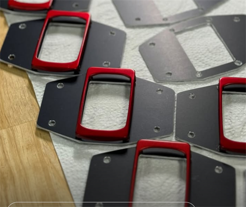
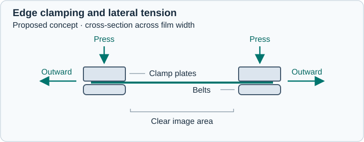
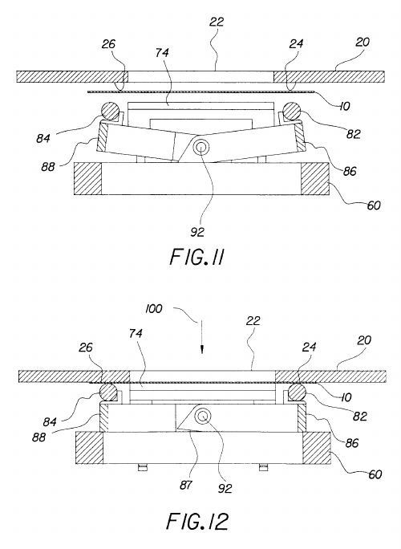
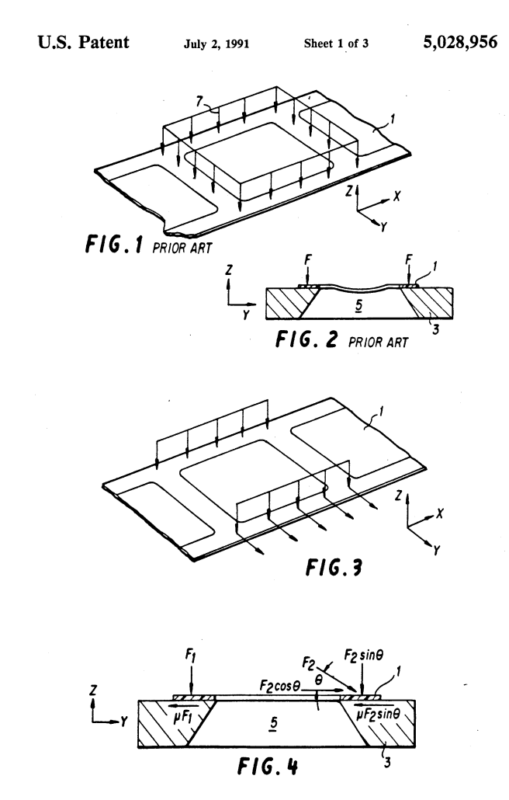
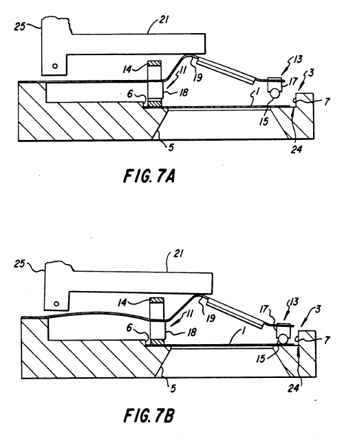

# 4. Flattening & capture

[Overview](../README.md#overview) · Previous [Transport](3-transport.md) · Next [Output](5-output.md)

## Filmomat Autocarrier as a reference

Of the carriers we have looked at, the Filmomat 135 Autocarrier is probably the best current option for consistent film flatness. Its magnetic BOBACH pressure mask holds each frame flat during capture. Filmomat specifies a minimum of three frames for cut strips. [Filmomat 135 Autocarrier](https://shop.filmomat.eu/products/135-autocarrier)

*Autocarrier BOBACH holders.* [Full-size image](../images/film-gate-holders-with-red-clamps.png)

Changes to the transport or pressure mask might improve the Autocarrier. It is hard to tell how much we could gain without testing. We need to feed and flatten loose single frames, including negatives cut flush with the image. A clamp across either cut end could cover part of the image.

The SlideSnap Strip is a useful transport reference because it accepts loose single frames. SlideSnap notes that severely curled film can still be hard to hold flat. Our goal is to handle single frames and keep the whole image consistently flat during capture. [SlideSnap Strip](https://slidesnap.com/product/slidesnap-strip/) · [SlideSnap film handling and limitations](https://slidesnap.com/slidesnap-scanners/slidesnap-strip-batch-negative-film-scanner/slidesnap-strip-film-type-capabilities/)

## Proposed edge clamping and lateral tension

1. Stop the belts at the imaging position.
2. Press elongated clamping plates against the film edges and belts.
3. Move both clamped assemblies slightly outward to tension the film across its width.
4. Capture, release the clamps and resume transport.

The plates would touch the edges and leave the image area unobstructed. Transverse flattening is the intended effect. Longitudinal curl, tension uniformity and safe contact pressure remain open.

### Kodak film clamps

In EP0660170A1, a single vertical stroke both grips the film and tensions it across its width. A common carrier lifts two spring-loaded pivoting arms. Their compliant, high-friction rods first press the film's long edges against a fixed flat plate around the aperture. As the carrier continues upward, the arms pivot outward and the rods pull the two edges apart by friction. [EP0660170A1](https://patents.google.com/patent/EP0660170A1/en)

*Figure 11 shows clearance for transport. In figure 12, the raised carrier (60) has pivoted the arms (86, 88) and moved the clamping rods (82, 84) apart.* [Full-size image](../images/kodak-ep0660170a1-figures-11-12.png) · [Original patent drawings, p. 19](https://patentimages.storage.googleapis.com/2e/72/97/aa4b3926566d12/EP0660170A1.pdf#page=19)

Kodak also uses separate spring-loaded clamps at the leading and trailing edges of the image frame. These press toward the plate to hold curled ends down. A single-frame negative cut flush with the image may have no room for these clamps without covering part of the frame.

In the proposed gate, the belts serve as the clamping surfaces, so belt deflection or slip could reduce how far the film edges actually move. An earlier Kodak design, US5028956A, uses a transport belt to hold one long edge against a fixed plate while a separate clamp pulls the opposite edge outward. [US5028956A](https://patents.google.com/patent/US5028956A/en)

*Figures 1 and 2 show how the film can stay bowed across the aperture when the clamps only press down. Figures 3 and 4 show the same area in perspective and in cross-section with one long edge held down and the opposite edge pushed down and outward to tension the film.* [Original patent drawings, sheet 1](https://patentimages.storage.googleapis.com/02/14/4c/e87900dbdbdebd/US5028956.pdf#page=2)

*In figure 7A, the belt (14) holds one edge. In figure 7B, the opposing clamp (13) engages and tensions the film.* [Full-size image](../images/kodak-us5028956a-figures-7a-7b.png) · [Original patent drawings, PDF p. 4](https://patentimages.storage.googleapis.com/02/14/4c/e87900dbdbdebd/US5028956.pdf#page=4)

## Alternative and experiments

- Compare edge clamping alone with clamping plus lateral displacement on the same curled single-frame negatives, with the cut ends free in both cases. Check flatness at the center and corners, image registration and edge marks.
- Measure the lateral movement of both film edges relative to the clamp travel to see how much of the motion reaches the film.
- Include film curled in different directions. Check that clamps release cleanly before transport resumes.

---

[Overview](../README.md#overview) · Previous [Transport](3-transport.md) · Next [Output](5-output.md)
