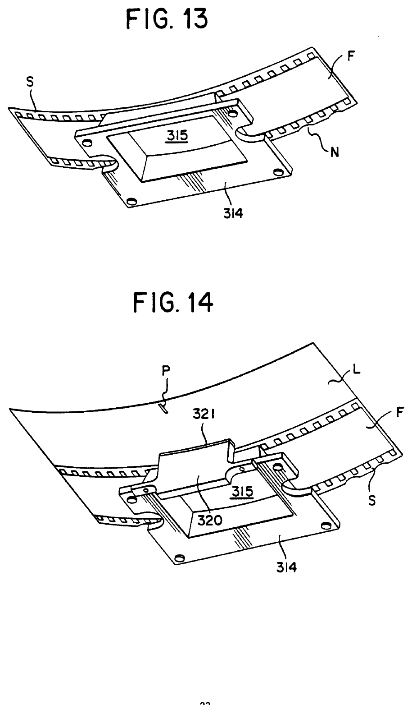
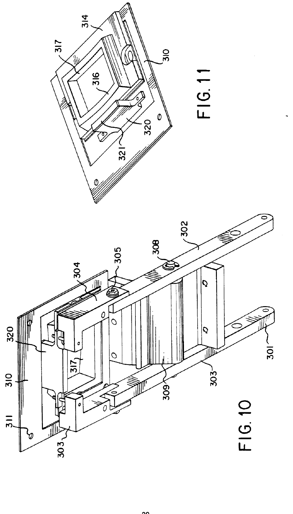

# Clamping arrangement for film scanning apparatus

A laminate clamp conforms film to an arcuate scanner gate without stretching it over a flat window.

[EP0588308B1 · complete original PDF (29 pages)](../sources/EP0588308B1.pdf) · [Archival PDF source](https://patentimages.storage.googleapis.com/3a/6d/50/051cc8289c2260/EP0588308B1.pdf) · [Searchable publication](https://patents.google.com/patent/EP0588308B1/en) · [Espacenet](https://worldwide.espacenet.com/patent/search?q=pn%3DEP0588308B1)

## Original drawings

<figure>

<figcaption>Figs. 13–14. Curved gate and clamp components in the scanner. <a href="../sources/EP0588308B1.pdf#page=23">EP0588308B1, PDF p. 23</a>.</figcaption>
</figure>
<figure>

<figcaption>Figs. 10A–10B. Perspectives of clamp and contrasting gate geometries. <a href="../sources/EP0588308B1.pdf#page=20">EP0588308B1, PDF p. 20</a>.</figcaption>
</figure>

## Publication

- **Publication** EP0588308B1
- **Inventors** Tomi Lahcanski, Eric P. Hochreiter, James M. Thomas, Mathew D. Dobbins
- **Original assignee** Eastman Kodak Company
- **Priority** 1992-09-14 · **Filing** 1993-09-14 · **Publication** 1998-04-22
- **Original application** Film scanner
- **Mechanisms** Mechanical clamping, Controlled bending, Edge grip, Combined mechanisms

## What the patent describes

**Original problem.** A lab scanner needed a predictable local film surface across strips, rolls and mounted formats without relying on stretching a flat gate.

**Operating sequence.** A selection of strip, roll and mounted-film routes feeds the segment-shaped gate. A resilient laminate moves into contact and the film follows the radius during scanning. The gate opens for additional transport.

**Film contact.** Clamp surfaces contact selected film borders or the mounting format. The radial gate has a clear scanning region.

**Transverse control.** The clamp constrains cross-film lift near the line being sampled.

**Longitudinal control.** The gate prescribes a curved geometry along the working path. The scanning geometry follows that radius rather than assuming a whole planar image.

## Engineering interpretation

**Advantages and limits.** A controlled optical surface can be curved in a line-scanning system. This choice would leave focus variation across a simultaneous area exposure.

**Camera scanning.** A deliberately curved reference is a useful source of transport concepts. Its end control and contact sequence can be isolated from the imaging geometry.

## Commercial evidence and sources

The background names the PIW 2200 and the Kodak 2000 flat-gate scanner. The arcuate design is the subject of the later disclosure. Use of that design in a named model is unverified.

## Related patents

[US5088813A · Film scanner](US5088813A.md) · [US5111241A · Bernoulli scan gate](US5111241A.md) · [US6304315B2 · High speed high resolution continuous optical film printer for duplicating motion films](US6304315B2.md)

**Selected indexed prior references.** [BE662989A](https://patents.google.com/patent/BE662989A/en) · [EP0588294A1](https://patents.google.com/patent/EP0588294A1/en) · [US4736228A](https://patents.google.com/patent/US4736228A/en) · [US4965632A](https://patents.google.com/patent/US4965632A/en)

[Return to the archive](../index.md)
