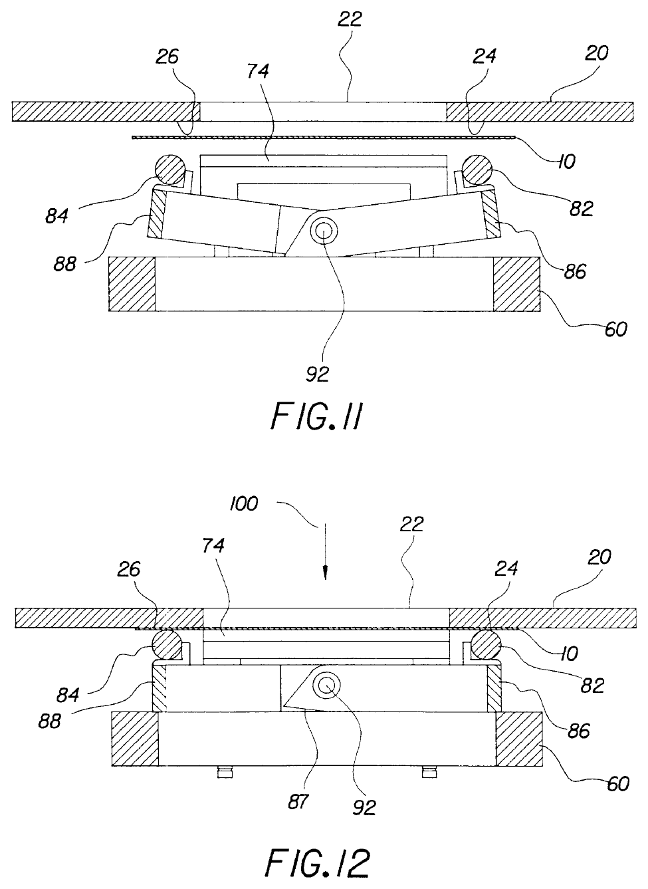
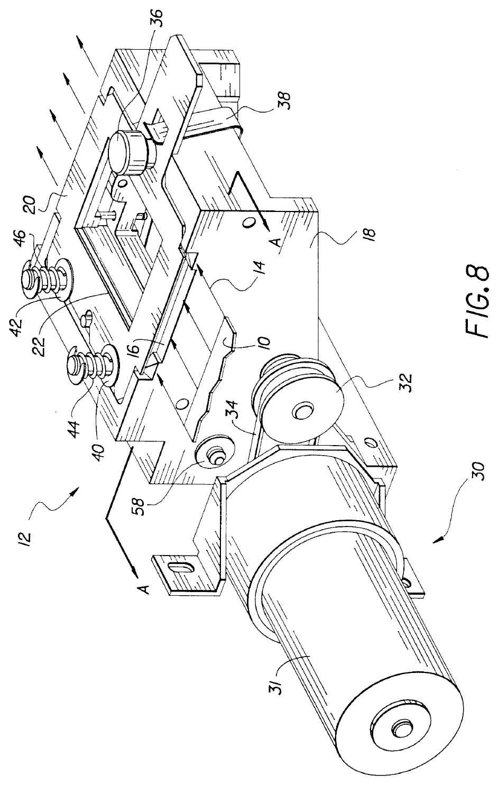
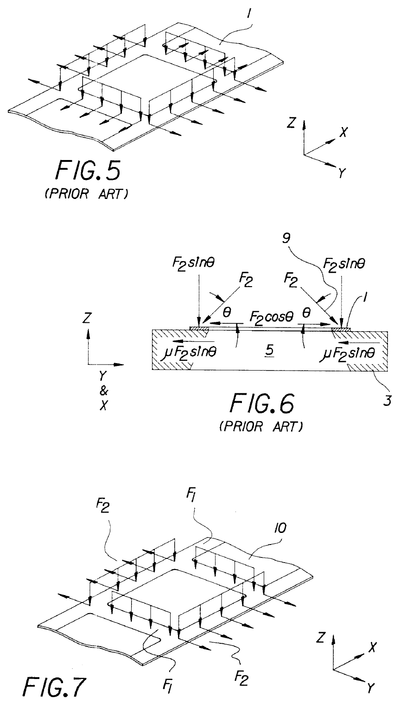

# Film clamp for flattening image frames in a scanning gate

Pivoting long clamps pull outward while separate end clamps press the frame down.

[EP0660170A1 · complete original PDF (20 pages)](../sources/EP0660170A1.pdf) · [Archival PDF source](https://data.epo.org/publication-server/rest/v1.2/patents/EP0660170NWA1/document.pdf) · [Searchable publication](https://patents.google.com/patent/EP0660170A1/en) · [Espacenet](https://worldwide.espacenet.com/patent/search?q=pn%3DEP0660170A1)

## Original drawings

<figure>

<figcaption>Figs. 11–12. Open and engaged cross-sections of the pivoting longitudinal film clamps. <a href="../sources/EP0660170A1.pdf#page=19">EP0660170A1, PDF p. 19</a>.</figcaption>
</figure>
<figure>

<figcaption>Fig. 8. Exploded view of the actuator and the aperture assembly. <a href="../sources/EP0660170A1.pdf#page=16">EP0660170A1, PDF p. 16</a>.</figcaption>
</figure>
<figure>

<figcaption>Figs. 5–7. Diagrammatic locations and force directions of the film contacts. <a href="../sources/EP0660170A1.pdf#page=15">EP0660170A1, PDF p. 15</a>.</figcaption>
</figure>

## Publication

- **Publication** EP0660170A1
- **Inventors** Clyde L. Fetterman, Donald F. Grube
- **Original assignee** Eastman Kodak Company
- **Priority** 1993-12-14 · **Filing** 1994-12-10 · **Publication** 1995-06-28
- **Original application** Film scanner
- **Mechanisms** Mechanical clamping, Edge grip, Lateral tension, Combined mechanisms

## What the patent describes

**Original problem.** The scan gate sought to address transverse bow and curled ends while keeping the frame clear for transmission.

**Operating sequence.** Retract the carrier to feed. Lower it toward the base so the sprung clamping members engage. Long clamps pivot and move apart as their bias is taken up. Transverse clamping blocks take up their stroke against the end margins. Raise the carrier to advance.

**Film contact.** Two elongated clamps grip the long sides around the image. Two other members apply normal load at the frame's transverse borders.

**Transverse control.** Pivoting long-side clamps apply an explicit outward tension while pressing onto the base.

**Longitudinal control.** The end clamps apply normal compression to address the lengthwise shape. The preferred motion is not active end-to-end stretching.

## Engineering interpretation

**Advantages and limits.** Four controlled contacts can flatten across two axes while retaining a glassless window. Clearance and overlap at cut ends determine whether all contacts can engage.

**Camera scanning.** A direct comparison for the belt hypothesis. Try independent timing and two-axis height measurements, including negatives cut very close to the image.

## Commercial evidence and sources

Commercial deployment of the disclosed mechanism is unverified in the sources reviewed.

## Related patents

[US2248646A · Photographic film tensioning mechanism](US2248646A.md) · [US5028956A · Film clamp](US5028956A.md) · [US5258807A · Multiformat film clamp](US5258807A.md) · [US5406352A · Photographic film segment flattening apparatus](US5406352A.md)

**Family publications.** [US5400117A](https://patents.google.com/patent/US5400117A/en) · [JPH07199366A](https://patents.google.com/patent/JPH07199366A/en)

**Selected indexed prior references.** [EP0312328A2](https://patents.google.com/patent/EP0312328A2/en) · [US2248646A](https://patents.google.com/patent/US2248646A/en) · [US4774553A](https://patents.google.com/patent/US4774553A/en) · [WO1991008511A1](https://patents.google.com/patent/WO1991008511A1/en)

[Return to the archive](../index.md)
