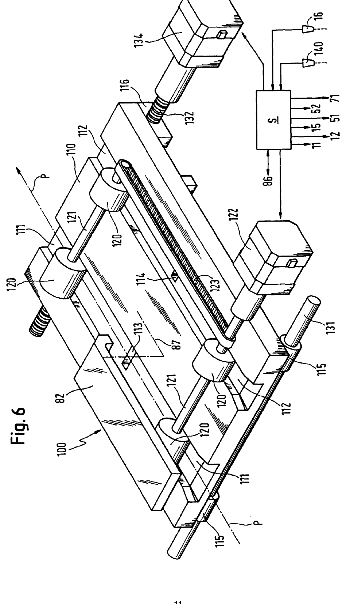
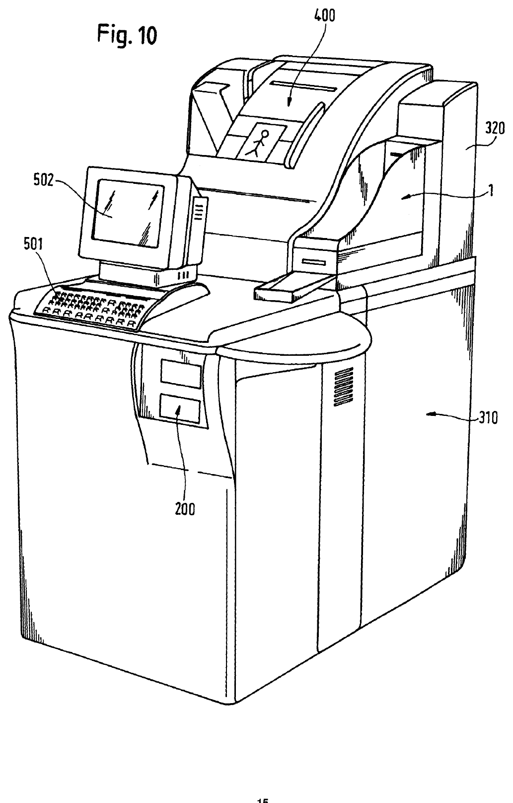

# Fotoelektrische Abtastvorrichtung und damit ausgestattetes fotografisches Kopiergerät

A sensor selects the guide geometry for different film formats in an inline minilab scanner.

[EP0935160A1 · complete original PDF (18 pages)](../sources/EP0935160A1.pdf) · [Archival PDF source](https://patentimages.storage.googleapis.com/15/c6/b5/eb4fb3cefcedb1/EP0935160A1.pdf) · [Searchable publication](https://patents.google.com/patent/EP0935160A1/en) · [Espacenet](https://worldwide.espacenet.com/patent/search?q=pn%3DEP0935160A1)

## Original drawings

<figure>

<figcaption>Fig. 5. Perspective view of the changeover guide platform. <a href="../sources/EP0935160A1.pdf#page=11">EP0935160A1, PDF p. 11</a>.</figcaption>
</figure>
<figure>

<figcaption>Drawing sheet. The scanning system installed in a photographic processing and printing machine. <a href="../sources/EP0935160A1.pdf#page=15">EP0935160A1, PDF p. 15</a>.</figcaption>
</figure>

## Publication

- **Publication** EP0935160A1
- **Inventors** Hugo Knecht
- **Original assignee** Gretag Imaging AG
- **Priority** 1998-02-04 · **Filing** 1998-02-04 · **Publication** 1999-08-11
- **Original application** Photographic printer
- **Mechanisms** Edge grip, Combined mechanisms

## What the patent describes

**Original problem.** A minilab scanner needed to handle different widths automatically while locating moving film relative to a single optical measuring zone.

**Operating sequence.** Film enters from a processing line after leader-card separation or through a manual inlet. Rollers move it through the measurement zone. A sensor and controller select a motorized guide platform appropriate to the detected width while the transmitted light is sampled.

**Film contact.** Feed rollers and the selected mechanical guide contact the film. Light passes through the measuring field.

**Transverse control.** A selected guide introduces film to the cross-film measuring position appropriate to its format.

**Longitudinal control.** Roller transport and the guide place the film at the local scan zone. There is no explicit whole-frame end tension in the described transport.

## Engineering interpretation

**Advantages and limits.** Automatic format changeover can share the measurement optics. Performance depends on correct format detection and film-to-guide fit.

**Camera scanning.** Useful when considering one transport path for mixed film materials and when deciding which restraints should change with film width.

## Commercial evidence and sources

Commercial deployment of the disclosed mechanism is unverified in the sources reviewed.

## Related patents

[US4761675A · Negative carrier assembly for use with a photographic printer](US4761675A.md) · [US5461492A · Film scanner with in-line dual scanning gates](US5461492A.md) · [US6002469A · Apparatus for tensioning copy masters](US6002469A.md)

**Selected indexed prior references.** [US4092067A](https://patents.google.com/patent/US4092067A/en) · [US4252436A](https://patents.google.com/patent/US4252436A/en) · [US4647190A](https://patents.google.com/patent/US4647190A/en) · [US5184227A](https://patents.google.com/patent/US5184227A/en)

[Return to the archive](../index.md)
