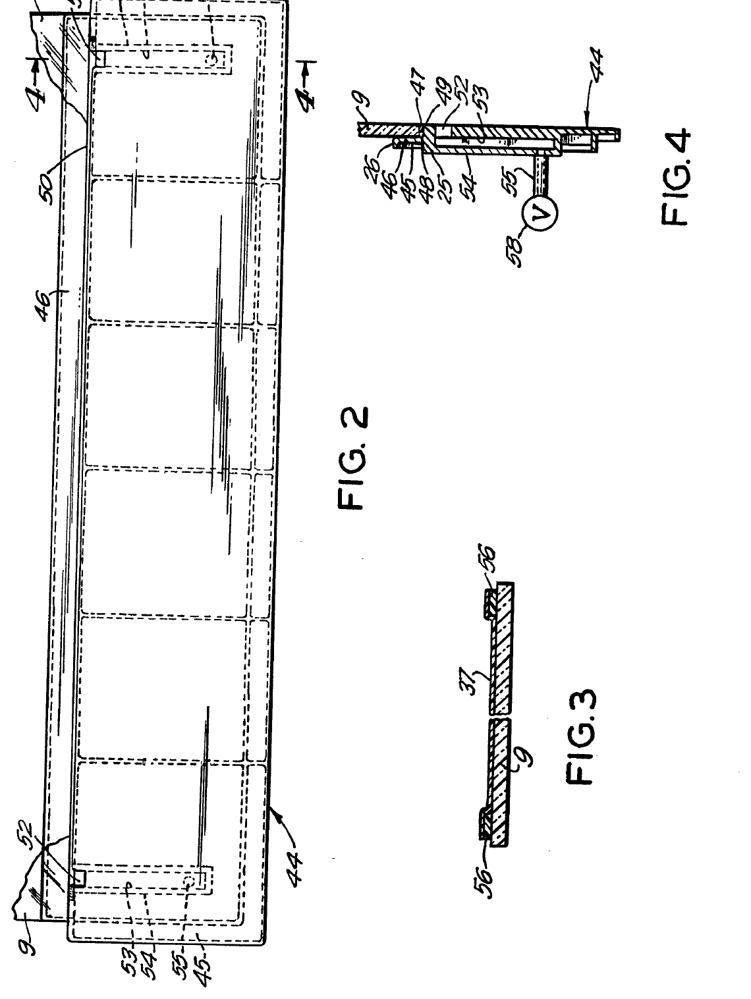
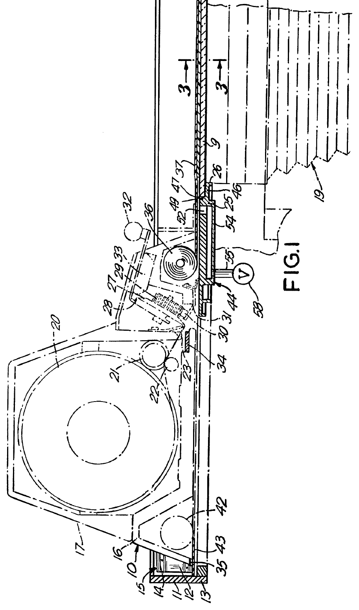

# Apparatus for storing, transporting and exposing photosensitive film for camera

An embossed flexible sheet collapses onto cut film as air is evacuated from one margin.

[GB2138152A · complete original PDF (8 pages)](../sources/GB2138152A.pdf) · [Archival PDF source](https://patentimages.storage.googleapis.com/87/55/bd/abefe58a4d6a63/GB2138152A.pdf) · [Searchable publication](https://patents.google.com/patent/GB2138152A/en) · [Espacenet](https://worldwide.espacenet.com/patent/search?q=pn%3DGB2138152A)

## Original drawings

<figure>

<figcaption>Drawing sheet. Vacuum table arrangement and sections of the film-support structure. <a href="../sources/GB2138152A.pdf#page=3">GB2138152A, PDF p. 3</a>.</figcaption>
</figure>
<figure>

<figcaption>Fig. 1. Storage carriage, roll path and fixed platen. <a href="../sources/GB2138152A.pdf#page=2">GB2138152A, PDF p. 2</a>.</figcaption>
</figure>

## Publication

- **Publication** GB2138152A
- **Inventors** Quentin Vaughan
- **Original assignee** Visual Graphics Corporation
- **Priority** 1983-04-11 · **Filing** 1983-09-07 · **Publication** 1984-10-17
- **Original application** Reproduction and copying
- **Mechanisms** Vacuum, Mechanical clamping, Combined mechanisms

## What the patent describes

**Original problem.** A reproduction camera needed to cut and expose fresh film automatically without trapping air under its flexible overlay.

**Operating sequence.** The carriage feeds roll stock across a fixed exposure platen and a rotary knife cuts it. The overlay and platen are evacuated from an elongated edge groove. The overlay first seats near that groove and displaces air from the remaining area. Release suction before removing the film.

**Film contact.** The flexible overlay and rigid platen meet the film on opposite faces, with a margin adjacent to the vacuum bar.

**Transverse control.** The platen fixes the widthwise plane as the overlay settles.

**Longitudinal control.** Progressive evacuation across the support brings the entire exposure length to the same plane.

## Engineering interpretation

**Advantages and limits.** Embossing creates air paths and improves progressive seating. Direct full-area contact may be unsuitable for irreplaceable material or for the desired optical path.

**Camera scanning.** A precedent for purge paths and controlled collapse when using a transparent overlay above a stationary negative.

## Commercial evidence and sources

Commercial deployment of the disclosed mechanism is unverified in the sources reviewed.

## Related patents

[US2131926A · Camera magazine](US2131926A.md) · [US3237543A · Portable duplex vacuum type film holder](US3237543A.md) · [US3574460A · High-pressure gate for photographic contact printing](US3574460A.md)

**Selected indexed prior references.** [GB2042745A](https://patents.google.com/patent/GB2042745A/en) · [GB2116734A](https://patents.google.com/patent/GB2116734A/en)

[Return to the archive](../index.md)
