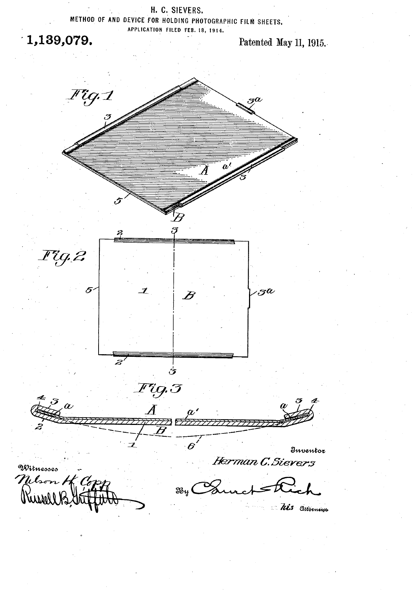

# Method of and device for holding photographic-film sheets

Inclined slots bend two sheet margins so the film seats itself against a flat back.

[US1139079A · complete original PDF (3 pages)](../sources/US1139079A.pdf) · [Archival PDF source](https://patentimages.storage.googleapis.com/7c/f9/c5/1b6975f15b03ac/US1139079.pdf) · [Searchable publication](https://patents.google.com/patent/US1139079A/en) · [Espacenet](https://worldwide.espacenet.com/patent/search?q=pn%3DUS1139079A)

## Original drawings

<figure>

<figcaption>Figs. 1–3. Backing plate, plan view and sectional view of angled retaining slots. <a href="../sources/US1139079A.pdf#page=1">US1139079A, PDF p. 1</a>.</figcaption>
</figure>

## Publication

- **Publication** US1139079A
- **Inventors** Herman C Sievers
- **Original assignee** Eastman Kodak Company
- **Priority** 1914-02-18 · **Filing** 1914-02-18 · **Publication** 1915-05-11
- **Original application** Camera
- **Mechanisms** Controlled bending, Edge grip

## What the patent describes

**Original problem.** Unsupported cut-film sheets could buckle and move parts of the sensitized surface outside the lens's focal plane.

**Operating sequence.** Slide the sheet end-first into opposing slots until it reaches a stop. The slots force the margins to tilt, so the sheet tries to bow into the backing. Slide it back out to unload.

**Film contact.** The backing meets the reverse surface. Folded slots touch opposing margins and a flange locates an end.

**Transverse control.** Deliberate edge bending creates a restoring moment into the back.

**Longitudinal control.** The rigid back carries the sheet along its length. The patent describes no independent pull along that axis.

## Engineering interpretation

**Advantages and limits.** There are no powered clamps, but the backing blocks transmitted light and sliding may drag the broad surface.

**Camera scanning.** The edge-moment principle could be trialled with a relieved or transparent reference and an edge guide that opens during travel.

## Commercial evidence and sources

Commercial deployment of the disclosed mechanism is unverified in the sources reviewed.

## Related patents

[US1829332A · Method of and apparatus for holding photographic films in flat position during exposure](US1829332A.md) · [US3237543A · Portable duplex vacuum type film holder](US3237543A.md)

[Return to the archive](../index.md)
