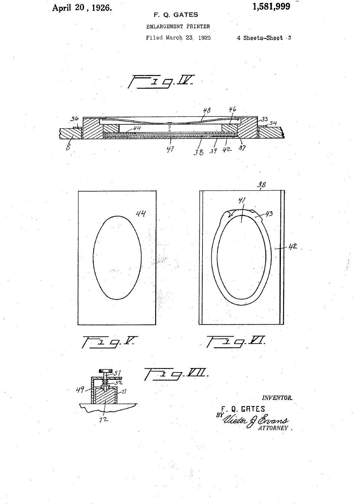
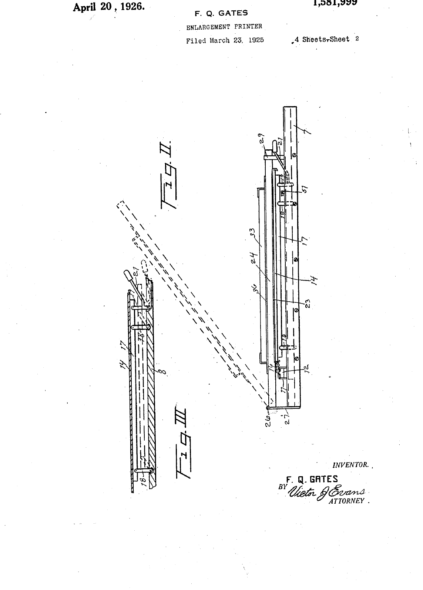

# Enlargement printer

A glass-mounted negative serves an enlargement printer that also makes contact-printed frame areas.

[US1581999A · complete original PDF (7 pages)](../sources/US1581999A.pdf) · [Archival PDF source](https://patentimages.storage.googleapis.com/d8/04/4d/ccf1bc8f16540f/US1581999.pdf) · [Searchable publication](https://patents.google.com/patent/US1581999A/en) · [Espacenet](https://worldwide.espacenet.com/patent/search?q=pn%3DUS1581999A)

## Original drawings

<figure>

<figcaption>Drawing sheet. Negative and glass assembly, including the image mask. <a href="../sources/US1581999A.pdf#page=3">US1581999A, PDF p. 3</a>.</figcaption>
</figure>
<figure>

<figcaption>Drawing sheet. Sectional views of the printing frame and paper mechanism. <a href="../sources/US1581999A.pdf#page=2">US1581999A, PDF p. 2</a>.</figcaption>
</figure>

## Publication

- **Publication** US1581999A
- **Inventors** Frank Q Gates
- **Original assignee** Individual
- **Priority** 1925-03-23 · **Filing** 1925-03-23 · **Publication** 1926-04-20
- **Original application** Enlarger
- **Mechanisms** Glass-based support, Mechanical clamping

## What the patent describes

**Original problem.** Repeated enlargement printing and contact-printing of frame details required a repeatable negative plane and paper position.

**Operating sequence.** Insert the glass-and-negative assembly in the slotted holder. A movable paper platen positions successive prints and rises against the negative for the contact exposure. Lower the platen to shift the paper or release it.

**Film contact.** Glass supports the negative; sensitized paper meets its exposed face in the contact operation.

**Transverse control.** The glass plane supports the full width.

**Longitudinal control.** The same glass supports the length. There is no separate tensioning step.

## Engineering interpretation

**Advantages and limits.** The glass carries the reference plane through repeated positioning. The process adds a transmissive surface and direct contact during part of the cycle.

**Camera scanning.** Useful as an early example of locating the negative once and changing the optical or contact configuration for each exposure.

## Commercial evidence and sources

Commercial deployment of the disclosed mechanism is unverified in the sources reviewed.

## Related patents

[US813531A · Photographic-printing frame](US813531A.md) · [US2008982A · Device for producing enlarged images](US2008982A.md)

**Selected indexed later citations.** [USD720001S1](https://patents.google.com/patent/USD720001S1/en)

[Return to the archive](../index.md)
