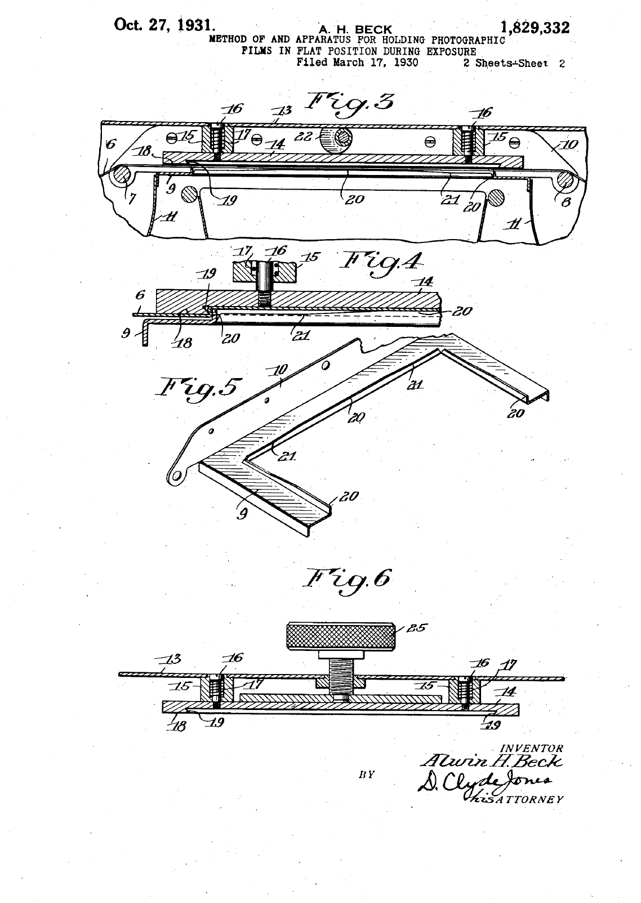
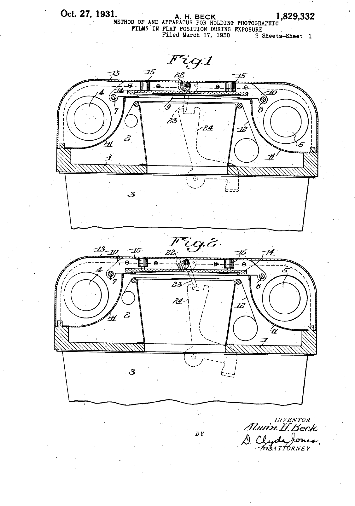

# Method of and apparatus for holding photographic films in flat position during exposure

Four raised points on a resilient aperture rim engage first, then closing pressure spreads to the surrounding film.

[US1829332A · complete original PDF (5 pages)](../sources/US1829332A.pdf) · [Archival PDF source](https://patentimages.storage.googleapis.com/d4/8a/f7/eb61da4e82e132/US1829332.pdf) · [Searchable publication](https://patents.google.com/patent/US1829332A/en) · [Espacenet](https://worldwide.espacenet.com/patent/search?q=pn%3DUS1829332A)

## Original drawings

<figure>

<figcaption>Drawing sheet. Aperture frame details and a cross-section of the alternate pressure arrangement. <a href="../sources/US1829332A.pdf#page=2">US1829332A, PDF p. 2</a>.</figcaption>
</figure>
<figure>

<figcaption>Drawing sheet. Two sectional views of the roll-film camera and exposure support. <a href="../sources/US1829332A.pdf#page=1">US1829332A, PDF p. 1</a>.</figcaption>
</figure>

## Publication

- **Publication** US1829332A
- **Inventors** Alwin H. Beck
- **Original assignee** Folmer Graflex Corporation
- **Priority** 1930-03-17 · **Filing** 1930-03-17 · **Publication** 1931-10-27
- **Original application** Camera
- **Mechanisms** Mechanical clamping, Lateral tension, Longitudinal tension, Combined mechanisms

## What the patent describes

**Original problem.** The patent sought focus across the exposure field while avoiding an external suction hose and exposure through glass.

**Operating sequence.** Rollers guide film from supply to take-up. A cam depresses a backing plate for exposure and releases it before winding. Further travel after four first contacts deflects the raised portions of the resilient rim toward a common plane.

**Film contact.** The pressure plate contacts the film back while the aperture rim engages the four surrounding margins.

**Transverse control.** The patent attributes flattening to progressive spreading of pressure from the high points on the side margins.

**Longitudinal control.** The same rim geometry engages the end margins. The inventor gives a proposed explanation for the stretching action.

## Engineering interpretation

**Advantages and limits.** The rim and plate replace the glass or suction arrangements discussed in the patent. The actual strain field depends on friction and elastic shape.

**Camera scanning.** A four-sided, sequenced mechanism predating modern scan gates. Compare initial points of constraint and corner motion under increasing load.

## Commercial evidence and sources

Commercial deployment of the disclosed mechanism is unverified in the sources reviewed.

## Related patents

[US1139079A · Method of and device for holding photographic-film sheets](US1139079A.md) · [US2131926A · Camera magazine](US2131926A.md) · [US5258807A · Multiformat film clamp](US5258807A.md)

**Selected indexed later citations.** [EP0017971A1](https://patents.google.com/patent/EP0017971A1/en) · [US2433906A](https://patents.google.com/patent/US2433906A/en) · [US2601817A](https://patents.google.com/patent/US2601817A/en) · [US2680574A](https://patents.google.com/patent/US2680574A/en)

[Return to the archive](../index.md)
