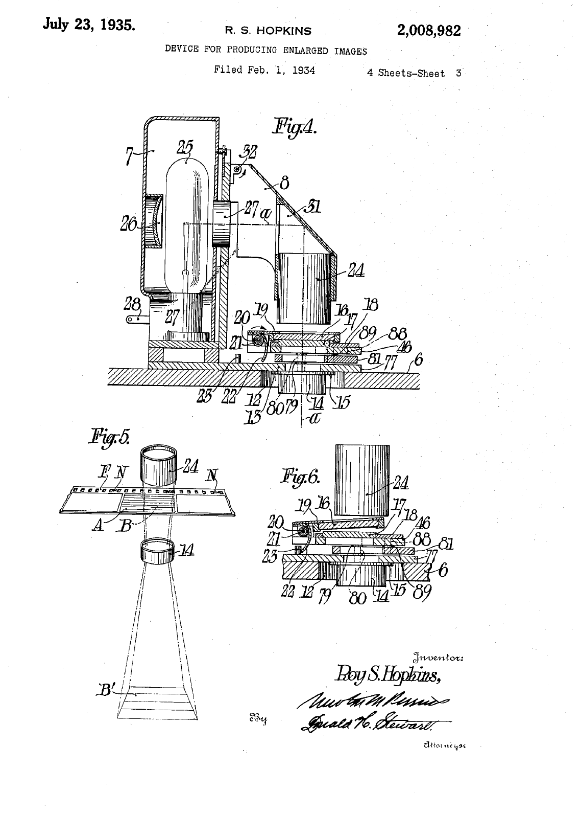
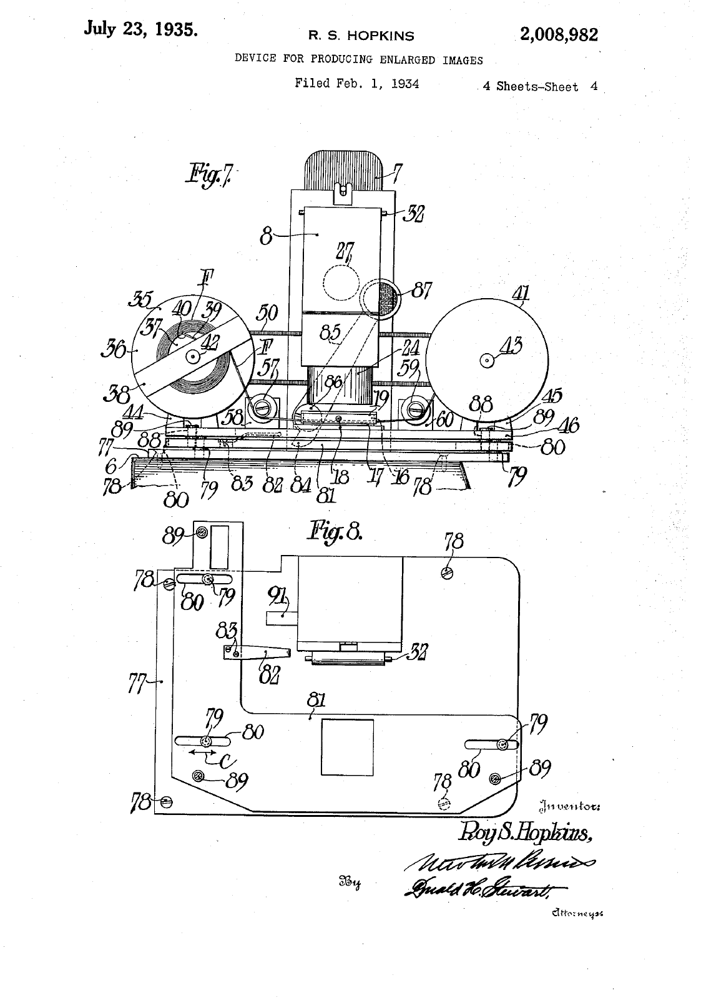

# Device for producing enlarged images

An interlock opens a glass carrier for film positioning and clamps it again for reading.

[US2008982A · complete original PDF (8 pages)](../sources/US2008982A.pdf) · [Archival PDF source](https://patentimages.storage.googleapis.com/90/cc/04/c385eb051a3299/US2008982.pdf) · [Searchable publication](https://patents.google.com/patent/US2008982A/en) · [Espacenet](https://worldwide.espacenet.com/patent/search?q=pn%3DUS2008982A)

## Original drawings

<figure>

<figcaption>Drawing sheet. Sectional views of the optical carrier and glass-clamping mechanism. <a href="../sources/US2008982A.pdf#page=3">US2008982A, PDF p. 3</a>.</figcaption>
</figure>
<figure>

<figcaption>Drawing sheet. Details of the carrier release and positioning system. <a href="../sources/US2008982A.pdf#page=4">US2008982A, PDF p. 4</a>.</figcaption>
</figure>

## Publication

- **Publication** US2008982A
- **Inventors** Roy S Hopkins
- **Original assignee** Eastman Kodak Company
- **Priority** 1934-02-01 · **Filing** 1934-02-01 · **Publication** 1935-07-23
- **Original application** Microfilm
- **Mechanisms** Glass-based support, Mechanical clamping, Combined mechanisms

## What the patent describes

**Original problem.** A microimage reader needed a sharp projected image and a way to reposition film without dragging it under a clamp.

**Operating sequence.** A control releases a spring-hinged carrier while the operator changes the projected area. The carrier can move in two directions. The interlock keeps the film from travelling while held between the plates.

**Film contact.** Two glass faces contact the area across which the objective looks.

**Transverse control.** The faces establish the reference across the film.

**Longitudinal control.** The same faces establish the along-film plane. The described control interlocks positioning and glass clamping.

## Engineering interpretation

**Advantages and limits.** The mechanism targets readable enlargement without dragging the film under a closed clamp. Glass requires cleaning, especially in an optical path.

**Camera scanning.** The interlock is directly relevant to automatic release and feed sequencing, even for a gate using a different reference.

## Commercial evidence and sources

Commercial deployment of the disclosed mechanism is unverified in the sources reviewed.

## Related patents

[US1581999A · Enlargement printer](US1581999A.md) · [US4203658A · Micro image storage and retrieval apparatus](US4203658A.md)

**Selected indexed later citations.** [DE944154C](https://patents.google.com/patent/DE944154C/en) · [DE944402C](https://patents.google.com/patent/DE944402C/en) · [US2415305A](https://patents.google.com/patent/US2415305A/en) · [US2431662A](https://patents.google.com/patent/US2431662A/en)

[Return to the archive](../index.md)
