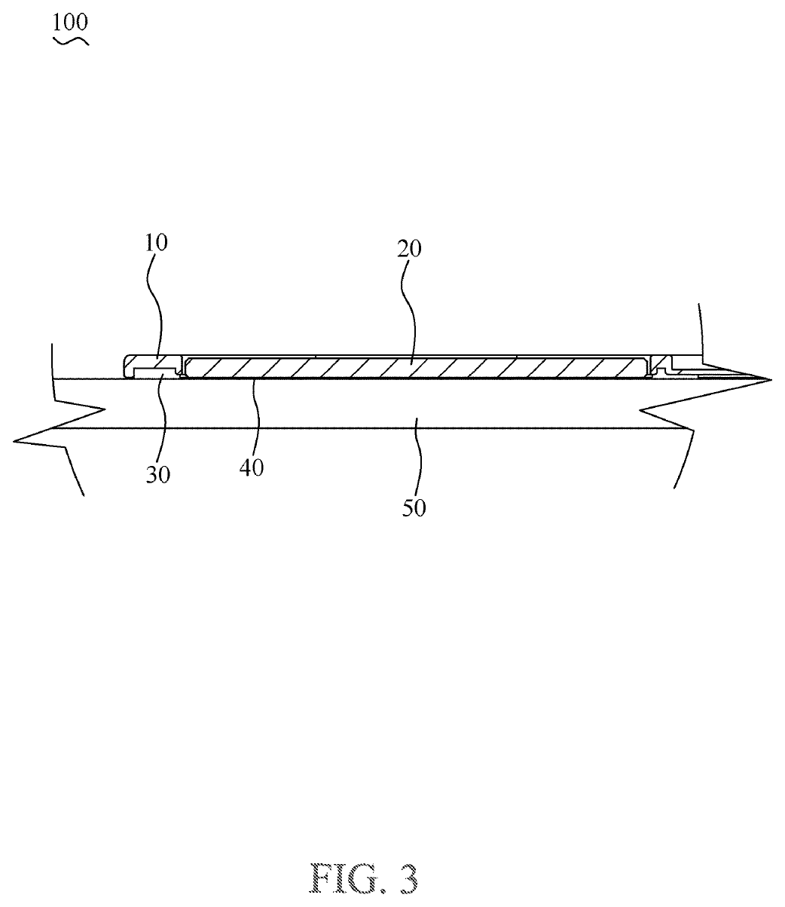
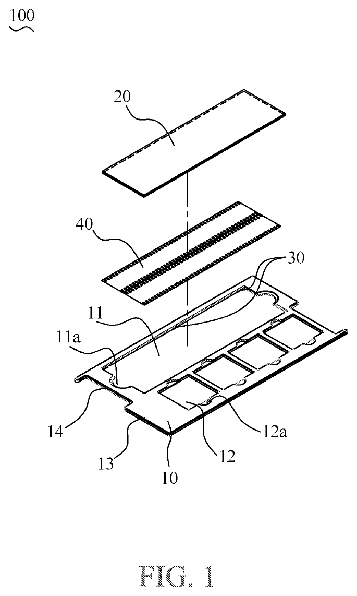

# Film clamping device

A flat removable cap pushes negative film directly onto the scanner glass.

[US20240364825A1 · complete original PDF (12 pages)](../sources/US20240364825A1.pdf) · [Archival PDF source](https://patentimages.storage.googleapis.com/c0/98/1e/7c01f5648809ed/US20240364825A1.pdf) · [Searchable publication](https://patents.google.com/patent/US20240364825A1/en) · [Espacenet](https://worldwide.espacenet.com/patent/search?q=pn%3DUS20240364825A1)

## Original drawings

<figure>

<figcaption>Fig. 3. Cross-section showing the negative in direct contact with the scanning glass. <a href="../sources/US20240364825A1.pdf#page=4">US20240364825A1, PDF p. 4</a>.</figcaption>
</figure>
<figure>

<figcaption>Fig. 1. Exploded view of holder, negative and removable cap. <a href="../sources/US20240364825A1.pdf#page=2">US20240364825A1, PDF p. 2</a>.</figcaption>
</figure>

## Publication

- **Publication** US20240364825A1
- **Inventors** Yun Long Lai, Chi Cheng Chuang
- **Original assignee** Foxlink Image Technology Co., Ltd.
- **Priority** 2023-04-28 · **Filing** 2024-03-05 · **Publication** 2024-10-31
- **Original application** Film scanner
- **Mechanisms** Glass-based support, Mechanical clamping, Combined mechanisms

## What the patent describes

**Original problem.** A carrier that only clamped the rim could let the middle of the negative bow outside the scanner's depth of field.

**Operating sequence.** Set film into a through-slot surrounded by elastic locating pads and fit the cap. The cap's flat bottom presses the film toward the scanner's glass. Remove the cap to release the film. Separate slots can accommodate mounted positives.

**Film contact.** Scan glass and cap contact the negative faces and pads guide the perimeter. Image-area contact is intentional.

**Transverse control.** The rigid glass establishes the plane across the negative.

**Longitudinal control.** The same glass establishes the along-strip reference without edge stretch.

## Engineering interpretation

**Advantages and limits.** Direct contact controls bow without needing traction at the margins. Dust, face abrasion and optical interference should be checked experimentally.

**Camera scanning.** A contemporary baseline for comparing near-complete face support with a clamped open aperture on the same curled frame.

## Commercial evidence and sources

Commercial deployment of the disclosed mechanism is unverified in the sources reviewed.

## Related patents

[US2008982A · Device for producing enlarged images](US2008982A.md) · [US4203658A · Micro image storage and retrieval apparatus](US4203658A.md) · [US7210259B2 · Film holder](US7210259B2.md)

**Selected indexed prior references.** [CN1755518A](https://patents.google.com/patent/CN1755518A/en) · [CN209524411U](https://patents.google.com/patent/CN209524411U/en) · [KR101944634B1](https://patents.google.com/patent/KR101944634B1/en)

[Return to the archive](../index.md)
