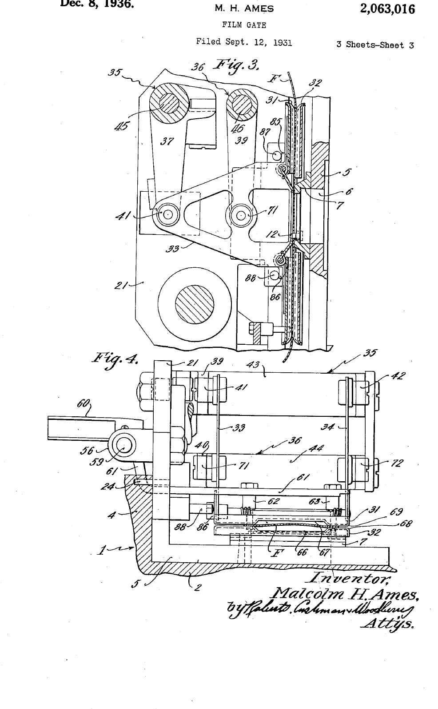
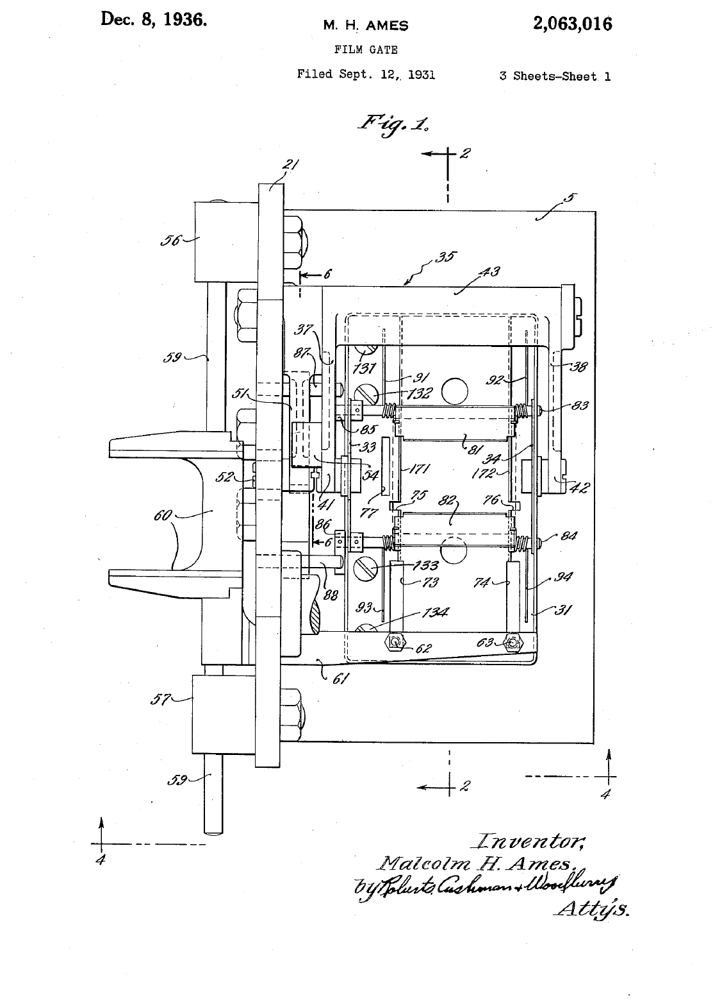

# Film gate

A rocking leaf clears the film during pulldown and closes with sprung rails during exposure.

[US2063016A · complete original PDF (6 pages)](../sources/US2063016A.pdf) · [Archival PDF source](https://patentimages.storage.googleapis.com/b4/6a/0d/fa8c3a7080b5b2/US2063016.pdf) · [Searchable publication](https://patents.google.com/patent/US2063016A/en) · [Espacenet](https://worldwide.espacenet.com/patent/search?q=pn%3DUS2063016A)

## Original drawings

<figure>

<figcaption>Drawing sheet. Sections of the gate and drive linkage. <a href="../sources/US2063016A.pdf#page=3">US2063016A, PDF p. 3</a>.</figcaption>
</figure>
<figure>

<figcaption>Drawing sheet. Gate rails and film opening viewed from the front. <a href="../sources/US2063016A.pdf#page=1">US2063016A, PDF p. 1</a>.</figcaption>
</figure>

## Publication

- **Publication** US2063016A
- **Inventors** Malcolm H Ames
- **Original assignee** Technicolor (indexed assignee)
- **Priority** 1931-09-12 · **Filing** 1931-09-12 · **Publication** 1936-12-08
- **Original application** Motion-picture camera and projector
- **Mechanisms** Mechanical clamping, Edge grip, Combined mechanisms

## What the patent describes

**Original problem.** A motion-picture gate needed exposure pressure without scratching the image during advance or jamming at thicker splices.

**Operating sequence.** A drive oscillates the film guide and aperture frame. The guide is recessed over the image while film moves. During the dwell, resilient linkage and rotating rails press film to the frame. The guide opens for the next stroke.

**Film contact.** Guides confine the strip margins. At the gate, the shaped rails and aperture frame meet the film around the picture.

**Transverse control.** Rails on the long sides bring those margins to the aperture plane.

**Longitudinal control.** The leaf and transverse aperture edges press the other margins. Spring compliance accommodates thickness changes such as splices.

## Engineering interpretation

**Advantages and limits.** The transport constraint differs from the exposure constraint. Frame timing, linkage fit and clearance govern whether a splice can pass cleanly.

**Camera scanning.** A useful model for a clamp that steps out of a curled strip's approach path and still seats repeatably.

## Commercial evidence and sources

Commercial deployment of the disclosed mechanism is unverified in the sources reviewed.

## Related patents

[US2168688A · Enlarging apparatus for movie films](US2168688A.md) · [US2227987A · Automatic projection printer](US2227987A.md) · [US5406352A · Photographic film segment flattening apparatus](US5406352A.md)

**Selected indexed later citations.** [RU2419117C1](https://patents.google.com/patent/RU2419117C1/en) · [US2445668A](https://patents.google.com/patent/US2445668A/en) · [US2897719A](https://patents.google.com/patent/US2897719A/en) · [US3612673A](https://patents.google.com/patent/US3612673A/en)

[Return to the archive](../index.md)
