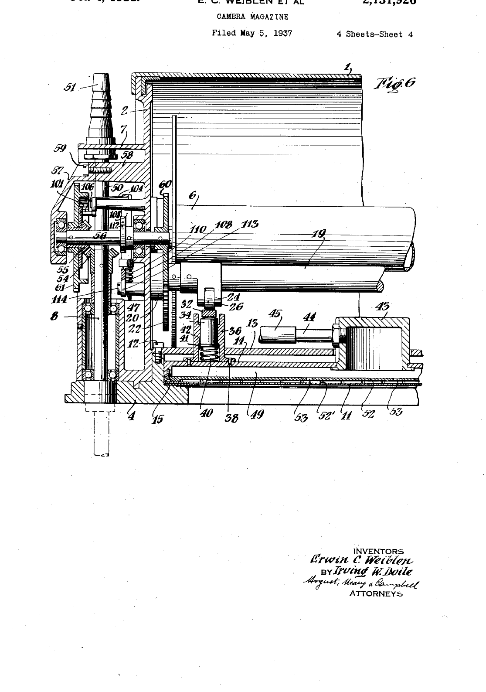
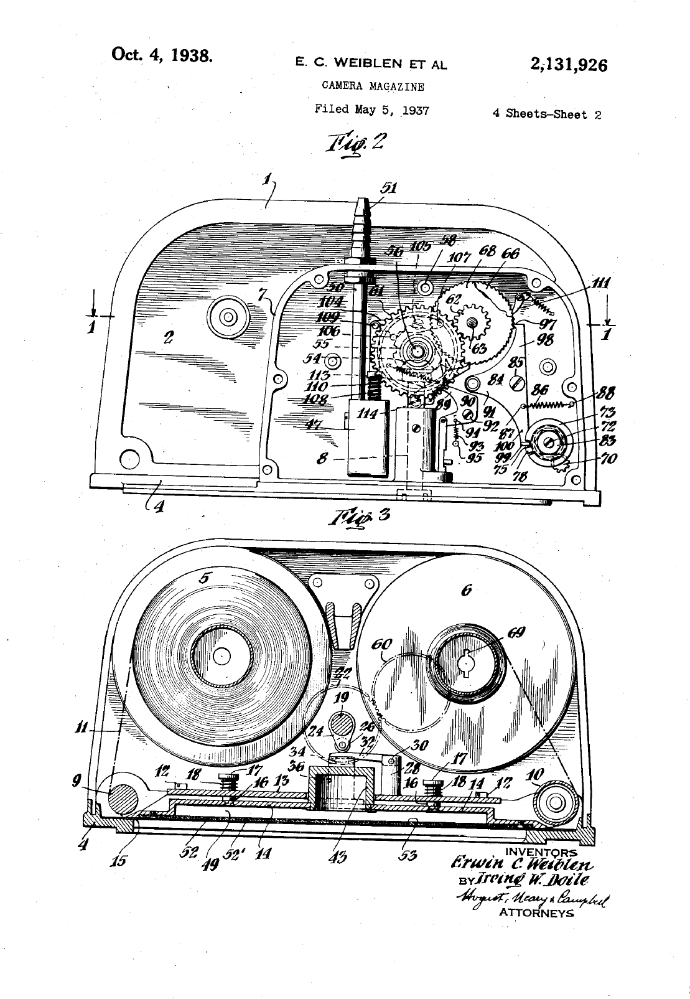

# Camera magazine

A moving vacuum back retracts so the web clears both plates during winding.

[US2131926A · complete original PDF (9 pages)](../sources/US2131926A.pdf) · [Archival PDF source](https://patentimages.storage.googleapis.com/0a/54/35/ffcb5be19ee5d3/US2131926.pdf) · [Searchable publication](https://patents.google.com/patent/US2131926A/en) · [Espacenet](https://worldwide.espacenet.com/patent/search?q=pn%3DUS2131926A)

## Original drawings

<figure>

<figcaption>Fig. 6. Transverse section through the metering and film-positioning system. <a href="../sources/US2131926A.pdf#page=4">US2131926A, PDF p. 4</a>.</figcaption>
</figure>
<figure>

<figcaption>Drawing sheet. Camera magazine sections with supply and receiving spools. <a href="../sources/US2131926A.pdf#page=2">US2131926A, PDF p. 2</a>.</figcaption>
</figure>

## Publication

- **Publication** US2131926A
- **Inventors** Erwin C Weiblen, Irving W Doyle
- **Original assignee** Fairchild Aerial Camera Corporation
- **Priority** 1937-05-05 · **Filing** 1937-05-05 · **Publication** 1938-10-04
- **Original application** Camera
- **Mechanisms** Vacuum, Mechanical clamping, Combined mechanisms

## What the patent describes

**Original problem.** An automatic aerial-camera back needed a repeatable focal plane and clearance for winding without surface damage.

**Operating sequence.** Guide rollers carry the film from supply to take-up. A timed shaft lowers the pressure plate, its suction valve applies vacuum, and the shutter sequence follows. Springs retract the back. Roller geometry provides clearance before the metered advance.

**Film contact.** The vacuum pressure plate contacts the back. The opposing positioning plate engages the film at exposure. Rollers touch it on approach and departure.

**Transverse control.** The machined pressure surface sets the cross-film plane.

**Longitudinal control.** Distributed suction and the positioning surface control along-travel shape. The feeding stage uses the released gap.

## Engineering interpretation

**Advantages and limits.** It isolates holding from transport to reduce scraping. The back, guide positions, metering and suction must be synchronized.

**Camera scanning.** Test a deliberate floating transport gap and independent capture plane. The broad vacuum support would need adaptation for transmitted light.

## Commercial evidence and sources

Commercial deployment of the disclosed mechanism is unverified in the sources reviewed.

## Related patents

[US1829332A · Method of and apparatus for holding photographic films in flat position during exposure](US1829332A.md) · [US3007368A · Film transport mechanism](US3007368A.md) · [US3966320A · Microfilm camera](US3966320A.md)

**Selected indexed later citations.** [US2418594A](https://patents.google.com/patent/US2418594A/en) · [US2482596A](https://patents.google.com/patent/US2482596A/en) · [US2510965A](https://patents.google.com/patent/US2510965A/en) · [US2521153A](https://patents.google.com/patent/US2521153A/en)

[Return to the archive](../index.md)
