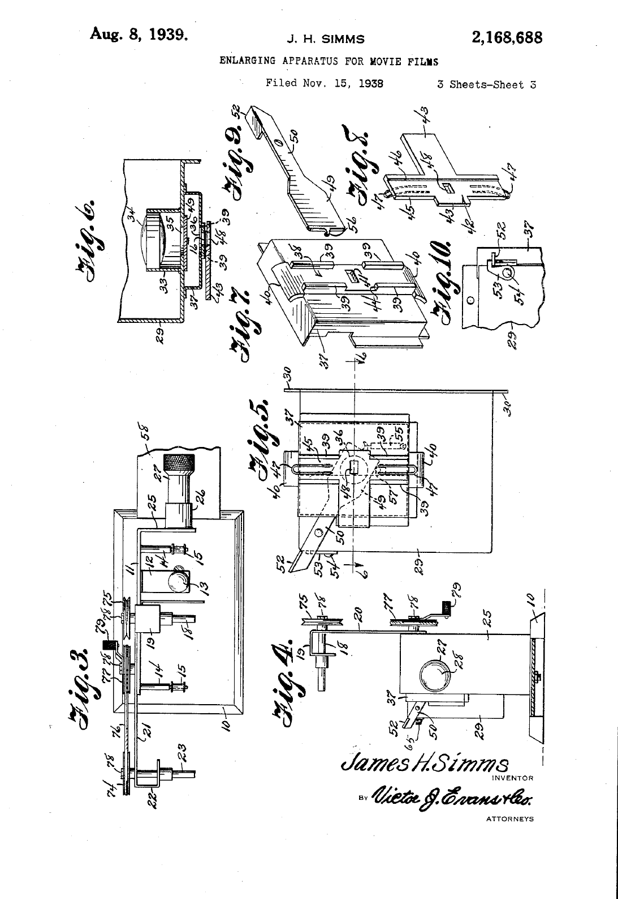
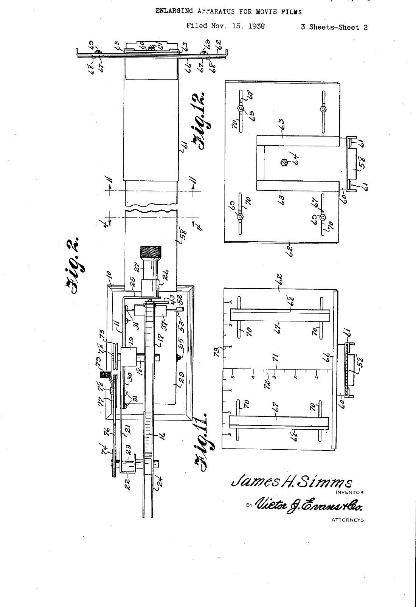

# Enlarging apparatus for movie films

A cruciform spring platen holds a movie frame in a photographic enlarger.

[US2168688A · complete original PDF (6 pages)](../sources/US2168688A.pdf) · [Archival PDF source](https://patentimages.storage.googleapis.com/a2/26/23/b2c69189d76006/US2168688.pdf) · [Searchable publication](https://patents.google.com/patent/US2168688A/en) · [Espacenet](https://worldwide.espacenet.com/patent/search?q=pn%3DUS2168688A)

## Original drawings

<figure>

<figcaption>Drawing sheet. Film gate details and the spring-loaded exposure assembly. <a href="../sources/US2168688A.pdf#page=3">US2168688A, PDF p. 3</a>.</figcaption>
</figure>
<figure>

<figcaption>Drawing sheet. Housing, guides and film transport views. <a href="../sources/US2168688A.pdf#page=2">US2168688A, PDF p. 2</a>.</figcaption>
</figure>

## Publication

- **Publication** US2168688A
- **Inventors** James H Simms
- **Original assignee** Individual
- **Priority** 1938-11-15 · **Filing** 1938-11-15 · **Publication** 1939-08-08
- **Original application** Enlarger
- **Mechanisms** Mechanical clamping, Edge grip

## What the patent describes

**Original problem.** A compact still-print enlarger needed to seat a movie frame accurately over its optical opening for the duration of exposure.

**Operating sequence.** The film is entered along guide ribs and manually wound to the frame. Hairpin springs bias the cruciform platen toward the gate throughout operation. A shutter times the exposure, then the operator winds or removes the film.

**Film contact.** A rib bears on the perforated margin and guide surfaces set the path. The exposing opening leaves the projected image clear.

**Transverse control.** The rib and gate plane locate the available margin beside the aperture.

**Longitudinal control.** The length of the bearing rib supports that margin along travel. No separate end tension is specified.

## Engineering interpretation

**Advantages and limits.** The mechanism is compact and leaves the optical path clear. Spring drag and curl on the less constrained side warrant measurement.

**Camera scanning.** A low-part-count baseline for testing how far a narrow edge-only constraint can flatten short film.

## Commercial evidence and sources

Commercial deployment of the disclosed mechanism is unverified in the sources reviewed.

## Related patents

[US2063016A · Film gate](US2063016A.md) · [US2741154A · Negative holder and carrier](US2741154A.md)

**Selected indexed later citations.** [US2626537A](https://patents.google.com/patent/US2626537A/en) · [US5218403A](https://patents.google.com/patent/US5218403A/en)

[Return to the archive](../index.md)
