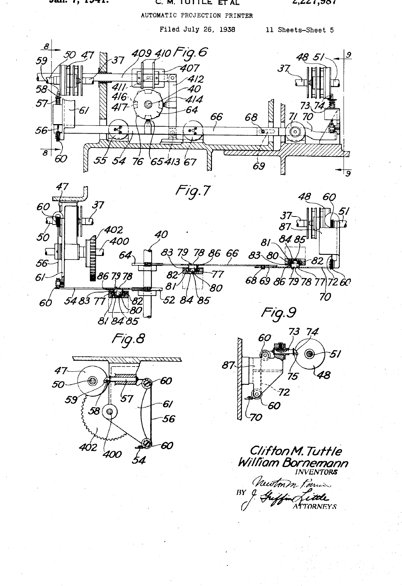
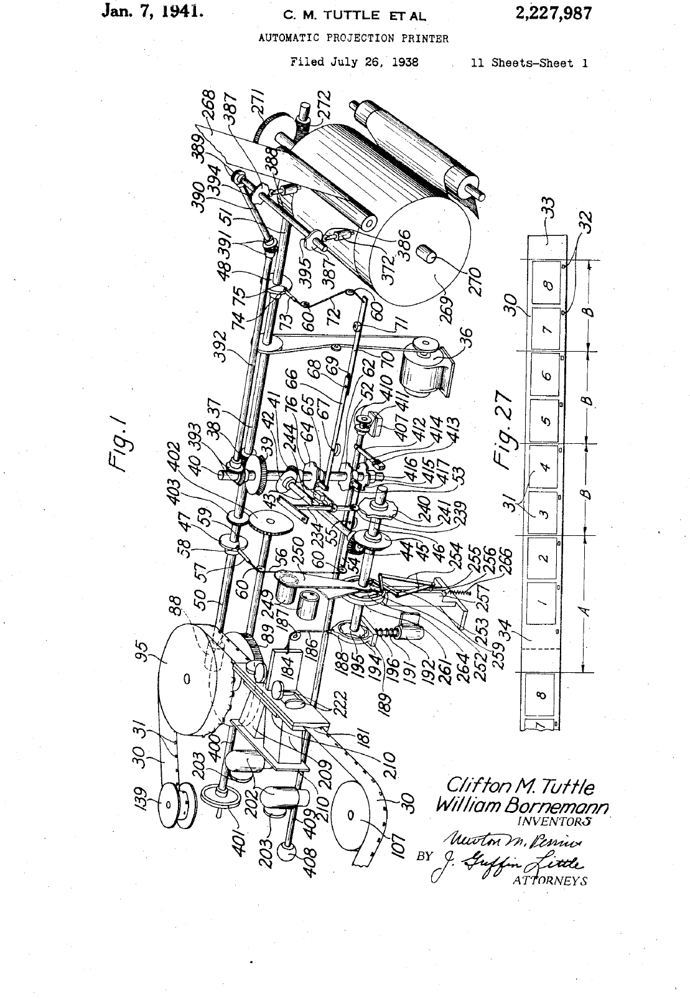

# Automatic projection printer

A yielding sprocket tensions miniature negative film in an automatic projection printer.

[US2227987A · complete original PDF (26 pages)](../sources/US2227987A.pdf) · [Archival PDF source](https://patentimages.storage.googleapis.com/9b/a4/bd/b3883b7677aa73/US2227987.pdf) · [Searchable publication](https://patents.google.com/patent/US2227987A/en) · [Espacenet](https://worldwide.espacenet.com/patent/search?q=pn%3DUS2227987A)

## Original drawings

<figure>

<figcaption>Drawing sheet. Gate and sprocket assembly sections. <a href="../sources/US2227987A.pdf#page=5">US2227987A, PDF p. 5</a>.</figcaption>
</figure>
<figure>

<figcaption>Drawing sheet. Automatic projection printer and its driven components. <a href="../sources/US2227987A.pdf#page=1">US2227987A, PDF p. 1</a>.</figcaption>
</figure>

## Publication

- **Publication** US2227987A
- **Inventors** Clifton M. Tuttle, William Bornemann
- **Original assignee** Eastman Kodak Company
- **Priority** 1938-07-26 · **Filing** 1938-07-26 · **Publication** 1941-01-07
- **Original application** Photographic printer
- **Mechanisms** Longitudinal tension, Edge grip, Combined mechanisms

## What the patent describes

**Original problem.** An unattended projection printer needed stable, repeatable focus from intermittent miniature negative stock.

**Operating sequence.** Timed drive components index the negative and paper. Two sprockets share a drive and one is resiliently mounted, creating tension in the film at the gate. The exposure follows during the indexed dwell and the mechanism then feeds again.

**Film contact.** Sprocket teeth engage perforations. The gate and guiding surfaces contact the film near the optical field.

**Transverse control.** The gate supplies the cross-film reference. The sprocket arrangement does not pull the long margins apart.

**Longitudinal control.** The resilient sprocket loads the section between two perforation engagements in the feed direction.

## Engineering interpretation

**Advantages and limits.** Controlled along-film load can improve seating while accepting pitch variation. It requires available engagement on both sides of the frame.

**Camera scanning.** Useful for comparing along-feed tension with across-film stretch. Very short strips may lack the span needed for the original arrangement.

## Commercial evidence and sources

Commercial deployment of the disclosed mechanism is unverified in the sources reviewed.

## Related patents

[US2063016A · Film gate](US2063016A.md) · [US2248646A · Photographic film tensioning mechanism](US2248646A.md) · [US4835555A · Film transport apparatus](US4835555A.md)

**Selected indexed later citations.** [US2578254A](https://patents.google.com/patent/US2578254A/en) · [US2642773A](https://patents.google.com/patent/US2642773A/en) · [US2657613A](https://patents.google.com/patent/US2657613A/en) · [US2699088A](https://patents.google.com/patent/US2699088A/en)

[Return to the archive](../index.md)
