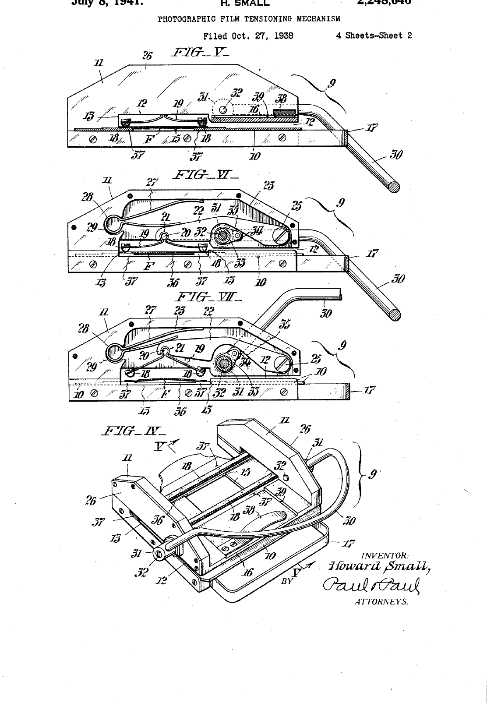
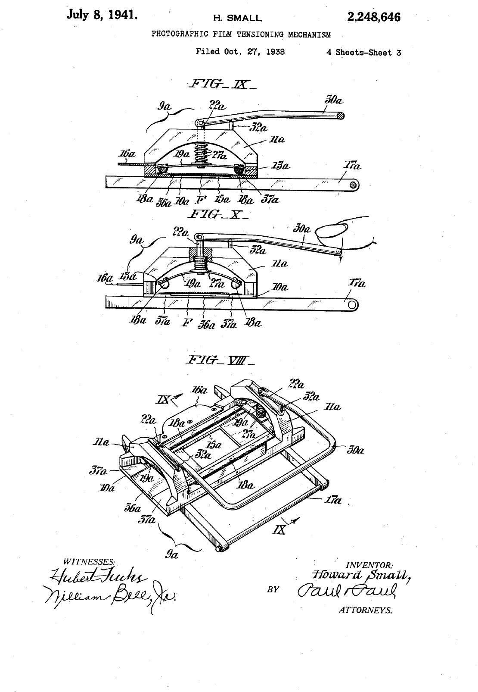

# Photographic film tensioning mechanism

Arched springs spread gripping bars across an optical opening when the gate is pressed down.

[US2248646A · complete original PDF (8 pages)](../sources/US2248646A.pdf) · [Archival PDF source](https://patentimages.storage.googleapis.com/b7/d8/53/ac8d7c9b8fe97f/US2248646.pdf) · [Searchable publication](https://patents.google.com/patent/US2248646A/en) · [Espacenet](https://worldwide.espacenet.com/patent/search?q=pn%3DUS2248646A)

## Original drawings

<figure>

<figcaption>Drawing sheet. Exploded components of the film-tensioning gate. <a href="../sources/US2248646A.pdf#page=2">US2248646A, PDF p. 2</a>.</figcaption>
</figure>
<figure>

<figcaption>Drawing sheet. Sections and further views of the gripping arrangements. <a href="../sources/US2248646A.pdf#page=3">US2248646A, PDF p. 3</a>.</figcaption>
</figure>

## Publication

- **Publication** US2248646A
- **Inventors** Howard Small
- **Original assignee** Individual
- **Priority** 1938-10-27 · **Filing** 1938-10-27 · **Publication** 1941-07-08
- **Original application** Photographic printer
- **Mechanisms** Mechanical clamping, Lateral tension, Longitudinal tension, Combined mechanisms

## What the patent describes

**Original problem.** Film curl caused enlarged blur. The specification also discusses reflections and dust from holding film against glass.

**Operating sequence.** A ribbon-film guiding slide sits by the optical axis. Lever arms depress the arched bow springs so the bars meet opposite margins, then move apart as the springs flatten. Releasing retracts the grip for the next move.

**Film contact.** Serrated or roughened bars grip opposing long margins. The underlying frame supports the film around the exposure opening.

**Transverse control.** The two bars move apart across the film as the bow springs flatten.

**Longitudinal control.** The detailed ribbon embodiment stretches across the web. The inventor proposes duplicating the components at right angles for cut film, so a lengthwise stretch is an optional variant.

## Engineering interpretation

**Advantages and limits.** It addresses optical artifacts and dust associated with glass. Repeatability depends on perimeter contact and adequate film beyond the aperture.

**Camera scanning.** Compare the order and direction of face contacts against modern four-sided clamps, including which contacts are possible on a single cut frame.

## Commercial evidence and sources

Commercial deployment of the disclosed mechanism is unverified in the sources reviewed.

## Related patents

[US1829332A · Method of and apparatus for holding photographic films in flat position during exposure](US1829332A.md) · [US2824491A · Film holder](US2824491A.md) · [EP0660170A1 · Film clamp for flattening image frames in a scanning gate](EP0660170A1.md)

**Selected indexed later citations.** [EP0032305A1](https://patents.google.com/patent/EP0032305A1/en) · [EP0312328A3](https://patents.google.com/patent/EP0312328A3/en) · [EP0660170A1](https://patents.google.com/patent/EP0660170A1/en) · [US2703941A](https://patents.google.com/patent/US2703941A/en)

[Return to the archive](../index.md)
