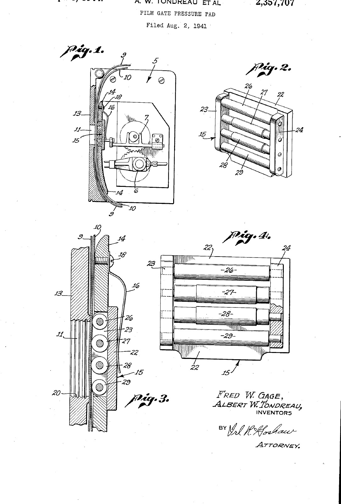

# Film gate pressure pad

A three-roller pressure pad brings two motion-picture films into close contact at a light aperture.

[US2357707A · complete original PDF (3 pages)](../sources/US2357707A.pdf) · [Archival PDF source](https://patentimages.storage.googleapis.com/81/79/4e/27393563142dd4/US2357707.pdf) · [Searchable publication](https://patents.google.com/patent/US2357707A/en) · [Espacenet](https://worldwide.espacenet.com/patent/search?q=pn%3DUS2357707A)

## Original drawings

<figure>

<figcaption>Drawing sheet. Pressure-pad assembly and roller geometry for two films. <a href="../sources/US2357707A.pdf#page=1">US2357707A, PDF p. 1</a>.</figcaption>
</figure>

## Publication

- **Publication** US2357707A
- **Inventors** Albert W Tondreau, Fred W Gage
- **Original assignee** Warner Bros. Pictures, Inc.
- **Priority** 1941-08-02 · **Filing** 1941-08-02 · **Publication** 1944-09-05
- **Original application** Contact and optical printing
- **Mechanisms** Mechanical clamping, Controlled bending, Combined mechanisms

## What the patent describes

**Original problem.** Two warped films entering from different angles could trap air and lose sharp contact during cine exposure or printing.

**Operating sequence.** Outer rollers bring the two films together from separate paths. The roller at the aperture presses the stacked films as they pass, and the lower part of the path shares tension during pulldown.

**Film contact.** The rollers touch the outer film surfaces. The two films contact one another across the exposed area.

**Transverse control.** The patent favors uniform-diameter rollers for keeping the films transverse to the path flat at the light aperture.

**Longitudinal control.** Along-film shape follows roller geometry and film draw. The objective is intimate contact between two moving strips.

## Engineering interpretation

**Advantages and limits.** The roller sequence addresses trapped air. It deliberately contacts the image faces and uses continuous strips.

**Camera scanning.** Use the staged approach as a reference for bringing a film and a transparent window together without trapping air.

## Commercial evidence and sources

Commercial deployment of the disclosed mechanism is unverified in the sources reviewed.

## Related patents

[US2964995A · Travelling matte optical and contact printer](US2964995A.md) · [US3574460A · High-pressure gate for photographic contact printing](US3574460A.md) · [US5812245A · Asynchronous contact printer for motion picture film](US5812245A.md)

**Selected indexed later citations.** [US2423925A](https://patents.google.com/patent/US2423925A/en) · [US2451161A](https://patents.google.com/patent/US2451161A/en) · [US2497847A](https://patents.google.com/patent/US2497847A/en)

[Return to the archive](../index.md)
