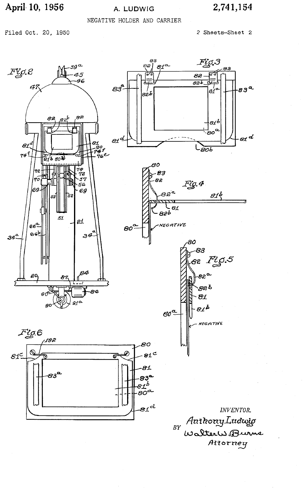

# Negative holder and carrier

A resilient hinge grips the negative before a glassless holder finishes closing.

[US2741154A · complete original PDF (6 pages)](../sources/US2741154A.pdf) · [Archival PDF source](https://patentimages.storage.googleapis.com/a5/66/59/6c61f11922a5f1/US2741154.pdf) · [Searchable publication](https://patents.google.com/patent/US2741154A/en) · [Espacenet](https://worldwide.espacenet.com/patent/search?q=pn%3DUS2741154A)

## Original drawings

<figure>

<figcaption>Drawing sheet. The slide carrier, hinged negative holder and resilient pivot details. <a href="../sources/US2741154A.pdf#page=2">US2741154A, PDF p. 2</a>.</figcaption>
</figure>

## Publication

- **Publication** US2741154A
- **Inventors** Anthony Ludwig
- **Original assignee** Individual
- **Priority** 1950-10-20 · **Filing** 1950-10-20 · **Publication** 1956-04-10
- **Original application** Enlarger
- **Mechanisms** Mechanical clamping, Edge grip

## What the patent describes

**Original problem.** An enlarger needed to prevent a manually positioned negative from shifting when its glassless holder closed.

**Operating sequence.** The operator opens the holder, positions a negative and lowers a hinged plate. The resilient pivot grips at an intermediate angle, then keeps the cover down. Opening to the release angle frees the film.

**Film contact.** The hinged plates and resilient gripping areas contact the negative around aligned openings.

**Transverse control.** The plate and spring grip seat the supported margins against the carrier plane.

**Longitudinal control.** The plate geometry sets the along-film reference. No distinct longitudinal stretching stage is specified.

## Engineering interpretation

**Advantages and limits.** Early grip helps prevent a negative shifting while the cover closes. Loading is manual and the grip depends on plate geometry.

**Camera scanning.** The grip-before-close sequence may be useful when a short piece would otherwise move as its final clamp engages.

## Commercial evidence and sources

Commercial deployment of the disclosed mechanism is unverified in the sources reviewed.

## Related patents

[US813531A · Photographic-printing frame](US813531A.md) · [US2824491A · Film holder](US2824491A.md) · [US4483612A · Device to position a copy master in a copying apparatus](US4483612A.md)

**Selected indexed prior references.** [US1712854A](https://patents.google.com/patent/US1712854A/en) · [US1894005A](https://patents.google.com/patent/US1894005A/en) · [US2249228A](https://patents.google.com/patent/US2249228A/en) · [US2263025A](https://patents.google.com/patent/US2263025A/en)

**Selected indexed later citations.** [US3078775A](https://patents.google.com/patent/US3078775A/en) · [US4093377A](https://patents.google.com/patent/US4093377A/en) · [US4353646A](https://patents.google.com/patent/US4353646A/en)

[Return to the archive](../index.md)
