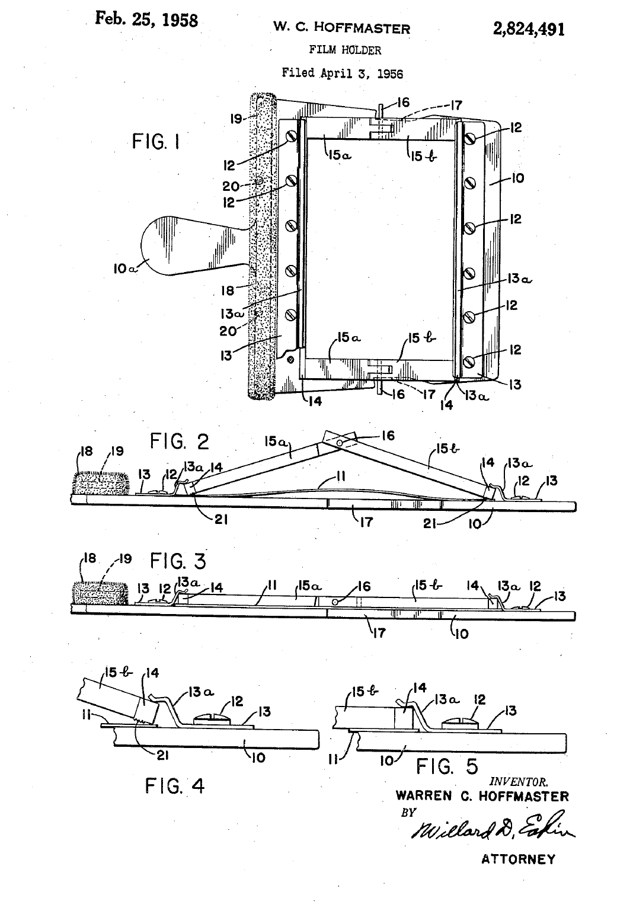

# Film holder

Two bars slide apart as a toggle goes flat, while the toggle links press the end margins down.

[US2824491A · complete original PDF (3 pages)](../sources/US2824491A.pdf) · [Archival PDF source](https://patentimages.storage.googleapis.com/a7/43/30/0c9307fad4bde9/US2824491.pdf) · [Searchable publication](https://patents.google.com/patent/US2824491A/en) · [Espacenet](https://worldwide.espacenet.com/patent/search?q=pn%3DUS2824491A)

## Original drawings

<figure>

<figcaption>Drawing sheet. Glassless holder in plan and section with the toggle raised and flattened. <a href="../sources/US2824491A.pdf#page=1">US2824491A, PDF p. 1</a>.</figcaption>
</figure>

## Publication

- **Publication** US2824491A
- **Inventors** Warren C Hoffmaster
- **Original assignee** Individual
- **Priority** 1956-04-03 · **Filing** 1956-04-03 · **Publication** 1958-02-25
- **Original application** Enlarger
- **Mechanisms** Mechanical clamping, Lateral tension, Combined mechanisms

## What the patent describes

**Original problem.** An enlarging camera needed a plane negative without introducing glass and while keeping an aperture clear for light.

**Operating sequence.** Place the film on an apertured frame and lower the raised toggle. The moving bars wedge under resilient flanges and drag the long margins outward. Raise the toggle by its projecting pins to free the frame.

**Film contact.** Two bars and the base meet the side margins. Toggle arms directly press the end margins onto the base.

**Transverse control.** Outward travel of the two side bars tensions the film across the opening.

**Longitudinal control.** The aligned toggle arms press the end margins down. That is normal compression along the ends, distinct from an end-to-end pull.

## Engineering interpretation

**Advantages and limits.** One action coordinates seating, lateral stretch and end control without glass. The mechanism needs clear room at each edge and moves the contact across the film.

**Camera scanning.** A compact starting point for a compliant actuator and a short, controlled outward stroke. Check for friction marks while the bars shift.

## Commercial evidence and sources

Commercial deployment of the disclosed mechanism is unverified in the sources reviewed.

## Related patents

[US2741154A · Negative holder and carrier](US2741154A.md) · [US5028956A · Film clamp](US5028956A.md) · [EP0660170A1 · Film clamp for flattening image frames in a scanning gate](EP0660170A1.md)

**Selected indexed prior references.** [US2248646A](https://patents.google.com/patent/US2248646A/en) · [US2704959A](https://patents.google.com/patent/US2704959A/en) · [US698015A](https://patents.google.com/patent/US698015A/en)

**Selected indexed later citations.** [EP0660171B1](https://patents.google.com/patent/EP0660171B1/en) · [US2959096A](https://patents.google.com/patent/US2959096A/en) · [US3132560A](https://patents.google.com/patent/US3132560A/en) · [US3207030A](https://patents.google.com/patent/US3207030A/en)

[Return to the archive](../index.md)
