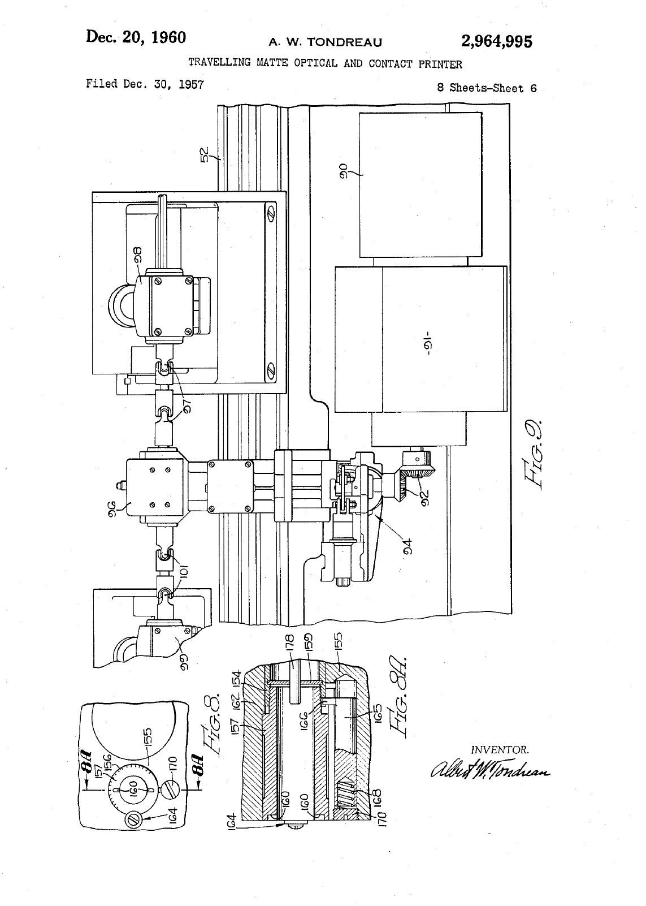
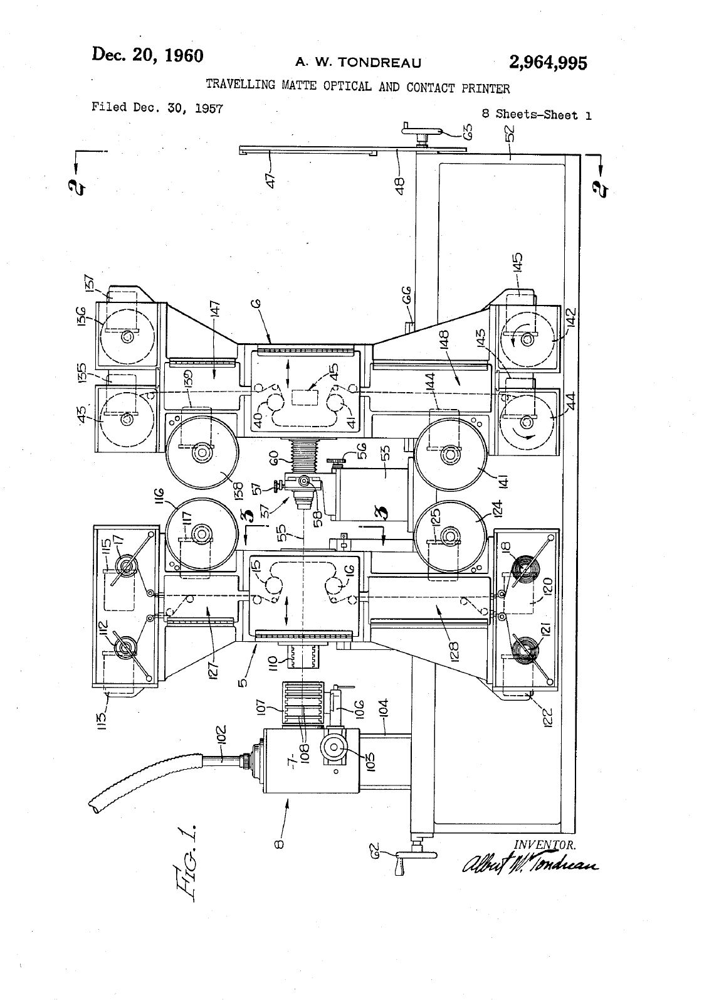

# Travelling matte optical and contact printer

An adjustable precision gate keeps contact pressure consistent for stacks of one to three films.

[US2964995A · complete original PDF (11 pages)](../sources/US2964995A.pdf) · [Archival PDF source](https://patentimages.storage.googleapis.com/4a/5a/6d/e3279e761c62d2/US2964995.pdf) · [Searchable publication](https://patents.google.com/patent/US2964995A/en) · [Espacenet](https://worldwide.espacenet.com/patent/search?q=pn%3DUS2964995A)

## Original drawings

<figure>

<figcaption>Drawing sheet. Sectional mechanism associated with the film gate. <a href="../sources/US2964995A.pdf#page=6">US2964995A, PDF p. 6</a>.</figcaption>
</figure>
<figure>

<figcaption>Drawing sheet. Printer and film paths arranged across the projection axis. <a href="../sources/US2964995A.pdf#page=1">US2964995A, PDF p. 1</a>.</figcaption>
</figure>

## Publication

- **Publication** US2964995A
- **Inventors** Albert W Tondreau
- **Original assignee** Warner Bros. Pictures, Inc.
- **Priority** 1957-12-30 · **Filing** 1957-12-30 · **Publication** 1960-12-20
- **Original application** Contact and optical printing
- **Mechanisms** Mechanical clamping, Edge grip, Combined mechanisms

## What the patent describes

**Original problem.** Repeated matte and color separation passes needed stable registration despite film shrinkage and changes in the stack.

**Operating sequence.** Sprockets and intermittent drives advance and register the films. The pressure assembly's offset from the fixed aperture plate can be set for the number of films. Film travel and dissolves are synchronized by the printer drive.

**Film contact.** Aperture and pressure plates contact the outer layers. Perforation drives register film and stacked layers contact on the image area.

**Transverse control.** The opposing aperture geometry fixes the cross-film position of the stack at exposure.

**Longitudinal control.** Pulldown and plate geometry locate each frame along travel. Adjustment takes up film-stack thickness rather than deliberately stretching the length.

## Engineering interpretation

**Advantages and limits.** Multiple film passes can be aligned even with stock variation. Image-area contact makes cleanliness and shrinkage important.

**Camera scanning.** The adjustable clearance is relevant when scanning materials of different thickness. Registration and focus should still be measured independently.

## Commercial evidence and sources

Commercial deployment of the disclosed mechanism is unverified in the sources reviewed.

## Related patents

[US2357707A · Film gate pressure pad](US2357707A.md) · [US3574460A · High-pressure gate for photographic contact printing](US3574460A.md) · [US4835555A · Film transport apparatus](US4835555A.md)

**Selected indexed prior references.** [US1580114A](https://patents.google.com/patent/US1580114A/en) · [US1598956A](https://patents.google.com/patent/US1598956A/en) · [US1959498A](https://patents.google.com/patent/US1959498A/en) · [US2207103A](https://patents.google.com/patent/US2207103A/en)

**Selected indexed later citations.** [US3682540A](https://patents.google.com/patent/US3682540A/en) · [US4017177A](https://patents.google.com/patent/US4017177A/en) · [US4070108A](https://patents.google.com/patent/US4070108A/en) · [US4073589A](https://patents.google.com/patent/US4073589A/en)

[Return to the archive](../index.md)
