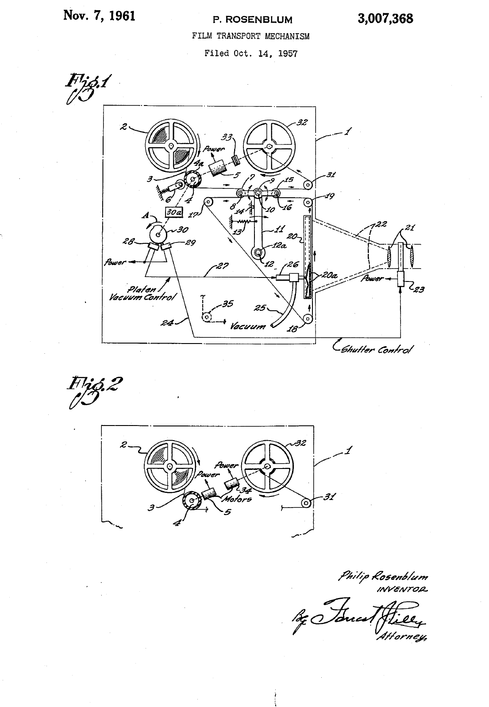

# Film transport mechanism

A vacuum platen stops the frame while spring-loaded roller loops absorb continuing reel motion.

[US3007368A · complete original PDF (5 pages)](../sources/US3007368A.pdf) · [Archival PDF source](https://patentimages.storage.googleapis.com/c0/5e/13/0f973858891952/US3007368.pdf) · [Searchable publication](https://patents.google.com/patent/US3007368A/en) · [Espacenet](https://worldwide.espacenet.com/patent/search?q=pn%3DUS3007368A)

## Original drawings

<figure>

<figcaption>Figs. 1–2. Web over the fixed platen and transport condition while the film is held. <a href="../sources/US3007368A.pdf#page=1">US3007368A, PDF p. 1</a>.</figcaption>
</figure>

## Publication

- **Publication** US3007368A
- **Inventors** Philip Rosenblum
- **Original assignee** Hycon Manufacturing Co
- **Priority** 1957-10-14 · **Filing** 1957-10-14 · **Publication** 1961-11-07
- **Original application** Camera
- **Mechanisms** Vacuum, Longitudinal tension, Combined mechanisms

## What the patent describes

**Original problem.** Aerial photographs required a stationary, flat film section even though the reels were intended to run continuously.

**Operating sequence.** A roll passes over a fixed platen between loops guided on a pivoting arm. A timed vacuum pulse grips and flattens the section for exposure as the arm takes up supply motion and pays out film downstream. On release the web catches up.

**Film contact.** Film contacts the guide rollers and the opaque platen when suction acts.

**Transverse control.** The vacuum draws the width toward the fixed plane.

**Longitudinal control.** The same vacuum establishes the reference along the frame. The spring arm manages web tension and buffers upstream and downstream travel.

## Engineering interpretation

**Advantages and limits.** The reels can keep moving during the optical dwell. The design assumes a continuous web and uses a broad support.

**Camera scanning.** The mechanical buffer is applicable to a roll system. For cut frames, independent short-stroke arrest and release can be tested without the loops.

## Commercial evidence and sources

Commercial deployment of the disclosed mechanism is unverified in the sources reviewed.

## Related patents

[US2131926A · Camera magazine](US2131926A.md) · [US4249821A · Belt microfilm camera](US4249821A.md)

**Selected indexed prior references.** [GB189510474A](https://patents.google.com/patent/GB189510474A/en) · [US2173996A](https://patents.google.com/patent/US2173996A/en) · [US2521153A](https://patents.google.com/patent/US2521153A/en) · [US2713814A](https://patents.google.com/patent/US2713814A/en)

**Selected indexed later citations.** [DE2440408A1](https://patents.google.com/patent/DE2440408A1/en) · [US10118252B2](https://patents.google.com/patent/US10118252B2/en) · [US20080179304A1](https://patents.google.com/patent/US20080179304A1/en) · [US3232508A](https://patents.google.com/patent/US3232508A/en)

[Return to the archive](../index.md)
