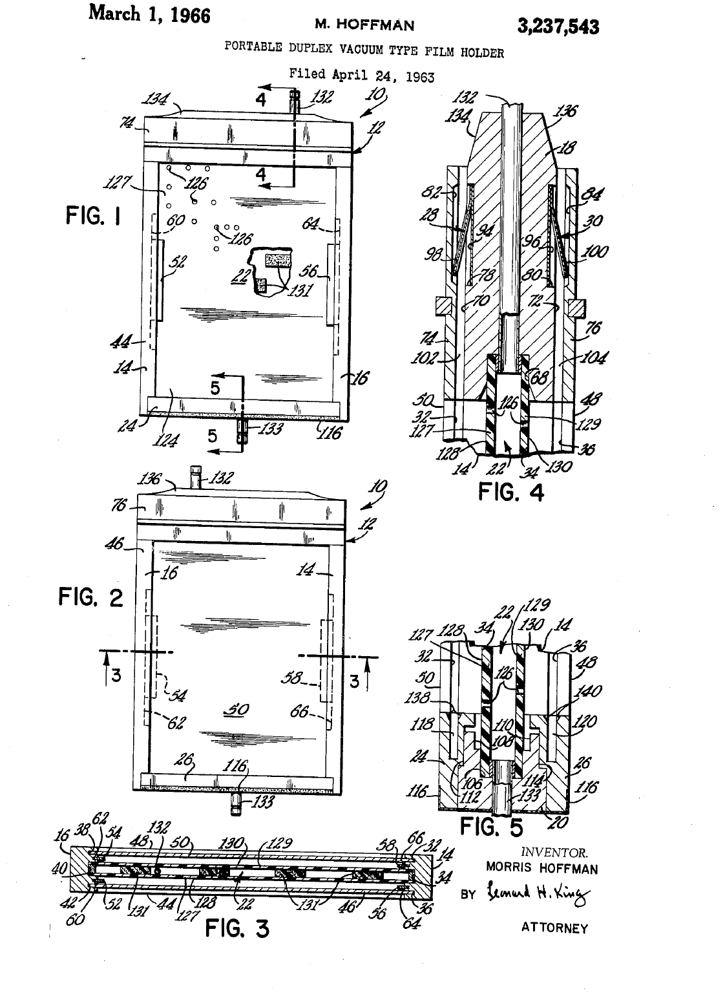

# Portable duplex vacuum type film holder

One portable two-sided vacuum chamber supports a sheet on either face.

[US3237543A · complete original PDF (4 pages)](../sources/US3237543A.pdf) · [Archival PDF source](https://patentimages.storage.googleapis.com/0c/d9/a8/246a0c7c625d8e/US3237543.pdf) · [Searchable publication](https://patents.google.com/patent/US3237543A/en) · [Espacenet](https://worldwide.espacenet.com/patent/search?q=pn%3DUS3237543A)

## Original drawings

<figure>

<figcaption>Drawing sheet. Front, back and sections of the two-sided vacuum holder. <a href="../sources/US3237543A.pdf#page=1">US3237543A, PDF p. 1</a>.</figcaption>
</figure>

## Publication

- **Publication** US3237543A
- **Inventors** Morris Hoffman
- **Original assignee** Individual
- **Priority** 1963-04-24 · **Filing** 1963-04-24 · **Publication** 1966-03-01
- **Original application** Camera
- **Mechanisms** Vacuum, Edge grip, Combined mechanisms

## What the patent describes

**Original problem.** A precision camera needed suction flatness in an interchangeable holder that could be loaded away from the camera.

**Operating sequence.** Load two sheets behind loose retaining bars and removable dark slides. Connect suction to the shared chamber when exposing a sheet. Vent the chamber and withdraw the sheets during unloading.

**Film contact.** The two perforated mounting faces support the backs. Edge bars retain the sheets before suction.

**Transverse control.** The perforated face pulls each sheet across its width onto a rigid plane.

**Longitudinal control.** The same face supports the length without end tension.

## Engineering interpretation

**Advantages and limits.** This preserves an interchangeable camera back while supplying suction to both faces. It requires a pressure seal and opaque full-area contact.

**Camera scanning.** A useful study of retaining film before suction takes over and of sharing a vacuum manifold across independently loaded film planes.

## Commercial evidence and sources

Commercial deployment of the disclosed mechanism is unverified in the sources reviewed.

## Related patents

[US1139079A · Method of and device for holding photographic-film sheets](US1139079A.md) · [US2131926A · Camera magazine](US2131926A.md) · [US3966320A · Microfilm camera](US3966320A.md)

**Selected indexed prior references.** [US1631479A](https://patents.google.com/patent/US1631479A/en) · [US2078741A](https://patents.google.com/patent/US2078741A/en)

**Selected indexed later citations.** [US3597081A](https://patents.google.com/patent/US3597081A/en) · [US3759613A](https://patents.google.com/patent/US3759613A/en) · [US4452529A](https://patents.google.com/patent/US4452529A/en) · [US4791459A](https://patents.google.com/patent/US4791459A/en)

[Return to the archive](../index.md)
