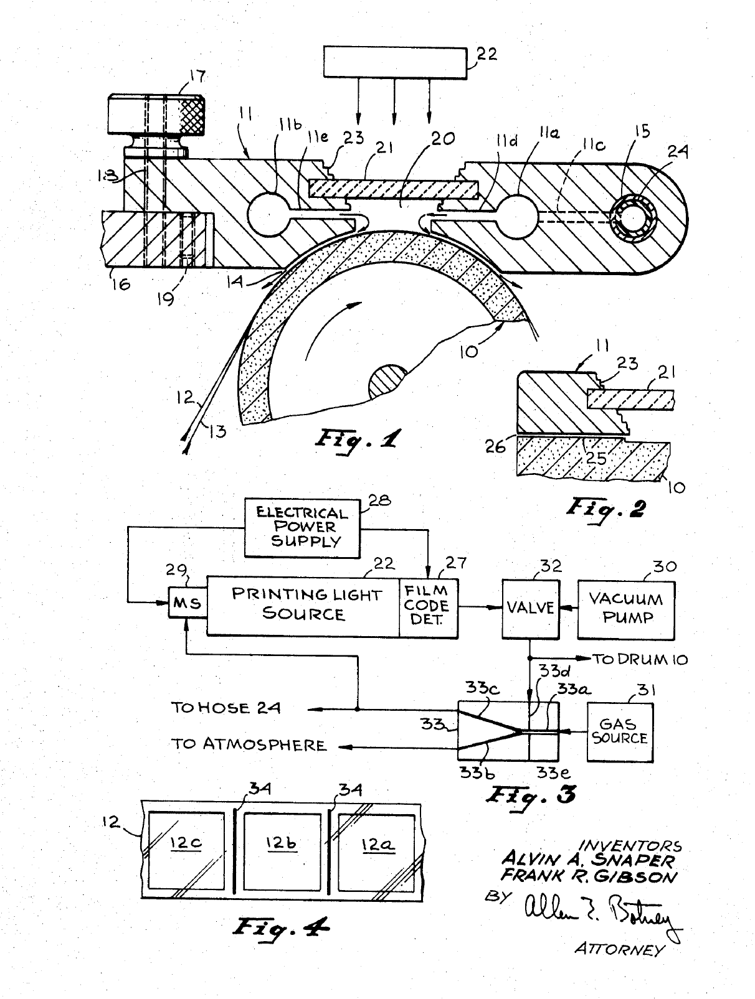

# High-pressure gate for photographic contact printing

A pressurized shoe seats the contact-print sandwich against a transparent drum or exposure window.

[US3574460A · complete original PDF (5 pages)](../sources/US3574460A.pdf) · [Archival PDF source](https://patentimages.storage.googleapis.com/ad/83/ad/09a371a974c5a3/US3574460.pdf) · [Searchable publication](https://patents.google.com/patent/US3574460A/en) · [Espacenet](https://worldwide.espacenet.com/patent/search?q=pn%3DUS3574460A)

## Original drawings

<figure>

<figcaption>Figs. 1–4. Drum, pressure shoe, planar-window detail and pneumatic schematics. <a href="../sources/US3574460A.pdf#page=2">US3574460A, PDF p. 2</a>.</figcaption>
</figure>

## Publication

- **Publication** US3574460A
- **Inventors** Alvin A Snaper, Frank R Gibson
- **Original assignee** Individual
- **Priority** 1968-11-14 · **Filing** 1968-11-14 · **Publication** 1971-04-13
- **Original application** Contact and optical printing
- **Mechanisms** Pneumatic pressure or air bearing, Controlled bending, Combined mechanisms

## What the patent describes

**Original problem.** Contact printing needed a stable pressure distribution to keep the negative and receiving stock optically close across the image.

**Operating sequence.** Original and print stock travel together into a shaped gap between drum and shoe. Pressure acts on the moving stack and the light exposes it while held. The film layers continue past the gap and separate downstream.

**Film contact.** The stack itself is in image-to-image contact. Its outer side can be supported by the drum or window, with gas acting on the shoe side.

**Transverse control.** Gas loading and the reference surfaces suppress cross-web lift and gap variation.

**Longitudinal control.** The film follows the curved drum or the local planar window in alternative embodiments. Force is distributed along the working region.

## Engineering interpretation

**Advantages and limits.** Applying pressure without a moving clamp is attractive for continuous throughput. It still needs a controlled gap, clean gas and allowance for sandwiched film.

**Camera scanning.** An example of regulated pressure for a local window, useful when comparing vacuum, air and contact methods.

## Commercial evidence and sources

Commercial deployment of the disclosed mechanism is unverified in the sources reviewed.

## Related patents

[US2357707A · Film gate pressure pad](US2357707A.md) · [US5812245A · Asynchronous contact printer for motion picture film](US5812245A.md) · [US5111241A · Bernoulli scan gate](US5111241A.md)

**Selected indexed prior references.** [CH438938A](https://patents.google.com/patent/CH438938A/en) · [US3468606A](https://patents.google.com/patent/US3468606A/en)

**Selected indexed later citations.** [US3741650A](https://patents.google.com/patent/US3741650A/en) · [US4037957A](https://patents.google.com/patent/US4037957A/en)

[Return to the archive](../index.md)
