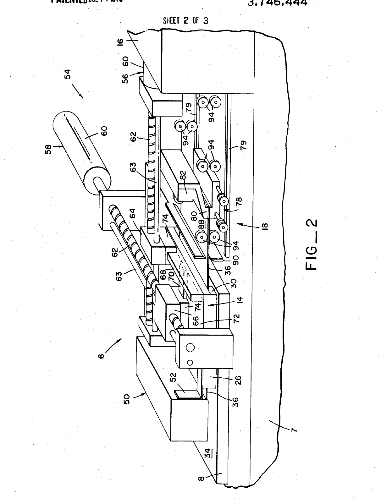
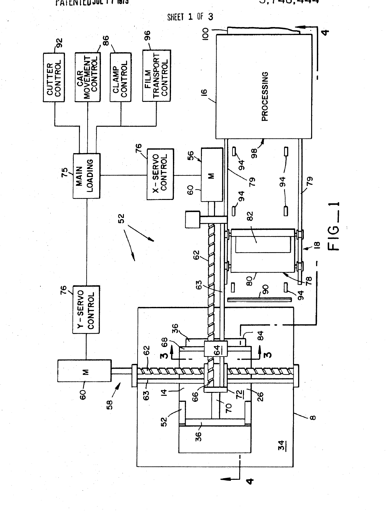

# Microfiche recorder and processor

A step-and-repeat microfiche recorder carries its own film supply on an X-Y vacuum platen.

[US3746444A · complete original PDF (8 pages)](../sources/US3746444A.pdf) · [Archival PDF source](https://patentimages.storage.googleapis.com/86/c3/9f/ab2b52fc849b12/US3746444.pdf) · [Searchable publication](https://patents.google.com/patent/US3746444A/en) · [Espacenet](https://worldwide.espacenet.com/patent/search?q=pn%3DUS3746444A)

## Original drawings

<figure>

<figcaption>Drawing sheet. Vacuum platen, film supply and the film removal assembly. <a href="../sources/US3746444A.pdf#page=3">US3746444A, PDF p. 3</a>.</figcaption>
</figure>
<figure>

<figcaption>Drawing sheet. Section through the recorder and its optical reference. <a href="../sources/US3746444A.pdf#page=2">US3746444A, PDF p. 2</a>.</figcaption>
</figure>

## Publication

- **Publication** US3746444A
- **Inventors** Rolf D. Kahle, David K. Studley, James D. Bryson
- **Original assignee** Bessemer Securities Corporation
- **Priority** 1971-11-24 · **Filing** 1971-11-24 · **Publication** 1973-07-17
- **Original application** Microfilm
- **Mechanisms** Vacuum, Edge grip, Combined mechanisms

## What the patent describes

**Original problem.** Recording a grid of sharp microimages required keeping fresh stock flat while the platen moved in two axes and reloaded automatically.

**Operating sequence.** The moving platen holds the film while each microimage is exposed through a reference aperture. At home a clamp grips an edge and suction releases. The exposed portion is drawn off, fresh film is loaded, and a cutter separates the completed sheet.

**Film contact.** The back of the exposed web lies against the platen. Guides and the reciprocating clamp engage its edges.

**Transverse control.** Vacuum draws the film to the reference plate geometry across its width.

**Longitudinal control.** The same support holds the film along-feed during the X-Y exposure pattern. The pull is used for reload.

## Engineering interpretation

**Advantages and limits.** Moving the supply with the platen avoids twisting and keeps the exposure reference fixed relative to the film. The mechanism handles long fresh stock.

**Camera scanning.** A complete precedent for separating acquisition, optical positioning and automated handoff with independent interlocks.

## Commercial evidence and sources

Commercial deployment of the disclosed mechanism is unverified in the sources reviewed.

## Related patents

[US3966320A · Microfilm camera](US3966320A.md) · [US4249821A · Belt microfilm camera](US4249821A.md)

**Selected indexed prior references.** [US3234849A](https://patents.google.com/patent/US3234849A/en) · [US3557675A](https://patents.google.com/patent/US3557675A/en) · [US3572925A](https://patents.google.com/patent/US3572925A/en) · [US3591282A](https://patents.google.com/patent/US3591282A/en)

**Selected indexed later citations.** [CN100383662C](https://patents.google.com/patent/CN100383662C/en) · [DE2828032A1](https://patents.google.com/patent/DE2828032A1/en) · [JPS536640U](https://patents.google.com/patent/JPS536640U/en) · [JPS536641U](https://patents.google.com/patent/JPS536641U/en)

[Return to the archive](../index.md)
