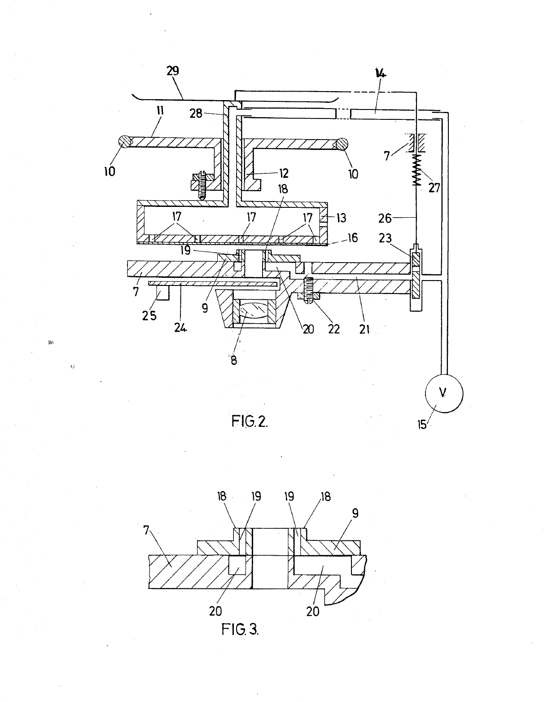
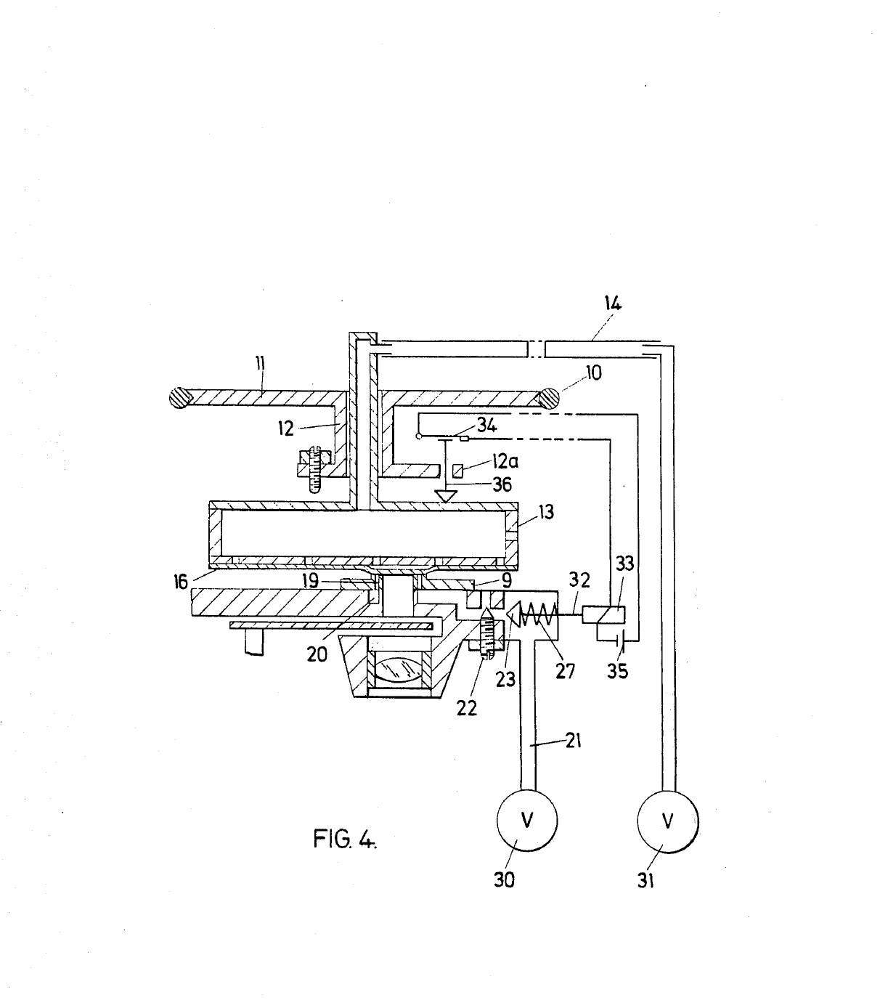

# Microfilm camera

A mobile suction holder retains the sheet while a second vacuum reference seats it at exposure.

[US3966320A · complete original PDF (7 pages)](../sources/US3966320A.pdf) · [Archival PDF source](https://patentimages.storage.googleapis.com/be/65/3b/fd535aeec5dd05/US3966320.pdf) · [Searchable publication](https://patents.google.com/patent/US3966320A/en) · [Espacenet](https://worldwide.espacenet.com/patent/search?q=pn%3DUS3966320A)

## Original drawings

<figure>

<figcaption>Figs. 2–3. Suction plate and gate, with a plan view of the bearing surface. <a href="../sources/US3966320A.pdf#page=3">US3966320A, PDF p. 3</a>.</figcaption>
</figure>
<figure>

<figcaption>Fig. 4. Alternate local exposure and suction arrangement. <a href="../sources/US3966320A.pdf#page=4">US3966320A, PDF p. 4</a>.</figcaption>
</figure>

## Publication

- **Publication** US3966320A
- **Inventors** Manfred Wiessner
- **Original assignee** VEB Pentacon Dresden
- **Priority** 1974-04-10 · **Filing** 1975-04-07 · **Publication** 1976-06-29
- **Original application** Microfilm
- **Mechanisms** Vacuum, Combined mechanisms

## What the patent describes

**Original problem.** Manufacturing and positioning errors in a stepping suction plate could move individual exposures off the microfilm gate's optical plane.

**Operating sequence.** The suction plate shifts stepwise while holding the sheet. When it is brought to the gate, a valve connects suction apertures near the film-bearing surface. The holder lifts and the gate suction is turned off before the next step.

**Film contact.** The moving suction plate supports one face. The film-bearing parts of the gate define the local exposure reference on the other side.

**Transverse control.** Gate suction seats the film across the exposure region.

**Longitudinal control.** The same gated vacuum corrects local along-film position regardless of the holder's stepping location.

## Engineering interpretation

**Advantages and limits.** A second reference removes errors from translating the first. The valves, support relative heights and suction forces must cooperate.

**Camera scanning.** Consider handoff between a pickup vacuum and a capture reference with independent timing and measured film displacement.

## Commercial evidence and sources

Commercial deployment of the disclosed mechanism is unverified in the sources reviewed.

## Related patents

[US2131926A · Camera magazine](US2131926A.md) · [US3746444A · Microfiche recorder and processor](US3746444A.md) · [US4249821A · Belt microfilm camera](US4249821A.md)

**Selected indexed prior references.** [US3306176A](https://patents.google.com/patent/US3306176A/en) · [US3525291A](https://patents.google.com/patent/US3525291A/en)

**Selected indexed later citations.** [US20030178911A1](https://patents.google.com/patent/US20030178911A1/en) · [US4595283A](https://patents.google.com/patent/US4595283A/en) · [US5099277A](https://patents.google.com/patent/US5099277A/en) · [US6800970B2](https://patents.google.com/patent/US6800970B2/en)

[Return to the archive](../index.md)
