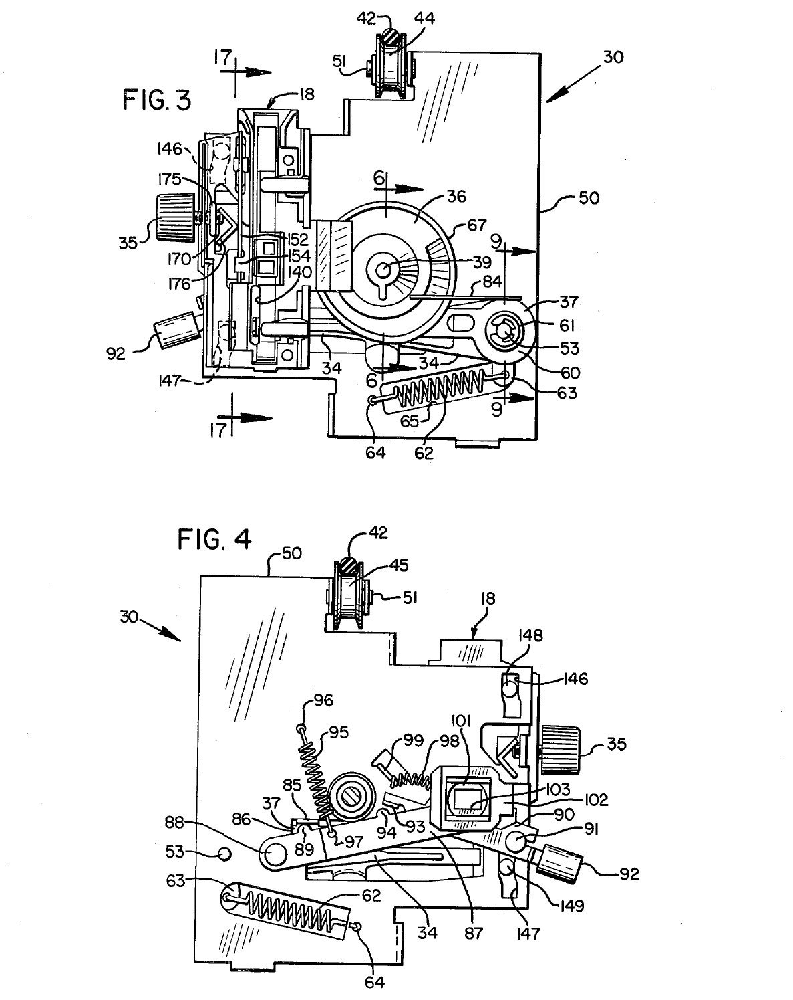
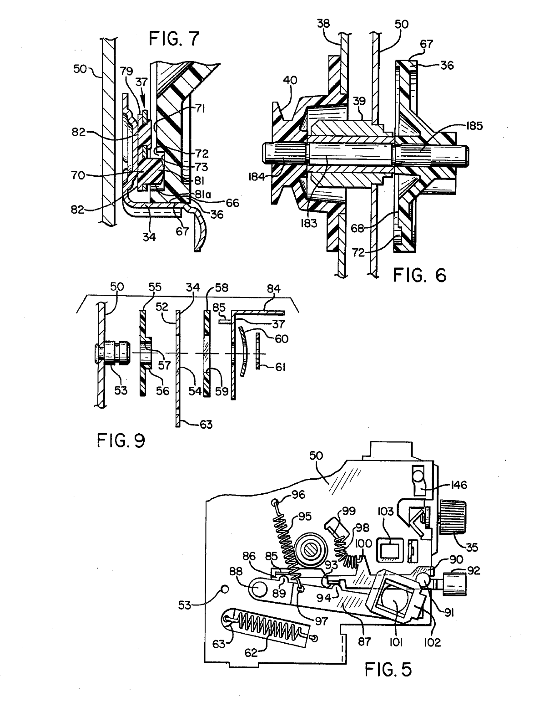

# Film transport and control mechanism for motion picture projectors

A selectable projector gate coordinates claw advance, still projection and clear threading.

[US4145127A · complete original PDF (17 pages)](../sources/US4145127A.pdf) · [Archival PDF source](https://patentimages.storage.googleapis.com/cc/23/1f/9590fe8a8ad36c/US4145127.pdf) · [Searchable publication](https://patents.google.com/patent/US4145127A/en) · [Espacenet](https://worldwide.espacenet.com/patent/search?q=pn%3DUS4145127A)

## Original drawings

<figure>

<figcaption>Drawing sheet. The projector gate module in two views. <a href="../sources/US4145127A.pdf#page=3">US4145127A, PDF p. 3</a>.</figcaption>
</figure>
<figure>

<figcaption>Drawing sheet. Cam, claw and gate component details. <a href="../sources/US4145127A.pdf#page=4">US4145127A, PDF p. 4</a>.</figcaption>
</figure>

## Publication

- **Publication** US4145127A
- **Inventors** Donald I. Loofbourow, Robert E. Lach
- **Original assignee** GAF Corporation
- **Priority** 1977-03-23 · **Filing** 1977-03-23 · **Publication** 1979-03-20
- **Original application** Motion-picture camera and projector
- **Mechanisms** Edge grip, Mechanical clamping

## What the patent describes

**Original problem.** A common projector transport needed to advance two film formats and to clear the film safely for still projection, threading and rewind.

**Operating sequence.** The operator threads through the two-format gate. The rotating cam moves a claw into perforations for intermittent feed, while selected cam sections keep it clear for still, rewind or loading modes.

**Film contact.** Gate surfaces define the film passage and the claw touches the perforations. The disclosure focuses on the transport module.

**Transverse control.** A selected gate and aperture constrain position across the strip. An active outward tensioning action is not specified.

**Longitudinal control.** The claw sets the indexed position along the strip, distinct from measuring or correcting along-frame bow.

## Engineering interpretation

**Advantages and limits.** Mode switching avoids dragging the claw at loading. The design depends on perforations and advances at projector timing.

**Camera scanning.** A comparison for retractable registration and mode switching, with film planarity treated as a separate experiment.

## Commercial evidence and sources

Commercial deployment of the disclosed mechanism is unverified in the sources reviewed.

## Related patents

[US2063016A · Film gate](US2063016A.md) · [US2227987A · Automatic projection printer](US2227987A.md) · [US6501530B2 · Motion picture film projector illumination system for minimizing film buckle](US6501530B2.md)

**Selected indexed prior references.** [US1964209A](https://patents.google.com/patent/US1964209A/en) · [US2089276A](https://patents.google.com/patent/US2089276A/en) · [US2431254A](https://patents.google.com/patent/US2431254A/en) · [US3014404A](https://patents.google.com/patent/US3014404A/en)

[Return to the archive](../index.md)
