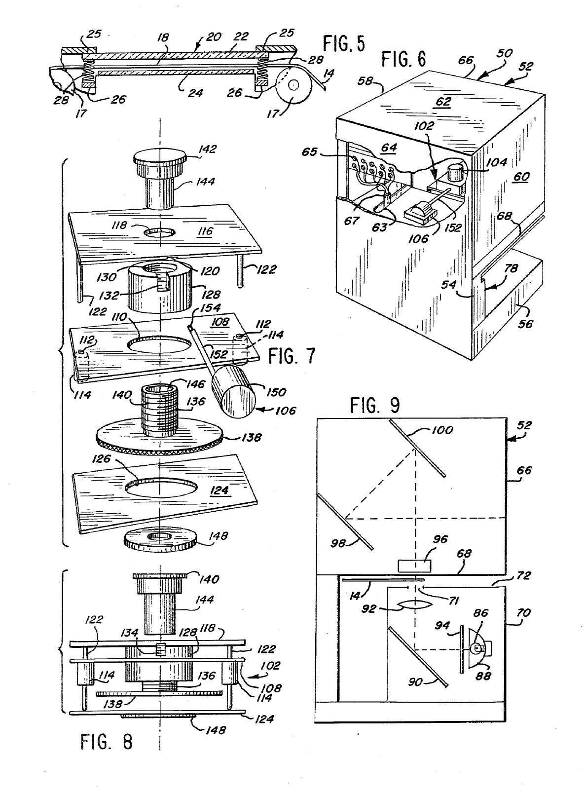
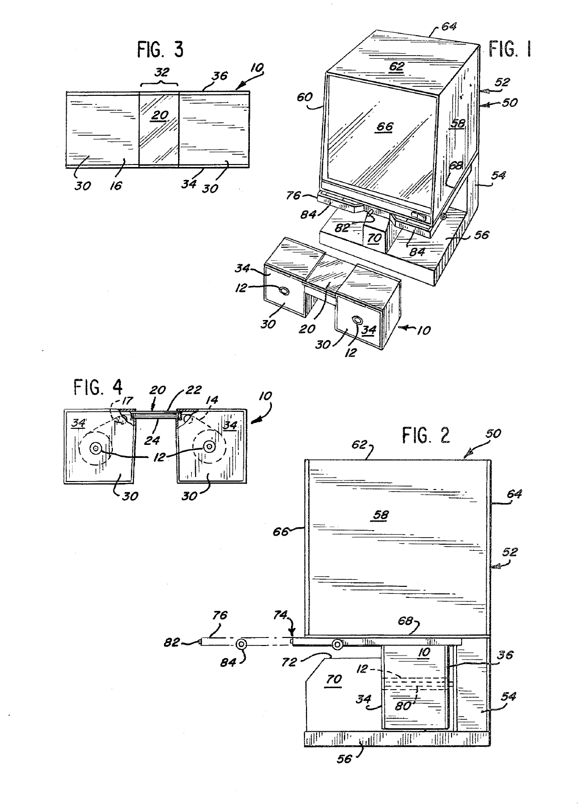

# Micro image storage and retrieval apparatus

Transparent plates open inside a cassette for address selection and close for microimage projection.

[US4203658A · complete original PDF (10 pages)](../sources/US4203658A.pdf) · [Archival PDF source](https://patentimages.storage.googleapis.com/54/02/e5/639005eff0d149/US4203658.pdf) · [Searchable publication](https://patents.google.com/patent/US4203658A/en) · [Espacenet](https://worldwide.espacenet.com/patent/search?q=pn%3DUS4203658A)

## Original drawings

<figure>

<figcaption>Drawing sheet. Cassette-access components and microimage layout. <a href="../sources/US4203658A.pdf#page=3">US4203658A, PDF p. 3</a>.</figcaption>
</figure>
<figure>

<figcaption>Drawing sheet. Transparent plates and cassette assembly. <a href="../sources/US4203658A.pdf#page=2">US4203658A, PDF p. 2</a>.</figcaption>
</figure>

## Publication

- **Publication** US4203658A
- **Inventors** Arnis E. Peters
- **Original assignee** Northern Engraving Co Inc
- **Priority** 1977-12-19 · **Filing** 1977-12-19 · **Publication** 1980-05-20
- **Original application** Microfilm
- **Mechanisms** Glass-based support, Mechanical clamping, Combined mechanisms

## What the patent describes

**Original problem.** A cassette indexer needed to let film move between addresses while returning it to a sharp projection plane at each address.

**Operating sequence.** The cassette indexes the film longitudinally and the optics select the row. An actuator separates the plates to reposition the film, then the plates close across the selected area for projection.

**Film contact.** Transparent plates contact both sides of the selected microimage region.

**Transverse control.** The plates impose a plane across the cassette window.

**Longitudinal control.** The plates impose the same plane along the selected window. Longitudinal indexing occurs only after release.

## Engineering interpretation

**Advantages and limits.** Built-in transport and clean release make repeated searching easier. The optical stack includes glass, and the original mechanism assumes a cassette.

**Camera scanning.** A reference for a glass clamp with independent drive and a clear transition between transport and capture.

## Commercial evidence and sources

Commercial deployment of the disclosed mechanism is unverified in the sources reviewed.

## Related patents

[US2008982A · Device for producing enlarged images](US2008982A.md) · [US3746444A · Microfiche recorder and processor](US3746444A.md) · [US3966320A · Microfilm camera](US3966320A.md)

**Selected indexed prior references.** [US2610540A](https://patents.google.com/patent/US2610540A/en) · [US3739069A](https://patents.google.com/patent/US3739069A/en) · [US3784295A](https://patents.google.com/patent/US3784295A/en) · [US3917389A](https://patents.google.com/patent/US3917389A/en)

**Selected indexed later citations.** [USD309621S](https://patents.google.com/patent/USD309621S/en)

[Return to the archive](../index.md)
