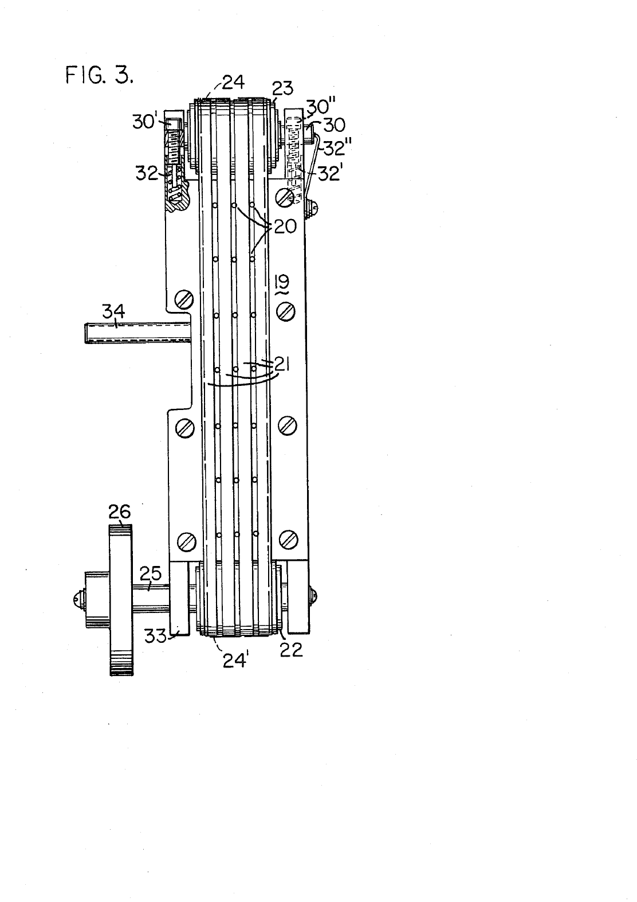
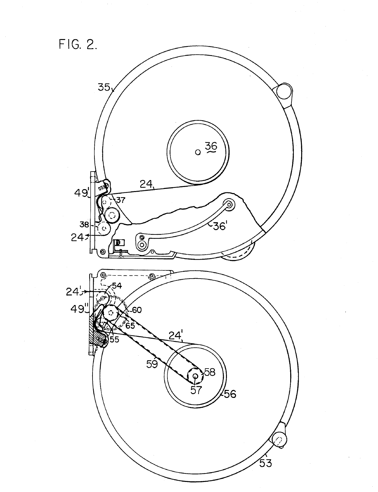

# Belt microfilm camera

Multiple coplanar vacuum belts carry and hold film through a stationary-exposure cycle.

[US4249821A · complete original PDF (17 pages)](../sources/US4249821A.pdf) · [Archival PDF source](https://patentimages.storage.googleapis.com/0c/07/0a/71f08f50b83741/US4249821.pdf) · [Searchable publication](https://patents.google.com/patent/US4249821A/en) · [Espacenet](https://worldwide.espacenet.com/patent/search?q=pn%3DUS4249821A)

## Original drawings

<figure>

<figcaption>Fig. 3. Coplanar vacuum belts and the film-support zone. <a href="../sources/US4249821A.pdf#page=4">US4249821A, PDF p. 4</a>.</figcaption>
</figure>
<figure>

<figcaption>Fig. 2. Two states of a film-loop buffer surrounding the belt transport. <a href="../sources/US4249821A.pdf#page=3">US4249821A, PDF p. 3</a>.</figcaption>
</figure>

## Publication

- **Publication** US4249821A
- **Inventors** Michael W. Rudy, Forrest L. Langford, Robert D. Therien
- **Original assignee** Terminal Data Corporation
- **Priority** 1979-06-21 · **Filing** 1979-06-21 · **Publication** 1981-02-10
- **Original application** Microfilm
- **Mechanisms** Vacuum, Edge grip, Combined mechanisms

## What the patent describes

**Original problem.** A step-exposure microfilm camera needed low-inertia, low-slip transport and a predictable exposure stop.

**Operating sequence.** Thread the film over the belts between low-inertia vacuum loops. Vacuum keeps the film moving with the belts, which stop at an exposure event and then advance under sensor-based control.

**Film contact.** Film contacts the belts. Loop chambers buffer film supply and take-up by airflow.

**Transverse control.** Coplanar belt runs and suction draw the web toward their common support plane.

**Longitudinal control.** The belt bed supports the held span. Vacuum loops manage feeding tension and isolate reel inertia.

## Engineering interpretation

**Advantages and limits.** The same force couples film to the transport and reference surfaces, reducing slip during indexing. Continuous film is assumed.

**Camera scanning.** Compare whether short belts and separate vacuum zones could keep a single frame under control without obstructing transmitted light.

## Commercial evidence and sources

Commercial deployment of the disclosed mechanism is unverified in the sources reviewed.

## Related patents

[US3007368A · Film transport mechanism](US3007368A.md) · [US3746444A · Microfiche recorder and processor](US3746444A.md) · [US5028956A · Film clamp](US5028956A.md)

**Selected indexed prior references.** [US3007368A](https://patents.google.com/patent/US3007368A/en) · [US3197645A](https://patents.google.com/patent/US3197645A/en) · [US3339815A](https://patents.google.com/patent/US3339815A/en) · [US3645619A](https://patents.google.com/patent/US3645619A/en)

**Selected indexed later citations.** [US20050219462A1](https://patents.google.com/patent/US20050219462A1/en) · [US7093939B2](https://patents.google.com/patent/US7093939B2/en)

[Return to the archive](../index.md)
