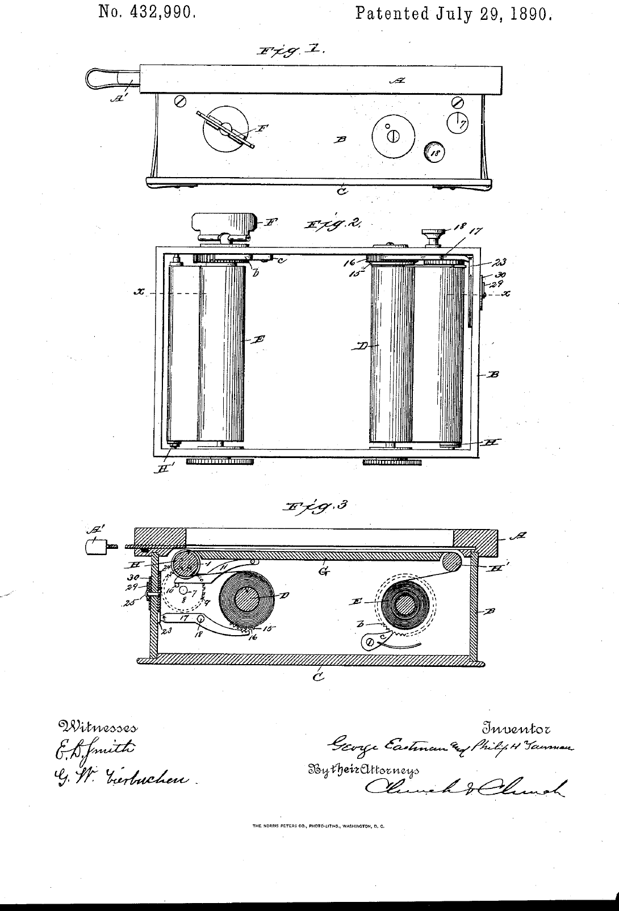
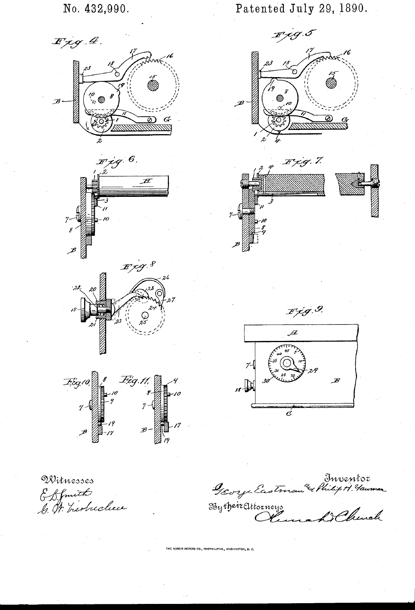

# Roller-holder for photographic films

A pawl and driven take-up hold roll film taut over a fixed exposure support.

[US432990A · complete original PDF (5 pages)](../sources/US432990A.pdf) · [Archival PDF source](https://patentimages.storage.googleapis.com/15/51/7c/17a781de96fdf1/US432990.pdf) · [Searchable publication](https://patents.google.com/patent/US432990A/en) · [Espacenet](https://worldwide.espacenet.com/patent/search?q=pn%3DUS432990A)

## Original drawings

<figure>

<figcaption>Figs. 1–3. Roll holder assembled, with the back removed and in section. <a href="../sources/US432990A.pdf#page=1">US432990A, PDF p. 1</a>.</figcaption>
</figure>
<figure>

<figcaption>Figs. 4–11. Details of the winding lock, metering and film marker. <a href="../sources/US432990A.pdf#page=2">US432990A, PDF p. 2</a>.</figcaption>
</figure>

## Publication

- **Publication** US432990A
- **Inventors** George Eastman, Philip H. Yawman
- **Original assignee** Eastman Dry Plate and Film Company
- **Priority** 1889-07-08 · **Filing** 1889-07-08 · **Publication** 1890-07-29
- **Original application** Camera
- **Mechanisms** Longitudinal tension, Edge grip

## What the patent describes

**Original problem.** Early camera operators needed to advance one exposure reliably and keep pliable roll film taut on the support during exposure.

**Operating sequence.** The strip runs from the supply across a support to a receiving reel. A winding key takes up film and a pawl prevents backward movement. For the next picture the operator advances and measures a fresh length.

**Film contact.** Roll supports, guide surfaces and the fixed exposure support contact the strip.

**Transverse control.** The support establishes cross-film shape. The mechanism does not impose a separate lateral stretching action.

**Longitudinal control.** A pull between supply and take-up holds the span taut against the support.

## Engineering interpretation

**Advantages and limits.** The patent presents a compact roll holder with metering. Its tension depends on a connected roll at both sides.

**Camera scanning.** Historical evidence that feed tension was used for focus before powered gates. It suggests a controlled long-strip reference against which to test short-frame handling.

## Commercial evidence and sources

The inventor and filing fields are transcribed from the original specification. The Google Patents entry has an abbreviated title and omits some early bibliographic fields.

## Related patents

[US450794A · Photographic roll-paper holder](US450794A.md) · [US1139079A · Method of and device for holding photographic-film sheets](US1139079A.md) · [US2227987A · Automatic projection printer](US2227987A.md)

**Selected indexed later citations.** [US2882807A](https://patents.google.com/patent/US2882807A/en)

[Return to the archive](../index.md)
