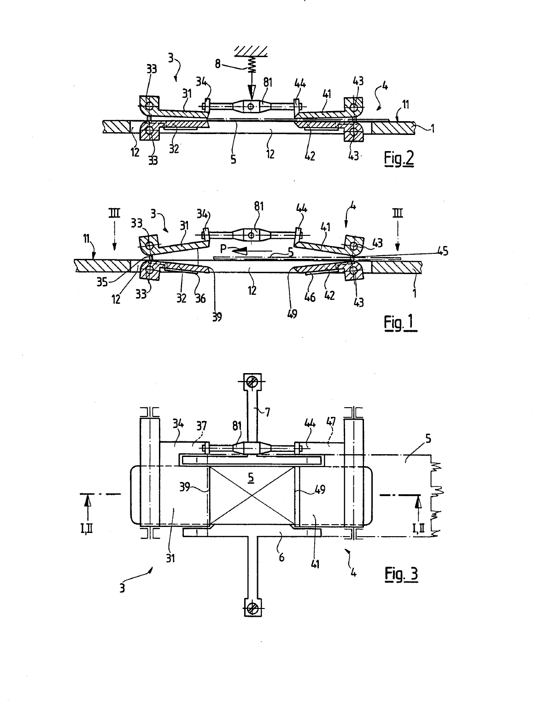

# Device to position a copy master in a copying apparatus

Opposed flaps open around the plane for travel and close on two sides of a short copy master.

[US4483612A · complete original PDF (5 pages)](../sources/US4483612A.pdf) · [Archival PDF source](https://patentimages.storage.googleapis.com/e5/71/ed/352f1b6f328b09/US4483612.pdf) · [Searchable publication](https://patents.google.com/patent/US4483612A/en) · [Espacenet](https://worldwide.espacenet.com/patent/search?q=pn%3DUS4483612A)

## Original drawings

<figure>

<figcaption>Drawing sheet. Opposing clamp flaps in section and window assembly in plan. <a href="../sources/US4483612A.pdf#page=2">US4483612A, PDF p. 2</a>.</figcaption>
</figure>

## Publication

- **Publication** US4483612A
- **Inventors** Erich G. Binder
- **Original assignee** Gretag Aktiengesellschaft
- **Priority** 1982-04-23 · **Filing** 1983-03-29 · **Publication** 1984-11-20
- **Original application** Photographic printer
- **Mechanisms** Mechanical clamping, Edge grip, Combined mechanisms

## What the patent describes

**Original problem.** Short copy masters that could not be pulled taut by a long transport web still needed a planar dwell at the copying aperture.

**Operating sequence.** Retract both pairs during approach. An electromagnet closes opposed upper and lower flaps onto film at the window and spring strips hold the other margins. Release the actuator before advancing.

**Film contact.** Flap edges grip two opposite sides and elastic hold-down strips touch the other margins.

**Transverse control.** Together the opposing contacts put the two long margins at the window plane.

**Longitudinal control.** The complementary contacts establish the remaining sides. The mechanism is bilateral clamping rather than a designed stretching stroke.

## Engineering interpretation

**Advantages and limits.** Opening to both sides leaves a useful entry gap for short masters. Coordinated flap closure still needs accurate register and suitable clearances.

**Camera scanning.** A strong reference for handling discrete pieces with a large approach gap and low image-area contact.

## Commercial evidence and sources

Commercial deployment of the disclosed mechanism is unverified in the sources reviewed.

## Related patents

[US2824491A · Film holder](US2824491A.md) · [US4761675A · Negative carrier assembly for use with a photographic printer](US4761675A.md) · [US5028956A · Film clamp](US5028956A.md)

**Selected indexed prior references.** [GB336842A](https://patents.google.com/patent/GB336842A/en) · [US2110475A](https://patents.google.com/patent/US2110475A/en) · [US2174020A](https://patents.google.com/patent/US2174020A/en) · [US2248646A](https://patents.google.com/patent/US2248646A/en)

**Selected indexed later citations.** [US4965632A](https://patents.google.com/patent/US4965632A/en) · [US5028956A](https://patents.google.com/patent/US5028956A/en) · [US5258807A](https://patents.google.com/patent/US5258807A/en) · [US5822045A](https://patents.google.com/patent/US5822045A/en)

[Return to the archive](../index.md)
