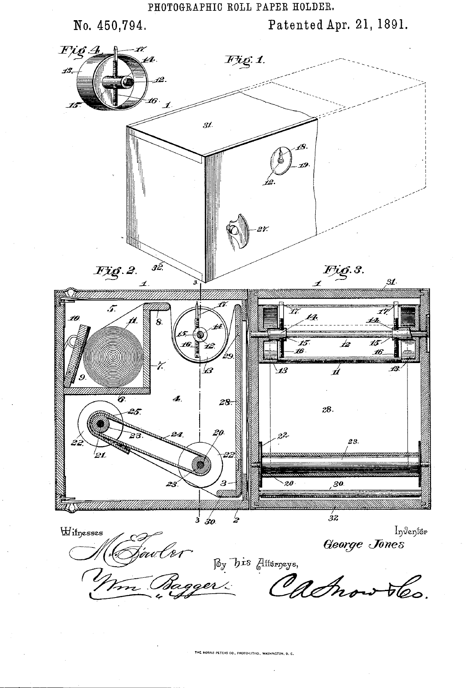

# Photographic roll-paper holder

Guide flanges and adjustable take-up tension smooth sensitized roll stock for exposure.

[US450794A · complete original PDF (4 pages)](../sources/US450794A.pdf) · [Archival PDF source](https://patentimages.storage.googleapis.com/ab/d2/c1/be4a5f364948ef/US450794.pdf) · [Searchable publication](https://patents.google.com/patent/US450794A/en) · [Espacenet](https://worldwide.espacenet.com/patent/search?q=pn%3DUS450794A)

## Original drawings

<figure>

<figcaption>Drawing sheet. Roll-paper holder with take-up, guides and tensioning details. <a href="../sources/US450794A.pdf#page=1">US450794A, PDF p. 1</a>.</figcaption>
</figure>

## Publication

- **Publication** US450794A
- **Inventors** George Jones
- **Original assignee** Individual
- **Priority** 1890-08-20 · **Filing** 1890-08-20 · **Publication** 1891-04-21
- **Original application** Camera
- **Mechanisms** Edge grip, Longitudinal tension, Combined mechanisms

## What the patent describes

**Original problem.** Sensitized paper or film needed to remain taut while being measured and marked for later cutting.

**Operating sequence.** Thread the photosensitive strip through the guide path to the receiving roll or winding belt. A spring plate bears against the supply. The winding and tension components keep the exposed span taut and move the used material on after exposure.

**Film contact.** Guide flanges, drums and receiving parts contact the strip. The spring plate restrains the supply roll.

**Transverse control.** The guide flanges define the cross-film reference as the strip is drawn through.

**Longitudinal control.** Take-up and resistance at the supply create controlled tension along the strip.

## Engineering interpretation

**Advantages and limits.** The same winding system positions and holds film, but presupposes a flexible continuous strip and hand operation.

**Camera scanning.** An early reference for drawing film against a static plane using tension. On modern loose strips the supply brake and take-up need substitutes.

## Commercial evidence and sources

The inventor and filing date are transcribed from the original specification. This facsimile does not state a distinct earlier priority claim.

## Related patents

[US432990A · Roller-holder for photographic films](US432990A.md) · [US1829332A · Method of and apparatus for holding photographic films in flat position during exposure](US1829332A.md) · [US3007368A · Film transport mechanism](US3007368A.md)

**Selected indexed later citations.** [US3205770A](https://patents.google.com/patent/US3205770A/en)

[Return to the archive](../index.md)
