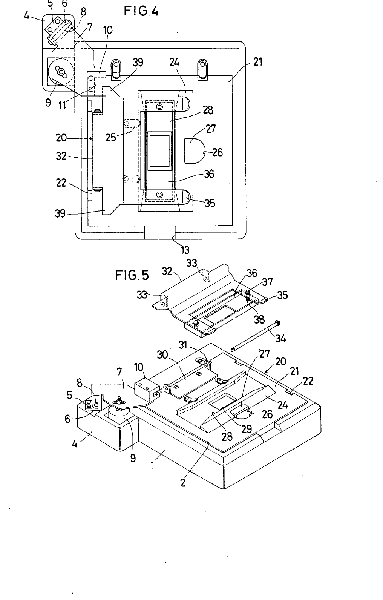

# Negative carrier assembly for use with a photographic printer

A rotatable negative-mask support switches the feed direction while a hinged presser fixes the film.

[US4761675A · complete original PDF (5 pages)](../sources/US4761675A.pdf) · [Archival PDF source](https://patentimages.storage.googleapis.com/c3/82/2c/829c797a98a556/US4761675.pdf) · [Searchable publication](https://patents.google.com/patent/US4761675A/en) · [Espacenet](https://worldwide.espacenet.com/patent/search?q=pn%3DUS4761675A)

## Original drawings

<figure>

<figcaption>Drawing sheet. Alternative mask orientation and carrier assembly. <a href="../sources/US4761675A.pdf#page=3">US4761675A, PDF p. 3</a>.</figcaption>
</figure>

## Publication

- **Publication** US4761675A
- **Inventors** Takashi Sawasaki
- **Original assignee** Noritsu Kenkyu Center Co., Ltd.
- **Priority** 1986-09-01 · **Filing** 1987-08-31 · **Publication** 1988-08-02
- **Original application** Photographic printer
- **Mechanisms** Mechanical clamping, Edge grip

## What the patent describes

**Original problem.** A photo printer needed fast changes of feed direction and film size while keeping each negative seated over the correct mask.

**Operating sequence.** Lift the presser arm to insert or move a negative. The presser frame lowers onto the mask to hold the film for printing. To change feed orientation, lift and re-seat the mask support rotated by 90 degrees.

**Film contact.** A guide groove locates the negative and the apertured presser frame contacts the film around the optical opening.

**Transverse control.** The mask and presser provide normal support relative to the chosen feed orientation.

**Longitudinal control.** Their aperture geometry also locates the film at its end margins if those areas are present. No active pull is described.

## Engineering interpretation

**Advantages and limits.** Fast changeover preserves an optical datum. Manual resetting and compatibility of mask and strip are necessary.

**Camera scanning.** Consider a removable registration insert before committing to a single film orientation or transport geometry.

## Commercial evidence and sources

Commercial deployment of the disclosed mechanism is unverified in the sources reviewed.

## Related patents

[US4483612A · Device to position a copy master in a copying apparatus](US4483612A.md) · [US5258807A · Multiformat film clamp](US5258807A.md) · [EP0935160A1 · Fotoelektrische Abtastvorrichtung und damit ausgestattetes fotografisches Kopiergerät](EP0935160A1.md)

**Selected indexed prior references.** [CA685196A](https://patents.google.com/patent/CA685196A/en) · [US2263025A](https://patents.google.com/patent/US2263025A/en) · [US4313677A](https://patents.google.com/patent/US4313677A/en) · [US4353645A](https://patents.google.com/patent/US4353645A/en)

**Selected indexed later citations.** [US4965632A](https://patents.google.com/patent/US4965632A/en) · [US5028956A](https://patents.google.com/patent/US5028956A/en) · [US5055874A](https://patents.google.com/patent/US5055874A/en) · [US5258807A](https://patents.google.com/patent/US5258807A/en)

[Return to the archive](../index.md)
