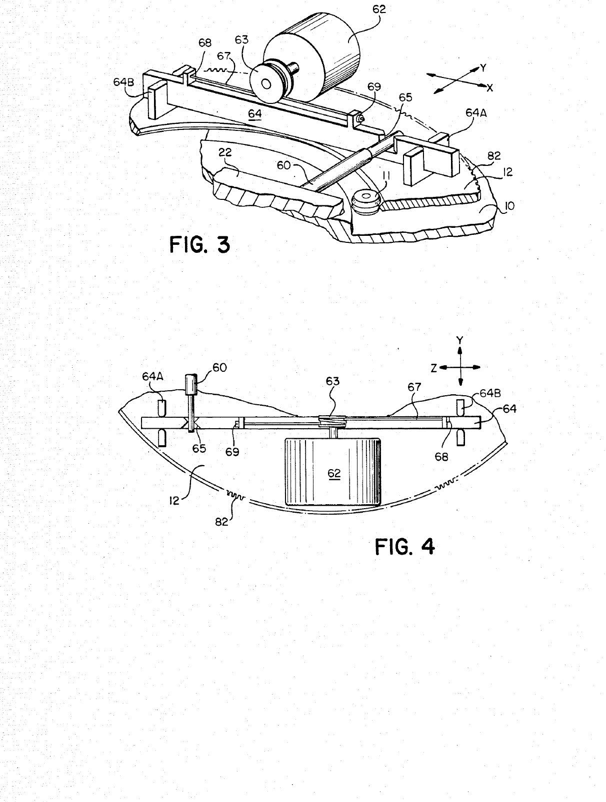

# Film handling mechanism

A four-edge gate keeps an adjustable frame registered for automatic printing.

[US4774553A · complete original PDF (11 pages)](../sources/US4774553A.pdf) · [Archival PDF source](https://patentimages.storage.googleapis.com/a3/02/b6/ebde08819cf2eb/US4774553.pdf) · [Searchable publication](https://patents.google.com/patent/US4774553A/en) · [Espacenet](https://worldwide.espacenet.com/patent/search?q=pn%3DUS4774553A)

## Original drawings

<figure>

<figcaption>Figs. 3–4. Perspective views of the film holder and pressure assembly. <a href="../sources/US4774553A.pdf#page=4">US4774553A, PDF p. 4</a>.</figcaption>
</figure>

## Publication

- **Publication** US4774553A
- **Inventors** Douglass L. Blanding, Shaun M. Amos, Thomas C. Jessop
- **Original assignee** Eastman Kodak Company
- **Priority** 1987-11-19 · **Filing** 1987-11-19 · **Publication** 1988-09-27
- **Original application** Photographic printer
- **Mechanisms** Mechanical clamping, Edge grip, Combined mechanisms

## What the patent describes

**Original problem.** A printer needed to align and rotate arbitrary frames precisely while avoiding accumulated tolerances in stacked slides.

**Operating sequence.** Film advances to a preview and reading position. A positioning assembly can shift and rotate the film in its own plane. The selected frame is clamped on four sides for printing and released for further motion.

**Film contact.** Aperture clamps meet the four margins and transport parts engage the film outside the exposure opening.

**Transverse control.** Side clamps put the borders at the printing-plane reference while preserving the selected orientation.

**Longitudinal control.** End clamps seat transverse borders along the feed axis. The primary claim is positioning flexibility, not a prescribed lengthwise strain.

## Engineering interpretation

**Advantages and limits.** One sliding interface limits tolerance accumulation while retaining adjustment. Closure and X-Y rotation still need separate control.

**Camera scanning.** A useful reference for measuring angle and offset before applying focus-related clamp pressure.

## Commercial evidence and sources

Commercial deployment of the disclosed mechanism is unverified in the sources reviewed.

## Related patents

[US4483612A · Device to position a copy master in a copying apparatus](US4483612A.md) · [EP0660170A1 · Film clamp for flattening image frames in a scanning gate](EP0660170A1.md) · [US5461492A · Film scanner with in-line dual scanning gates](US5461492A.md)

**Selected indexed prior references.** [US3953123A](https://patents.google.com/patent/US3953123A/en) · [US4452526A](https://patents.google.com/patent/US4452526A/en) · [US4545674A](https://patents.google.com/patent/US4545674A/en) · [US4575226A](https://patents.google.com/patent/US4575226A/en)

**Selected indexed later citations.** [DE4000796A1](https://patents.google.com/patent/DE4000796A1/en) · [DE4000796C2](https://patents.google.com/patent/DE4000796C2/en) · [EP0660170A1](https://patents.google.com/patent/EP0660170A1/en) · [EP0660171A1](https://patents.google.com/patent/EP0660171A1/en)

[Return to the archive](../index.md)
