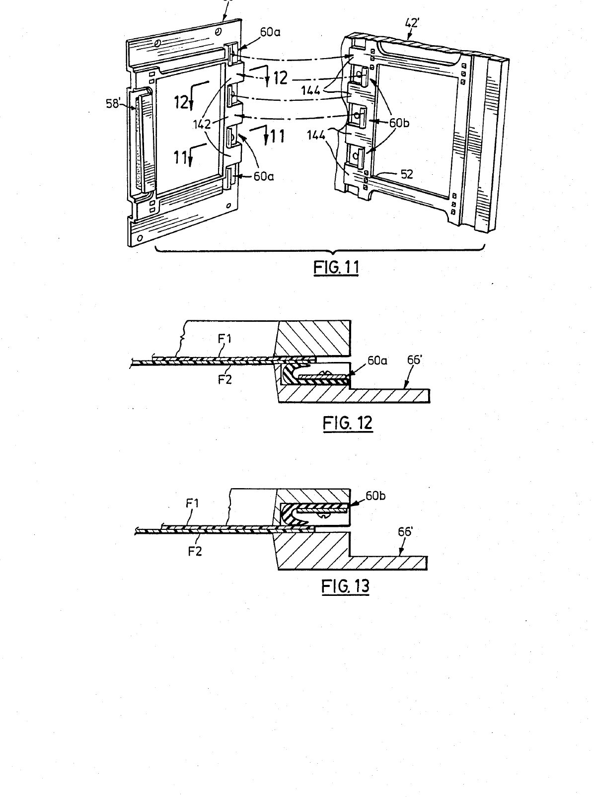
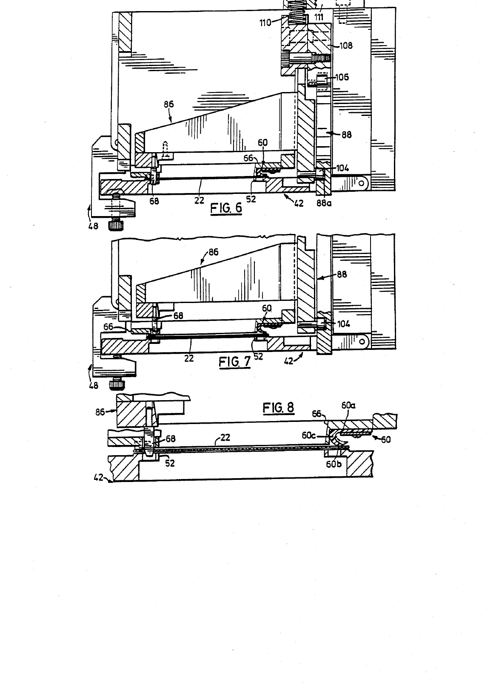

# Film transport apparatus

Registration pins anchor one edge while a curved blade progressively tensions the opposite side.

[US4835555A · complete original PDF (19 pages)](../sources/US4835555A.pdf) · [Archival PDF source](https://patentimages.storage.googleapis.com/ec/c7/6b/930a84c282c736/US4835555.pdf) · [Searchable publication](https://patents.google.com/patent/US4835555A/en) · [Espacenet](https://worldwide.espacenet.com/patent/search?q=pn%3DUS4835555A)

## Original drawings

<figure>

<figcaption>Drawing sheet. Gate components and pre-clamp and engaged views of the tensioning blade. <a href="../sources/US4835555A.pdf#page=8">US4835555A, PDF p. 8</a>.</figcaption>
</figure>
<figure>

<figcaption>Drawing sheet. Sections through the film path and registration mechanism. <a href="../sources/US4835555A.pdf#page=6">US4835555A, PDF p. 6</a>.</figcaption>
</figure>

## Publication

- **Publication** US4835555A
- **Inventors** Ian Maxwell
- **Original assignee** IMAX Systems Corporation
- **Priority** 1987-10-13 · **Filing** 1987-10-13 · **Publication** 1989-05-30
- **Original application** Contact and optical printing
- **Mechanisms** Mechanical clamping, Edge grip, Lateral tension, Combined mechanisms

## What the patent describes

**Original problem.** An optical printer needed frame registration as well as removal of cross-film bow during every exposure dwell.

**Operating sequence.** An intermittent drive positions the film. Registration pins and a pad secure one side of the optical aperture. A descending blade engages the opposite edge and applies lateral tension as it clamps. The assemblies lift before the next advance.

**Film contact.** Pins engage perforations and the pressure pad and curved blade meet opposite margins. The platen supports the gate region.

**Transverse control.** The blade draws the far side away from the fixed margin and seats it against the gate.

**Longitudinal control.** Pin registration fixes frame position along the strip. The aperture reference provides longitudinal support without a separate lengthwise stretch.

## Engineering interpretation

**Advantages and limits.** Registration and tension are coordinated but use different elements. Worn perforations can affect acquisition and repeatability.

**Camera scanning.** Separate the datum-side registration from the force applied at the opposite side. That is an alternative to symmetric edge belts.

## Commercial evidence and sources

Commercial deployment of the disclosed mechanism is unverified in the sources reviewed.

## Related patents

[US2248646A · Photographic film tensioning mechanism](US2248646A.md) · [US5028956A · Film clamp](US5028956A.md) · [US6304315B2 · High speed high resolution continuous optical film printer for duplicating motion films](US6304315B2.md)

**Selected indexed prior references.** [FR33497E](https://patents.google.com/patent/FR33497E/en) · [FR660268A](https://patents.google.com/patent/FR660268A/en) · [US2192692A](https://patents.google.com/patent/US2192692A/en) · [US3776626A](https://patents.google.com/patent/US3776626A/en)

**Selected indexed later citations.** [DE10315482A1](https://patents.google.com/patent/DE10315482A1/en) · [US20040222392A1](https://patents.google.com/patent/US20040222392A1/en) · [US5024522A](https://patents.google.com/patent/US5024522A/en) · [US5052796A](https://patents.google.com/patent/US5052796A/en)

[Return to the archive](../index.md)
