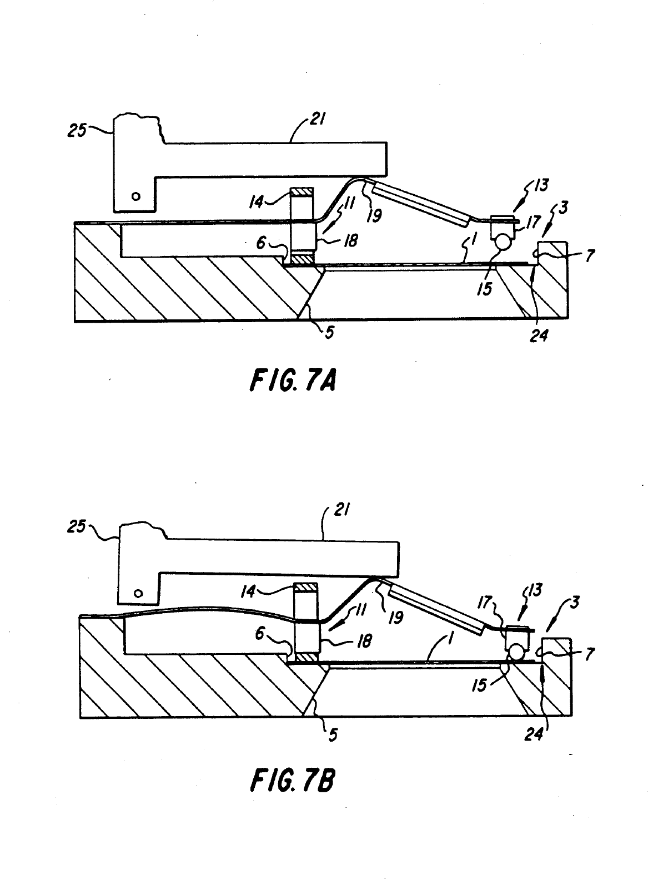
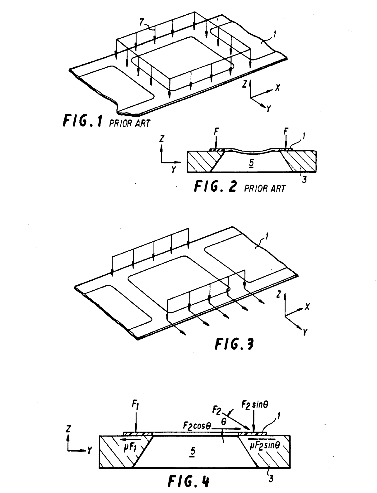
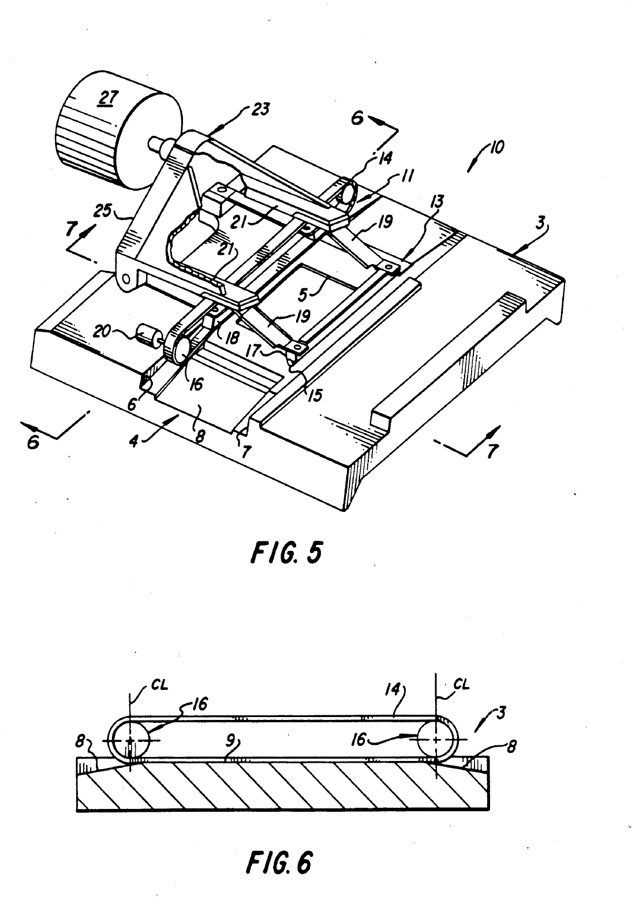

# Film clamp

One edge belt feeds and anchors the strip, then a second clamp presses down and outward.

[US5028956A · complete original PDF (7 pages)](../sources/US5028956A.pdf) · [Archival PDF source](https://patentimages.storage.googleapis.com/02/14/4c/e87900dbdbdebd/US5028956.pdf) · [Searchable publication](https://patents.google.com/patent/US5028956A/en) · [Espacenet](https://worldwide.espacenet.com/patent/search?q=pn%3DUS5028956A)

## Original drawings

<figure>

<figcaption>Figs. 7A–7B. Belt-side grip before and after the opposing cylinder engages. <a href="../sources/US5028956A.pdf#page=4">US5028956A, PDF p. 4</a>.</figcaption>
</figure>
<figure>

<figcaption>Figs. 1–4. Comparison of downward clamping alone and lateral tension across the aperture. <a href="../sources/US5028956A.pdf#page=2">US5028956A, PDF p. 2</a>.</figcaption>
</figure>
<figure>

<figcaption>Figs. 5–6. Gate assembly, drive belt and section through the transport surface. <a href="../sources/US5028956A.pdf#page=3">US5028956A, PDF p. 3</a>.</figcaption>
</figure>

## Publication

- **Publication** US5028956A
- **Inventors** Paul E. VanScooter
- **Original assignee** Eastman Kodak Company
- **Priority** 1990-10-22 · **Filing** 1990-10-22 · **Publication** 1991-07-02
- **Original application** Film scanner
- **Mechanisms** Mechanical clamping, Edge grip, Lateral tension, Combined mechanisms

## What the patent describes

**Original problem.** A scanning gate needed both to advance short film and to flatten its transverse bow when stopped.

**Operating sequence.** The belt advances film into the gate. A bell crank first lowers the tie bar against the stationary belt and seats the first margin. The far-side cylinder lands later and moves away from the anchored side. Spring arms retract the grips for the next advance.

**Film contact.** The driven belt and platen grip one long margin. The cylinder makes line contact with the opposite margin and presses it against the platen.

**Transverse control.** The press-and-outward action tensions the section across the open aperture. The patent reports 0.0010–0.0015 in flatness versus 0.004–0.006 in for its conventional comparator over a standard 35 mm image area.

**Longitudinal control.** The preferred embodiment has no end clamps. Longitudinal curl depends on long-edge support and remains an important separate test.

## Engineering interpretation

**Advantages and limits.** Combining feed and grip limits part count. Stretch depends on friction, available side clearance and grip sequencing. The measured values are applicant-reported.

**Camera scanning.** Direct precedent for the transport concept, with an asymmetric reference and one belt. Test release and end curl on individual frames before choosing the architecture.

## Commercial evidence and sources

The flatness comparison appears in the description as the applicant’s measurements. Production use of the claimed assembly is unverified.

## Related patents

[US2824491A · Film holder](US2824491A.md) · [US4835555A · Film transport apparatus](US4835555A.md) · [US5258807A · Multiformat film clamp](US5258807A.md) · [EP0660170A1 · Film clamp for flattening image frames in a scanning gate](EP0660170A1.md) · [US6002469A · Apparatus for tensioning copy masters](US6002469A.md)

**Selected indexed prior references.** [US2824491A](https://patents.google.com/patent/US2824491A/en) · [US4483612A](https://patents.google.com/patent/US4483612A/en) · [US4761675A](https://patents.google.com/patent/US4761675A/en)

**Selected indexed later citations.** [DE19743948C2](https://patents.google.com/patent/DE19743948C2/en) · [US5258807A](https://patents.google.com/patent/US5258807A/en) · [US5400117A](https://patents.google.com/patent/US5400117A/en) · [US5406352A](https://patents.google.com/patent/US5406352A/en)

[Return to the archive](../index.md)
