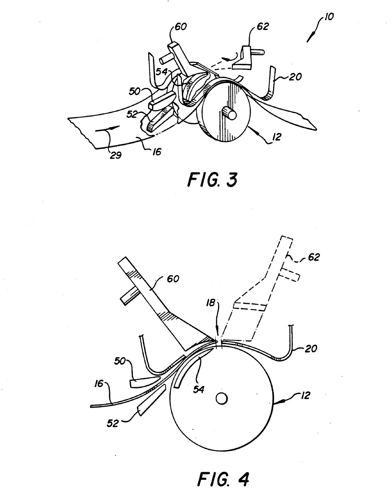
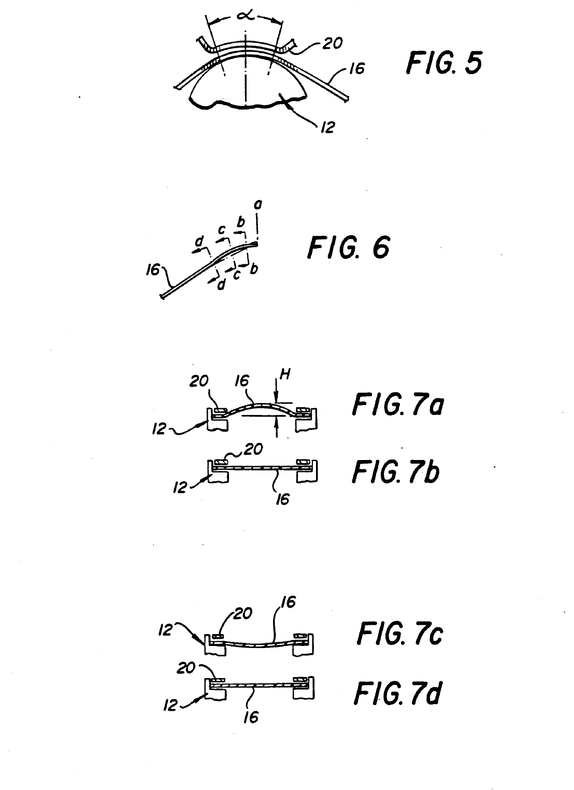

# Film scanner

Belts carry film around supports and movable guides rescue the strip ends at the scan line.

[US5088813A · complete original PDF (7 pages)](../sources/US5088813A.pdf) · [Archival PDF source](https://patentimages.storage.googleapis.com/e1/cb/5d/58d5453cebd611/US5088813.pdf) · [Searchable publication](https://patents.google.com/patent/US5088813A/en) · [Espacenet](https://worldwide.espacenet.com/patent/search?q=pn%3DUS5088813A)

## Original drawings

<figure>

<figcaption>Figs. 3–4. Roller and belt positions at the dynamic scanning gate. <a href="../sources/US5088813A.pdf#page=3">US5088813A, PDF p. 3</a>.</figcaption>
</figure>
<figure>

<figcaption>Drawing sheet. Strip-end curvature and guides near the scanning line. <a href="../sources/US5088813A.pdf#page=4">US5088813A, PDF p. 4</a>.</figcaption>
</figure>

## Publication

- **Publication** US5088813A
- **Inventors** Edward H. Wakefield
- **Original assignee** Eastman Kodak Company
- **Priority** 1990-07-27 · **Filing** 1990-07-27 · **Publication** 1992-02-18
- **Original application** Film scanner
- **Mechanisms** Edge grip, Controlled bending, Combined mechanisms

## What the patent describes

**Original problem.** The leading and trailing ends of film could lose support at the imaging line as they passed through a continuous rolling gate.

**Operating sequence.** Two belts trap margins against rollers while film moves continuously. When a short exposed end enters or leaves the support pair, movable guides engage near the light line. The film then exits without a full-frame clamp cycle.

**Film contact.** Belts engage the margins against rollers. The movable guides touch the film beside the scanning line when a film end needs support.

**Transverse control.** Across-strip curvature is constrained locally where the belts and roller support the illuminated line.

**Longitudinal control.** Roller curvature and end guides define the approach and departure shape. The complete frame is not held in a plane.

## Engineering interpretation

**Advantages and limits.** The guide sequence addresses unsupported ends and keeps motion continuous. It only needs usable focus over an illuminated line at each instant.

**Camera scanning.** Useful for transporting leading and trailing edges. Whole-frame camera capture needs an additional full-field focus test.

## Commercial evidence and sources

Commercial deployment of the disclosed mechanism is unverified in the sources reviewed.

## Related patents

[US4249821A · Belt microfilm camera](US4249821A.md) · [US5111241A · Bernoulli scan gate](US5111241A.md) · [US5461492A · Film scanner with in-line dual scanning gates](US5461492A.md) · [US6304315B2 · High speed high resolution continuous optical film printer for duplicating motion films](US6304315B2.md)

**Family publications.** [US5548328A](https://patents.google.com/patent/US5548328A/en)

**Selected indexed prior references.** [DE411914C](https://patents.google.com/patent/DE411914C/en) · [US1220195A](https://patents.google.com/patent/US1220195A/en) · [US2314027A](https://patents.google.com/patent/US2314027A/en) · [US3109924A](https://patents.google.com/patent/US3109924A/en)

**Selected indexed later citations.** [EP0690608A3](https://patents.google.com/patent/EP0690608A3/en) · [EP0849931A3](https://patents.google.com/patent/EP0849931A3/en) · [GB2481937A](https://patents.google.com/patent/GB2481937A/en) · [GB2481937B](https://patents.google.com/patent/GB2481937B/en)

[Return to the archive](../index.md)
