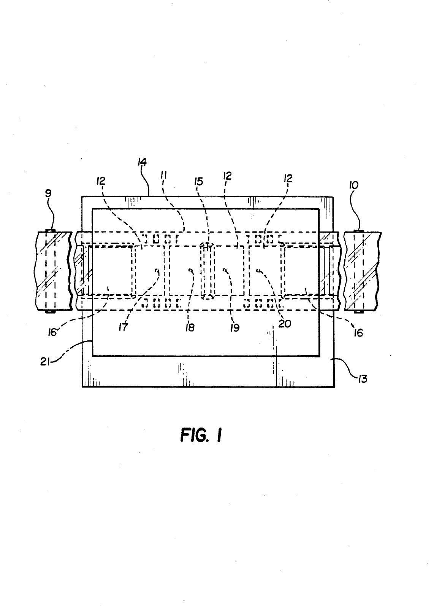
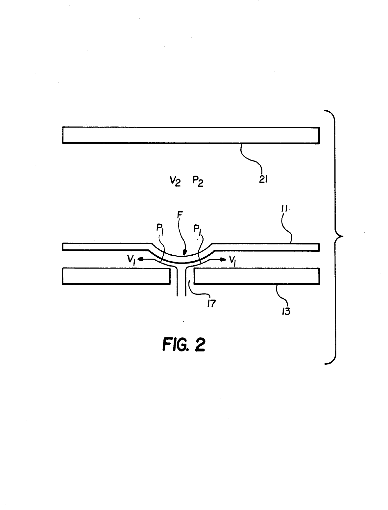

# Bernoulli scan gate

Air jets create a pressure differential and an air bearing beside a linear scan aperture.

[US5111241A · complete original PDF (7 pages)](../sources/US5111241A.pdf) · [Archival PDF source](https://patentimages.storage.googleapis.com/bf/06/1b/1fe8d2428c4a15/US5111241.pdf) · [Searchable publication](https://patents.google.com/patent/US5111241A/en) · [Espacenet](https://worldwide.espacenet.com/patent/search?q=pn%3DUS5111241A)

## Original drawings

<figure>

<figcaption>Fig. 1. Scan aperture, film path and air orifices. <a href="../sources/US5111241A.pdf#page=2">US5111241A, PDF p. 2</a>.</figcaption>
</figure>
<figure>

<figcaption>Fig. 2. Cross-section through an orifice and the upper deflector. <a href="../sources/US5111241A.pdf#page=3">US5111241A, PDF p. 3</a>.</figcaption>
</figure>

## Publication

- **Publication** US5111241A
- **Inventors** Christopher J. Kralles
- **Original assignee** Eastman Kodak Company
- **Priority** 1991-08-27 · **Filing** 1991-08-27 · **Publication** 1992-05-05
- **Original application** Photographic printer
- **Mechanisms** Pneumatic pressure or air bearing, Combined mechanisms

## What the patent describes

**Original problem.** A film or paper-backed web in a printer needed constant positioning near the measuring aperture without rubbing the platen.

**Operating sequence.** Rollers move the web beneath a deflector plate. Pressurized jets on both sides of the aperture generate fast flow under the film. The resulting pressure differential draws the web toward the platen while the air layer reduces sliding contact. The strip continues through.

**Film contact.** The scanning span is intended to ride on an air layer rather than scrape the platen. Transport rollers touch outside the optical field.

**Transverse control.** Distributed gas flow constrains the film near the illuminated width.

**Longitudinal control.** Orifices before and after the aperture stabilize the strip close to the line. The patent does not establish static planarity over a whole frame.

## Engineering interpretation

**Advantages and limits.** An unobstructed scan window is possible without broad sliding contact. Air flow, noise, dust, flutter and leaks matter with short pieces.

**Camera scanning.** A distinct test candidate for clear-aperture planarization. Measure static behavior and disturbance during jet startup and shutdown.

## Commercial evidence and sources

Commercial deployment of the disclosed mechanism is unverified in the sources reviewed.

## Related patents

[US3574460A · High-pressure gate for photographic contact printing](US3574460A.md) · [US5088813A · Film scanner](US5088813A.md) · [US6020952A · System and method for providing error-free optical scanning of images on film](US6020952A.md)

**Family publications.** [EP0601078A1](https://patents.google.com/patent/EP0601078A1/en) · [WO1993005440A1](https://patents.google.com/patent/WO1993005440A1/en)

**Selected indexed prior references.** [US3103850A](https://patents.google.com/patent/US3103850A/en) · [US3402638A](https://patents.google.com/patent/US3402638A/en) · [US3922086A](https://patents.google.com/patent/US3922086A/en) · [US3970385A](https://patents.google.com/patent/US3970385A/en)

**Selected indexed later citations.** [US20040251372A1](https://patents.google.com/patent/US20040251372A1/en) · [US5400117A](https://patents.google.com/patent/US5400117A/en) · [US5404195A](https://patents.google.com/patent/US5404195A/en) · [US5406352A](https://patents.google.com/patent/US5406352A/en)

[Return to the archive](../index.md)
