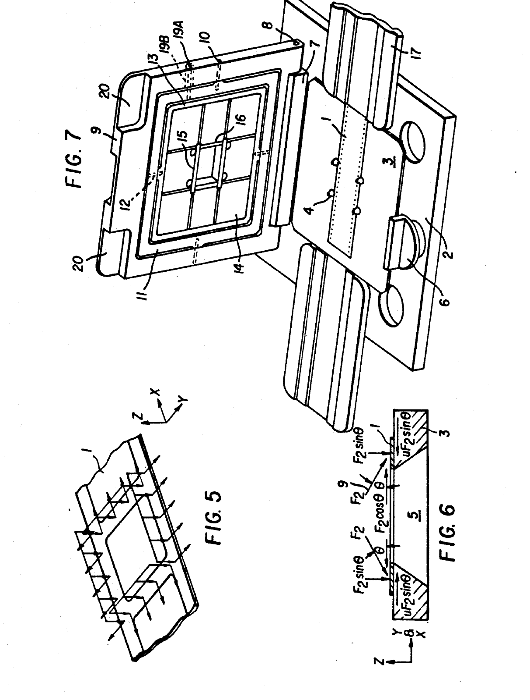
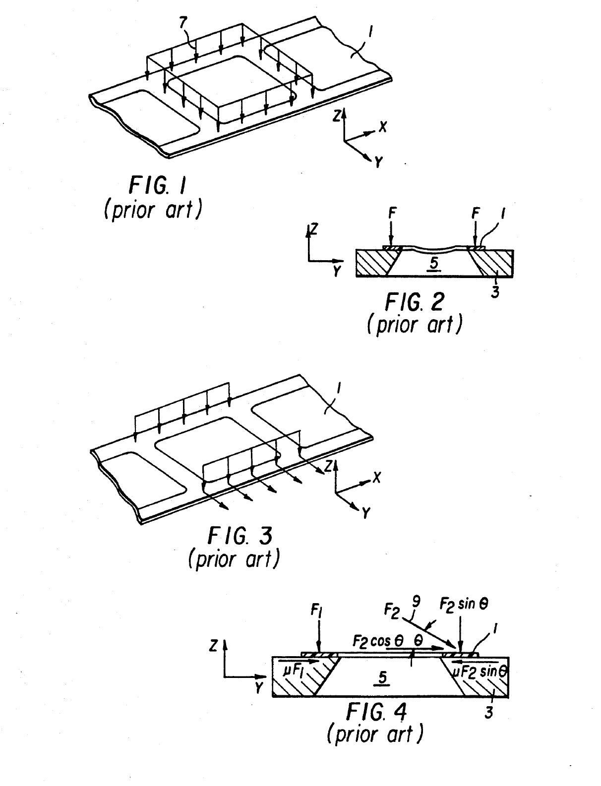

# Multiformat film clamp

A gimballed platen applies outward grip on four sides of replaceable apertures.

[US5258807A · complete original PDF (8 pages)](../sources/US5258807A.pdf) · [Archival PDF source](https://patentimages.storage.googleapis.com/66/2e/8c/ef993cf2bd53f5/US5258807.pdf) · [Searchable publication](https://patents.google.com/patent/US5258807A/en) · [Espacenet](https://worldwide.espacenet.com/patent/search?q=pn%3DUS5258807A)

## Original drawings

<figure>

<figcaption>Drawing sheet. Mechanism and replaceable apertures in exploded view. <a href="../sources/US5258807A.pdf#page=3">US5258807A, PDF p. 3</a>.</figcaption>
</figure>
<figure>

<figcaption>Figs. 1–4. The effect of outward rather than perpendicular-only gripping forces. <a href="../sources/US5258807A.pdf#page=2">US5258807A, PDF p. 2</a>.</figcaption>
</figure>

## Publication

- **Publication** US5258807A
- **Inventors** Stephen M. Reinke
- **Original assignee** Eastman Kodak Company
- **Priority** 1992-06-30 · **Filing** 1992-06-30 · **Publication** 1993-11-02
- **Original application** Film scanner
- **Mechanisms** Mechanical clamping, Lateral tension, Longitudinal tension, Combined mechanisms

## What the patent describes

**Original problem.** A scanner needed to flatten multiple film sizes while keeping the clamp face parallel to the interchangeable aperture.

**Operating sequence.** Choose the aperture inserts for the film format. Lower the platen so angled gripping strips contact the perimeter. Further closure drives them away from the center. The two-axis gimbal equalizes closure, and lifting the platen releases the film.

**Film contact.** The apertured base and strips grip the film around the image on four sides.

**Transverse control.** Angled grips on opposing long margins spread outward.

**Longitudinal control.** Angled grips at the transverse ends also spread outward, applying lengthwise tension.

## Engineering interpretation

**Advantages and limits.** Exchangeability and a gimbal help different formats seat. A short frame may have little safe material at the ends and opposing stretches can interact.

**Camera scanning.** A clear comparison to lateral-only tension. Instrument transverse and longitudinal forces individually when experimenting.

## Commercial evidence and sources

Commercial deployment of the disclosed mechanism is unverified in the sources reviewed.

## Related patents

[US1829332A · Method of and apparatus for holding photographic films in flat position during exposure](US1829332A.md) · [US5028956A · Film clamp](US5028956A.md) · [EP0660170A1 · Film clamp for flattening image frames in a scanning gate](EP0660170A1.md) · [US5406352A · Photographic film segment flattening apparatus](US5406352A.md)

**Selected indexed prior references.** [CA685196A](https://patents.google.com/patent/CA685196A/en) · [GB336842A](https://patents.google.com/patent/GB336842A/en) · [US2110475A](https://patents.google.com/patent/US2110475A/en) · [US2174020A](https://patents.google.com/patent/US2174020A/en)

**Selected indexed later citations.** [GB2306019A](https://patents.google.com/patent/GB2306019A/en) · [GB2306019B](https://patents.google.com/patent/GB2306019B/en) · [US20020171808A1](https://patents.google.com/patent/US20020171808A1/en) · [US20040179169A1](https://patents.google.com/patent/US20040179169A1/en)

[Return to the archive](../index.md)
