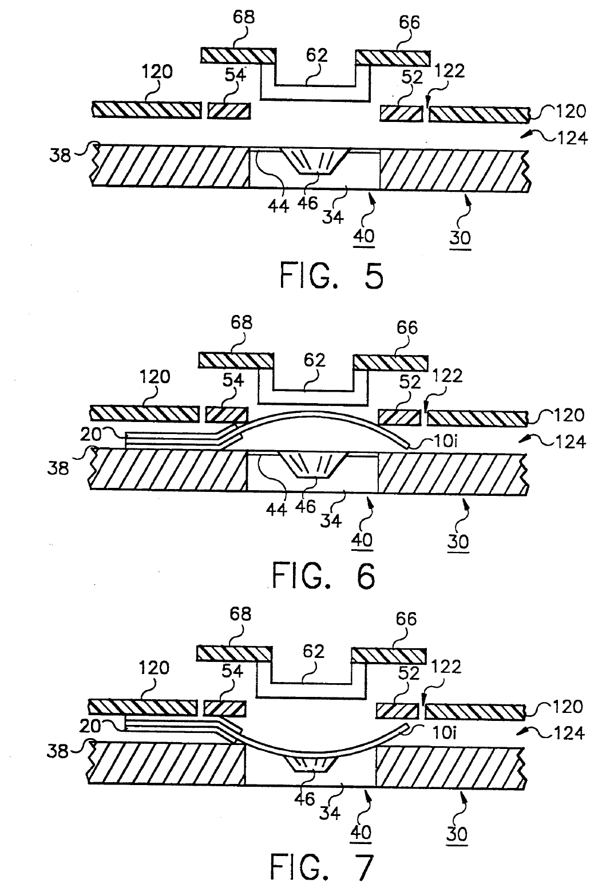
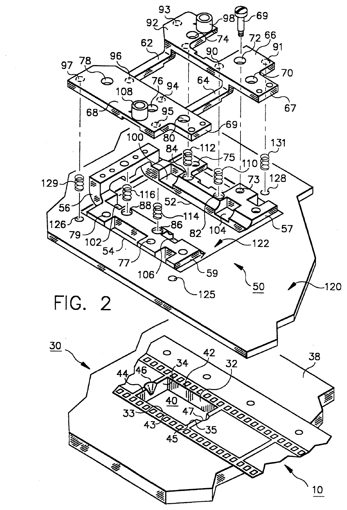

# Photographic film segment flattening apparatus

Two coordinated gate members flatten curled negative segments carried by a side tow web.

[US5406352A · complete original PDF (16 pages)](../sources/US5406352A.pdf) · [Archival PDF source](https://patentimages.storage.googleapis.com/cd/10/ce/62d55a0af9185a/US5406352.pdf) · [Searchable publication](https://patents.google.com/patent/US5406352A/en) · [Espacenet](https://worldwide.espacenet.com/patent/search?q=pn%3DUS5406352A)

## Original drawings

<figure>

<figcaption>Figs. 5–7. Sections through the feed gap and clamping members at different states. <a href="../sources/US5406352A.pdf#page=5">US5406352A, PDF p. 5</a>.</figcaption>
</figure>
<figure>

<figcaption>Fig. 2. Exploded view of the web-fed flattening assembly. <a href="../sources/US5406352A.pdf#page=3">US5406352A, PDF p. 3</a>.</figcaption>
</figure>

## Publication

- **Publication** US5406352A
- **Inventors** Christopher J. Kralles, Thomas C. Jessop
- **Original assignee** Eastman Kodak Company
- **Priority** 1993-12-14 · **Filing** 1993-12-14 · **Publication** 1995-04-11
- **Original application** Photographic printer
- **Mechanisms** Mechanical clamping, Edge grip, Lateral tension, Combined mechanisms

## What the patent describes

**Original problem.** High end curl in a tow-web negative segment could stub into the gate, preventing reliable automatic printing.

**Operating sequence.** The attached web indexes the segment through a gap with the clamps raised. Opposed transverse and longitudinal members then close against the base at the exposure opening. The geometry addresses upward-curled leading ends and reduces the chance of a strip catching the moving clamp.

**Film contact.** The web attaches beside the film. Clamping elements meet margins near the image and the stationary base carries the opposing contact.

**Transverse control.** Long-edge clamping elements establish the transverse plane. The patent includes configurations applying lateral force at the longitudinal edge.

**Longitudinal control.** End clamps bear down at the transverse borders. The tow web is part of transport and registration.

## Engineering interpretation

**Advantages and limits.** The system treats entry clearance as an explicit problem, valuable for strong end curl. It relies on a side-attached web and coordinated edge geometry.

**Camera scanning.** Use the swept clearance of every moving part as a design variable. Test curled ends in the fully retracted and partly closing states.

## Commercial evidence and sources

Commercial deployment of the disclosed mechanism is unverified in the sources reviewed.

## Related patents

[US4483612A · Device to position a copy master in a copying apparatus](US4483612A.md) · [US4774553A · Film handling mechanism](US4774553A.md) · [EP0660170A1 · Film clamp for flattening image frames in a scanning gate](EP0660170A1.md) · [US5822045A · Filmstrip holding apparatus and method](US5822045A.md)

**Family publications.** [EP0660171A1](https://patents.google.com/patent/EP0660171A1/en)

**Selected indexed prior references.** [US2199305A](https://patents.google.com/patent/US2199305A/en) · [US2251184A](https://patents.google.com/patent/US2251184A/en) · [US3288027A](https://patents.google.com/patent/US3288027A/en) · [US3488120A](https://patents.google.com/patent/US3488120A/en)

**Selected indexed later citations.** [US20080262523A1](https://patents.google.com/patent/US20080262523A1/en) · [US20120313273A1](https://patents.google.com/patent/US20120313273A1/en) · [US5519442A](https://patents.google.com/patent/US5519442A/en) · [US5644120A](https://patents.google.com/patent/US5644120A/en)

[Return to the archive](../index.md)
