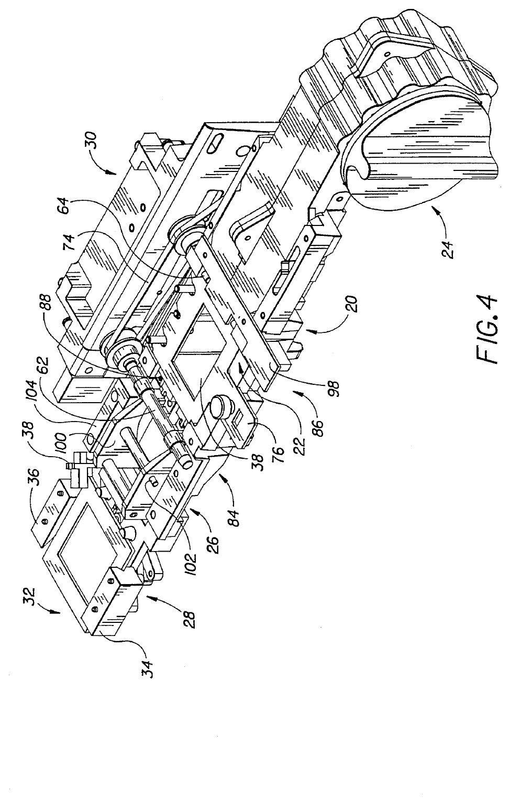
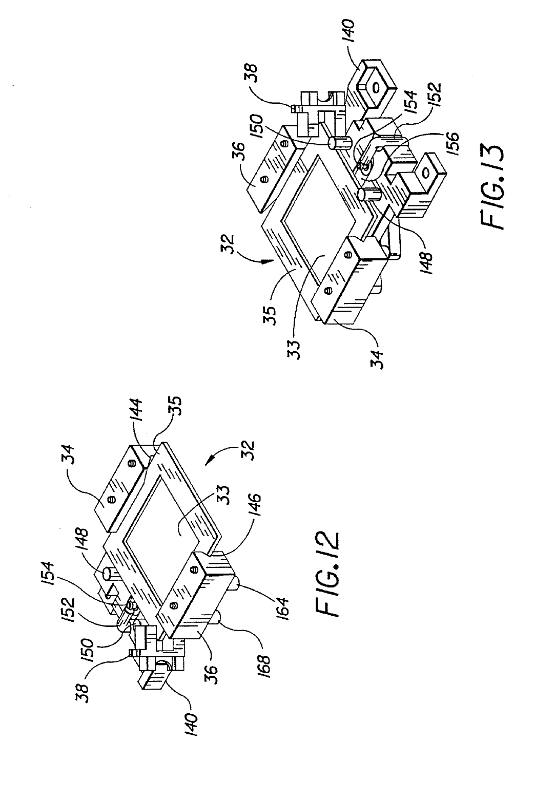

# Film scanner with in-line dual scanning gates

A dual optical gate pre-scans moving film, then holds it for slow high-resolution sampling.

[US5461492A · complete original PDF (27 pages)](../sources/US5461492A.pdf) · [Archival PDF source](https://patentimages.storage.googleapis.com/6e/70/b7/78a3dc6fa36083/US5461492.pdf) · [Searchable publication](https://patents.google.com/patent/US5461492A/en) · [Espacenet](https://worldwide.espacenet.com/patent/search?q=pn%3DUS5461492A)

## Original drawings

<figure>

<figcaption>Fig. 4. Perspective view of the scanning gate and adjacent mechanisms. <a href="../sources/US5461492A.pdf#page=5">US5461492A, PDF p. 5</a>.</figcaption>
</figure>
<figure>

<figcaption>Drawing sheet. Views of the light path and gate assembly. <a href="../sources/US5461492A.pdf#page=13">US5461492A, PDF p. 13</a>.</figcaption>
</figure>

## Publication

- **Publication** US5461492A
- **Inventors** Robert S. Jones
- **Original assignee** Eastman Kodak Company
- **Priority** 1994-02-16 · **Filing** 1994-02-16 · **Publication** 1995-10-24
- **Original application** Film scanner
- **Mechanisms** Mechanical clamping, Edge grip, Combined mechanisms

## What the patent describes

**Original problem.** A scanner needed both rapid frame identification and precise main scanning, with a common optical station for negatives and slides.

**Operating sequence.** Feed a negative to a pre-positioning stage. Advance it through the apertures for a low-resolution scan. Reverse to locate the frame, clamp and translate the gate as a unit, and route the completed strip out through a diverter.

**Film contact.** Rollers and guides feed the strip. The selected aperture's clamp meets the film at the gate and a separate gate handles slides.

**Transverse control.** The strip gate clamps the frame to its optical reference for the main scan.

**Longitudinal control.** The clamp keeps the selected portion stationary relative to the gate while the gate translates. The patent's focus is path orchestration and two different scan speeds.

## Engineering interpretation

**Advantages and limits.** Parallel preparation improves throughput and the reverse move decouples finding a frame from sampling it. It adds drives and handoff states.

**Camera scanning.** Use an inexpensive preview to find image boundaries before entering an exposure-only clamp cycle.

## Commercial evidence and sources

Commercial deployment of the disclosed mechanism is unverified in the sources reviewed.

## Related patents

[US4774553A · Film handling mechanism](US4774553A.md) · [US5088813A · Film scanner](US5088813A.md) · [EP0660170A1 · Film clamp for flattening image frames in a scanning gate](EP0660170A1.md) · [US7106480B2 · Film scanning device](US7106480B2.md)

**Selected indexed prior references.** [US3644038A](https://patents.google.com/patent/US3644038A/en) · [US4858003A](https://patents.google.com/patent/US4858003A/en) · [US5093734A](https://patents.google.com/patent/US5093734A/en) · [US5111241A](https://patents.google.com/patent/US5111241A/en)

**Selected indexed later citations.** [AU2006296787B2](https://patents.google.com/patent/AU2006296787B2/en) · [CN113055542A](https://patents.google.com/patent/CN113055542A/en) · [CN120378545A](https://patents.google.com/patent/CN120378545A/en) · [DE19805048A1](https://patents.google.com/patent/DE19805048A1/en)

[Return to the archive](../index.md)
