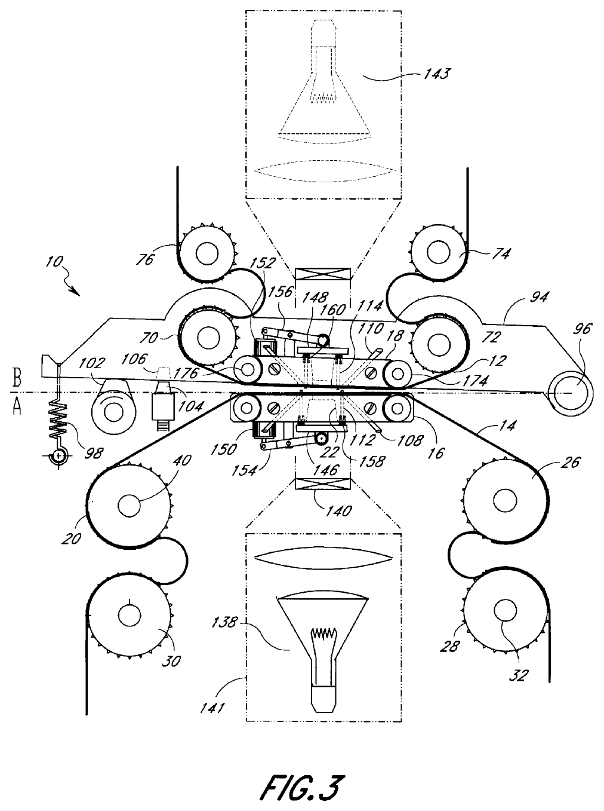

# Asynchronous contact printer for motion picture film

An intermittent contact printer brings independently indexed film formats together during each exposure.

[US5812245A · complete original PDF (18 pages)](../sources/US5812245A.pdf) · [Archival PDF source](https://patentimages.storage.googleapis.com/58/ef/ec/c514cd8adc2fc2/US5812245.pdf) · [Searchable publication](https://patents.google.com/patent/US5812245A/en) · [Espacenet](https://worldwide.espacenet.com/patent/search?q=pn%3DUS5812245A)

## Original drawings

<figure>

<figcaption>Fig. 3. Separate film paths brought together around the exposure region. <a href="../sources/US5812245A.pdf#page=5">US5812245A, PDF p. 5</a>.</figcaption>
</figure>

## Publication

- **Publication** US5812245A
- **Inventors** Dean K. Goodhill, Don P. Behrns
- **Original assignee** Individual
- **Priority** 1996-03-26 · **Filing** 1996-03-26 · **Publication** 1998-09-22
- **Original application** Contact and optical printing
- **Mechanisms** Pneumatic pressure or air bearing, Mechanical clamping, Combined mechanisms

## What the patent describes

**Original problem.** Copying between incompatible perforation pitches required independent advance followed by stable contact during each exposure.

**Operating sequence.** Two drives advance original and copy in different perforation increments. The films are held in intimate contact at the gate while stopped for exposure, then separated sufficiently to advance independently.

**Film contact.** The two films meet across the image. The gate and its pressure surfaces establish the position of the stack when stopped.

**Transverse control.** The gate applies pressure across the image width to control layer separation.

**Longitudinal control.** Aperture contact establishes the local along-film plane. Separate drives control pitch and registration rather than applying a flattening stretch.

## Engineering interpretation

**Advantages and limits.** Independent pitch supports copying between formats. Two film paths and accurate timing add complexity.

**Camera scanning.** Its separation and reconvergence sequence illustrates how to decouple positioning from the capture contact state.

## Commercial evidence and sources

Commercial deployment of the disclosed mechanism is unverified in the sources reviewed.

## Related patents

[US2357707A · Film gate pressure pad](US2357707A.md) · [US3574460A · High-pressure gate for photographic contact printing](US3574460A.md) · [US6304315B2 · High speed high resolution continuous optical film printer for duplicating motion films](US6304315B2.md)

**Selected indexed prior references.** [US1318610A](https://patents.google.com/patent/US1318610A/en) · [US1835743A](https://patents.google.com/patent/US1835743A/en) · [US1921494A](https://patents.google.com/patent/US1921494A/en) · [US1999754A](https://patents.google.com/patent/US1999754A/en)

**Selected indexed later citations.** [US20020122166A1](https://patents.google.com/patent/US20020122166A1/en) · [US20040004705A9](https://patents.google.com/patent/US20040004705A9/en) · [US20060033881A1](https://patents.google.com/patent/US20060033881A1/en) · [US6202727B1](https://patents.google.com/patent/US6202727B1/en)

[Return to the archive](../index.md)
