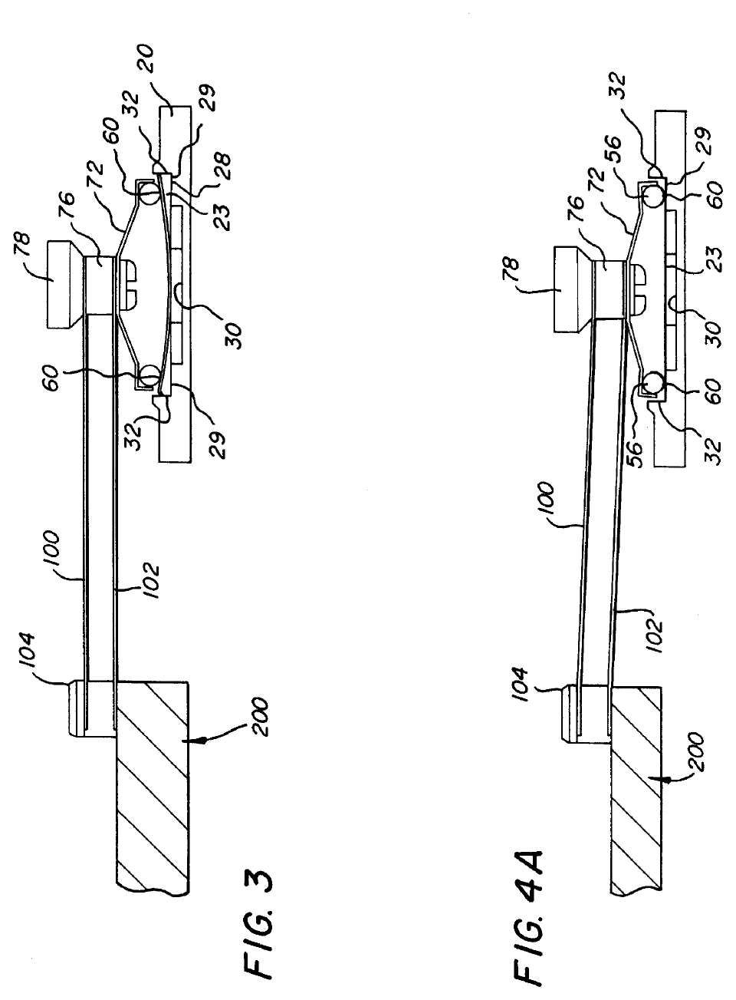
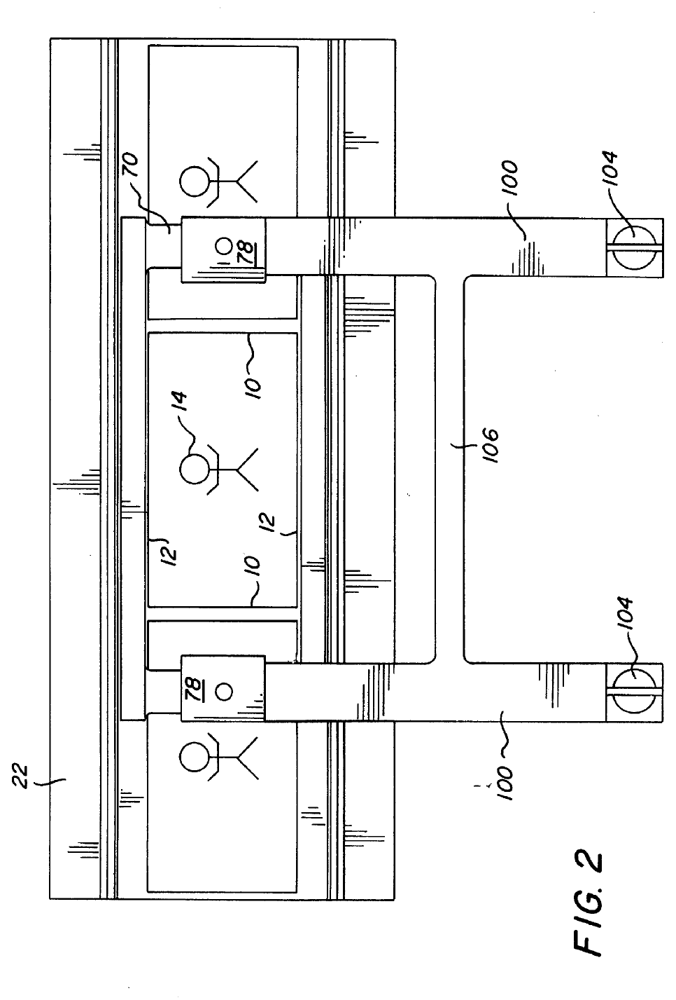

# Filmstrip holding apparatus and method

Long opposed strips capture margins beyond the aperture while leaving strong end curl clearance during travel.

[US5822045A · complete original PDF (13 pages)](../sources/US5822045A.pdf) · [Archival PDF source](https://patentimages.storage.googleapis.com/23/b4/7a/e553c2c8be6e4d/US5822045.pdf) · [Searchable publication](https://patents.google.com/patent/US5822045A/en) · [Espacenet](https://worldwide.espacenet.com/patent/search?q=pn%3DUS5822045A)

## Original drawings

<figure>

<figcaption>Figs. 3–4A. Raised and lowered states of the supported edge clamp. <a href="../sources/US5822045A.pdf#page=4">US5822045A, PDF p. 4</a>.</figcaption>
</figure>
<figure>

<figcaption>Fig. 2. Plan view of the strip channel and longitudinal rail contact region. <a href="../sources/US5822045A.pdf#page=3">US5822045A, PDF p. 3</a>.</figcaption>
</figure>

## Publication

- **Publication** US5822045A
- **Inventors** Gary Lee Erck
- **Original assignee** Eastman Kodak Company
- **Priority** 1995-08-24 · **Filing** 1996-03-15 · **Publication** 1998-10-13
- **Original application** Film scanner
- **Mechanisms** Mechanical clamping, Edge grip, Lateral tension, Combined mechanisms

## What the patent describes

**Original problem.** Strongly curled strips could strike the scanning aperture or bow during scan if guide and clamp clearance were inadequate.

**Operating sequence.** The film feeds along a channel under a raised pair of elongated clamps. They descend on both margins, optionally tensioning laterally. Raise the members to restore the travel gap. They extend past the imaged span to stabilize the edge supports.

**Film contact.** The elongated members and channel bottom grip long side portions. Preferred operation leaves the transverse end borders free of lateral clamping members.

**Transverse control.** Long contact and optional outward movement reduce transverse curl while the optical aperture remains clear.

**Longitudinal control.** The extended contact spans beyond the frame but acts on the long edges. There is no independent longitudinal pull or end clamp.

## Engineering interpretation

**Advantages and limits.** A wide rest gap accepts curly strips. The edge engagement length can exceed available film on one-frame samples.

**Camera scanning.** Tests whether sufficiently long compliant edge grip can control a frame without end contacts and where that approach fails on choppy cut ends.

## Commercial evidence and sources

The specification names Kodak’s PIW Model 2400 as an example of the preceding workflow. This establishes what the applicant reported about the context. Adoption of this patent’s elongated clamps in that machine is unverified.

## Related patents

[US5028956A · Film clamp](US5028956A.md) · [EP0660170A1 · Film clamp for flattening image frames in a scanning gate](EP0660170A1.md) · [US5406352A · Photographic film segment flattening apparatus](US5406352A.md) · [US6002469A · Apparatus for tensioning copy masters](US6002469A.md)

**Selected indexed prior references.** [US1870091A](https://patents.google.com/patent/US1870091A/en) · [US4241987A](https://patents.google.com/patent/US4241987A/en) · [US4410254A](https://patents.google.com/patent/US4410254A/en) · [US4483612A](https://patents.google.com/patent/US4483612A/en)

**Selected indexed later citations.** [US20090167853A1](https://patents.google.com/patent/US20090167853A1/en) · [US20090167854A1](https://patents.google.com/patent/US20090167854A1/en) · [US20090257096A1](https://patents.google.com/patent/US20090257096A1/en) · [US6268901B1](https://patents.google.com/patent/US6268901B1/en)

[Return to the archive](../index.md)
