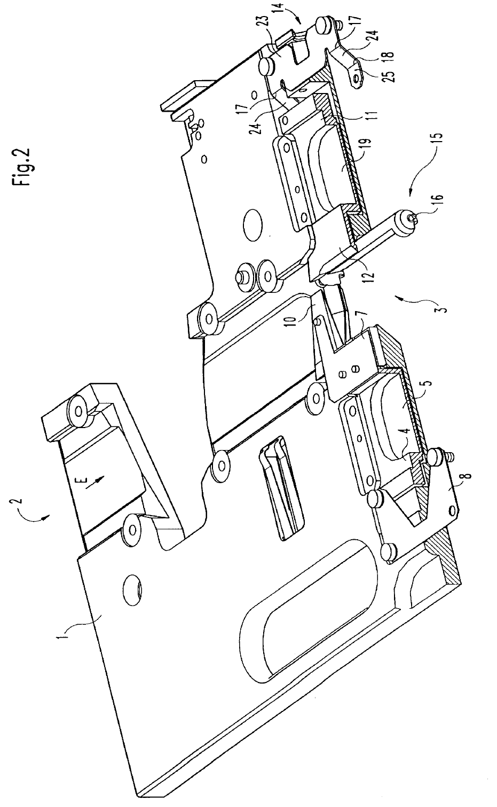
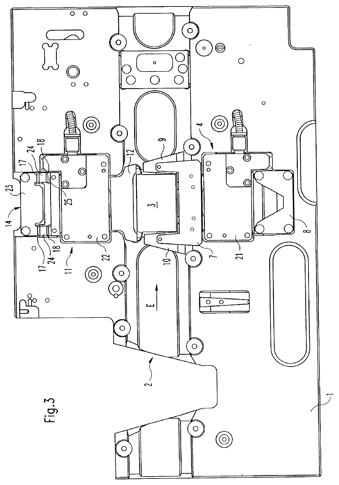

# Apparatus for tensioning copy masters

A moving counter-bearing carries one film margin laterally so it need not slide on a stationary base.

[US6002469A · complete original PDF (7 pages)](../sources/US6002469A.pdf) · [Archival PDF source](https://patentimages.storage.googleapis.com/e6/3e/1d/66b275e3cc2608/US6002469.pdf) · [Searchable publication](https://patents.google.com/patent/US6002469A/en) · [Espacenet](https://worldwide.espacenet.com/patent/search?q=pn%3DUS6002469A)

## Original drawings

<figure>

<figcaption>Fig. 2. Copy platen, clamp and moving counter-bearing arrangement. <a href="../sources/US6002469A.pdf#page=3">US6002469A, PDF p. 3</a>.</figcaption>
</figure>
<figure>

<figcaption>Fig. 3. Assembly viewed toward the plane of the copy platen. <a href="../sources/US6002469A.pdf#page=4">US6002469A, PDF p. 4</a>.</figcaption>
</figure>

## Publication

- **Publication** US6002469A
- **Inventors** Bernhard Lorenz, Georg Kurzmaier
- **Original assignee** Agfa-Gevaert AG
- **Priority** 1997-10-04 · **Filing** 1998-09-30 · **Publication** 1999-12-14
- **Original application** Photographic printer
- **Mechanisms** Mechanical clamping, Edge grip, Lateral tension, Combined mechanisms

## What the patent describes

**Original problem.** A tensioning grip that slid the copy master against a fixed platen depended on a friction difference that dirt could change.

**Operating sequence.** Feed the copy master over the platen. The press-on member grips one margin against a movable counter-bearing and the opposite side is fixed. Outward load shifts the film and bearing together. Reopen the clamps before transport.

**Film contact.** The gripping rail and counter-bearing roller contact opposite faces at the moving margin. The other margin and ends may be clamped against the platen.

**Transverse control.** A laterally movable bearing or roller turns the clamp's displacement into film tension with less sliding at the base.

**Longitudinal control.** Transverse legs can press the end regions against the platen. The main inventive force is across the film.

## Engineering interpretation

**Advantages and limits.** Lower bearing resistance addresses friction variability in fixed-platen tensioners. The mechanism adds bearings and sensitive contact alignment.

**Camera scanning.** A reference for testing co-moving film supports and grip materials in an edge-belt or flanking-gripper design.

## Commercial evidence and sources

Commercial deployment of the disclosed mechanism is unverified in the sources reviewed.

## Related patents

[US5028956A · Film clamp](US5028956A.md) · [US5258807A · Multiformat film clamp](US5258807A.md) · [EP0660170A1 · Film clamp for flattening image frames in a scanning gate](EP0660170A1.md) · [US5822045A · Filmstrip holding apparatus and method](US5822045A.md)

**Selected indexed prior references.** [US2959096A](https://patents.google.com/patent/US2959096A/en) · [US4175858A](https://patents.google.com/patent/US4175858A/en) · [US5028956A](https://patents.google.com/patent/US5028956A/en)

**Selected indexed later citations.** [US20070295612A1](https://patents.google.com/patent/US20070295612A1/en) · [US20080000778A1](https://patents.google.com/patent/US20080000778A1/en)

[Return to the archive](../index.md)
