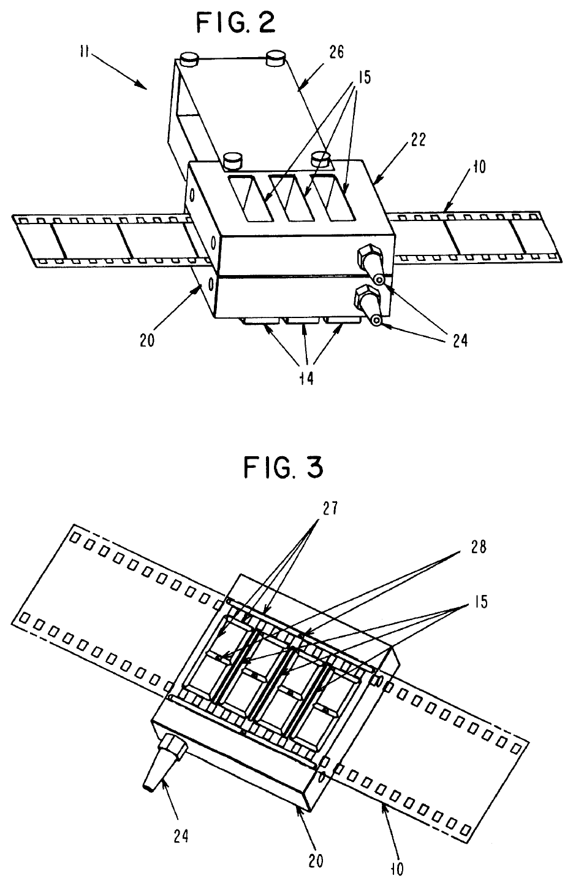

# System and method for providing error-free optical scanning of images on film

Opposed air-bearing plates maintain film position around an optical scanning window.

[US6020952A · complete original PDF (10 pages)](../sources/US6020952A.pdf) · [Archival PDF source](https://patentimages.storage.googleapis.com/77/13/c3/84967792c166f9/US6020952.pdf) · [Searchable publication](https://patents.google.com/patent/US6020952A/en) · [Espacenet](https://worldwide.espacenet.com/patent/search?q=pn%3DUS6020952A)

## Original drawings

<figure>

<figcaption>Figs. 2–3. Air-bearing plates, film passage and scanning aperture. <a href="../sources/US6020952A.pdf#page=3">US6020952A, PDF p. 3</a>.</figcaption>
</figure>

## Publication

- **Publication** US6020952A
- **Inventors** Thomas Mario Cipolla, Janusz Stanislaw Wilczynski
- **Original assignee** International Business Machines Corporation
- **Priority** 1997-05-05 · **Filing** 1997-05-05 · **Publication** 2000-02-01
- **Original application** Film scanner
- **Mechanisms** Pneumatic pressure or air bearing, Combined mechanisms

## What the patent describes

**Original problem.** Continuous optical scanning needed stable image distance without leaving abrasive contact or contamination in the scanning zone.

**Operating sequence.** Advance film into a passage between two air-bearing plates. The opposed cushions hold the film at a consistent distance while an aperture or optical-fiber array provides scan access. The film passes out continuously.

**Film contact.** Drive components contact the film outside the air-bearing span. In the intended scanning zone the pressure cushions separate film from the plates.

**Transverse control.** The opposed pressure fields support the web across the scan width.

**Longitudinal control.** The passage constrains film along the working span. The document describes continual movement, rather than securing a stopped single frame with cut ends.

## Engineering interpretation

**Advantages and limits.** Opposed cushions can reduce broad contact and contamination. Gas balance and edge leakage will vary with the shape and size of disconnected samples.

**Camera scanning.** Compare two-sided pressure control against a one-sided Bernoulli gate and check whether the window still works when a frame is stationary.

## Commercial evidence and sources

Commercial deployment of the disclosed mechanism is unverified in the sources reviewed.

## Related patents

[US5111241A · Bernoulli scan gate](US5111241A.md) · [US3574460A · High-pressure gate for photographic contact printing](US3574460A.md) · [US5088813A · Film scanner](US5088813A.md)

**Selected indexed prior references.** [NL6406851A](https://patents.google.com/patent/NL6406851A/en) · [US3081682A](https://patents.google.com/patent/US3081682A/en) · [US3103850A](https://patents.google.com/patent/US3103850A/en) · [US4226526A](https://patents.google.com/patent/US4226526A/en)

**Selected indexed later citations.** [EP2320191A1](https://patents.google.com/patent/EP2320191A1/en) · [US20030123107A1](https://patents.google.com/patent/US20030123107A1/en) · [US20110107818A1](https://patents.google.com/patent/US20110107818A1/en) · [US8561455B2](https://patents.google.com/patent/US8561455B2/en)

[Return to the archive](../index.md)
