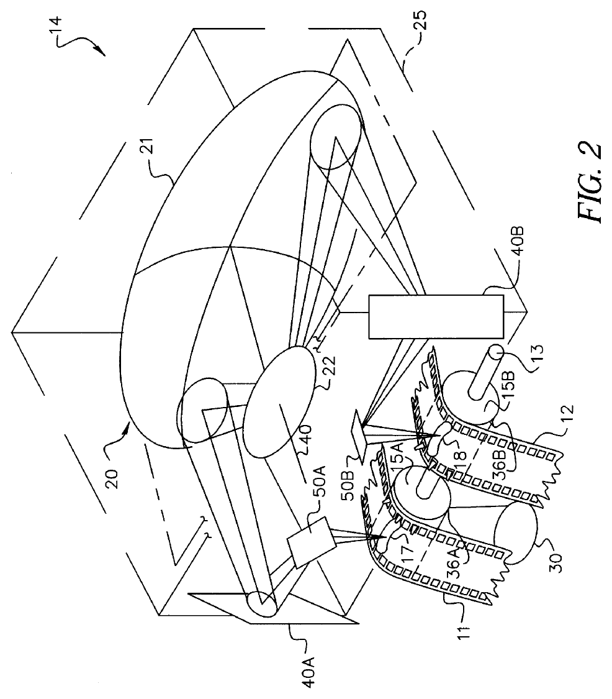
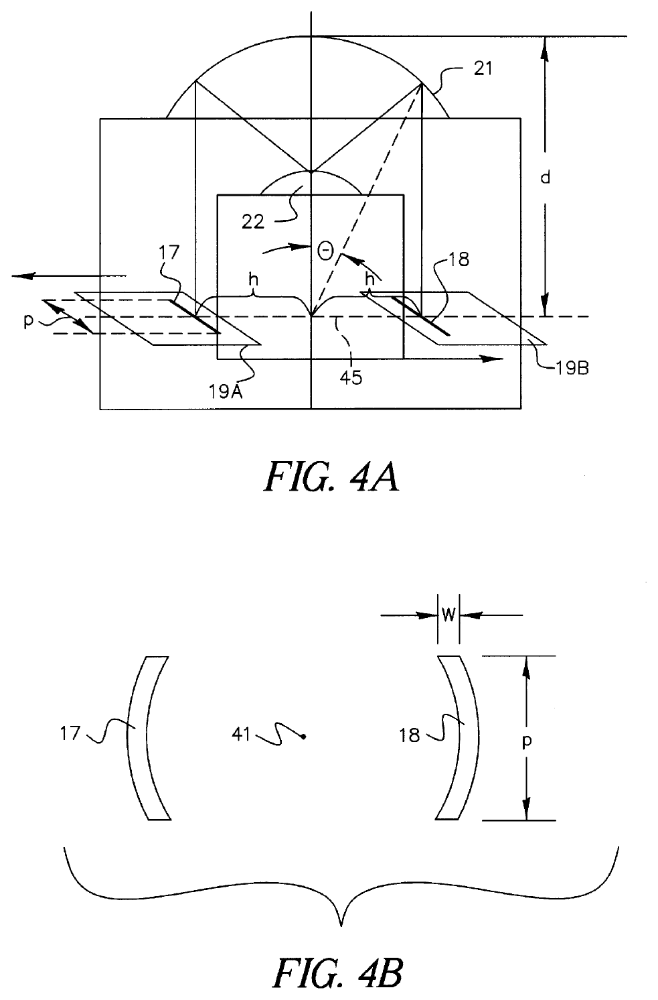

# High speed high resolution continuous optical film printer for duplicating motion films

Two films travel side by side around a shared shaft and meet conjugate optical lines.

[US6304315B2 · complete original PDF (10 pages)](../sources/US6304315B2.pdf) · [Archival PDF source](https://patentimages.storage.googleapis.com/ed/c3/db/ae2dd4ed3a6fb4/US6304315.pdf) · [Searchable publication](https://patents.google.com/patent/US6304315B2/en) · [Espacenet](https://worldwide.espacenet.com/patent/search?q=pn%3DUS6304315B2)

## Original drawings

<figure>

<figcaption>Fig. 2. Printer geometry and shared film transport shaft. <a href="../sources/US6304315B2.pdf#page=3">US6304315B2, PDF p. 3</a>.</figcaption>
</figure>
<figure>

<figcaption>Figs. 4A–4B. The scanning and exposure lines and their optical relationship. <a href="../sources/US6304315B2.pdf#page=5">US6304315B2, PDF p. 5</a>.</figcaption>
</figure>

## Publication

- **Publication** US6304315B2
- **Inventors** David Kessler, David H. Kirkpatrick
- **Original assignee** Eastman Kodak Company
- **Priority** 1999-08-31 · **Filing** 1999-08-31 · **Publication** 2001-10-16
- **Original application** Contact and optical printing
- **Mechanisms** Controlled bending, Edge grip, Combined mechanisms

## What the patent describes

**Original problem.** High-resolution cine duplication needed synchronized film travel, optical registration and low flare at continuous throughput.

**Operating sequence.** Negative and positive stock advance synchronously on the same transport shaft, with a narrow illuminated strip projected from one to the other. The films leave the shaft continuously after exposure.

**Film contact.** Transport components and the shaft support surfaces touch the film. The imaging path keeps negative and print stock separate.

**Transverse control.** Across-film shape is constrained locally by the shaft and support geometry where the narrow lines pass.

**Longitudinal control.** A prescribed wrap defines the surface along travel. The image is projected line by line across the curved support.

## Engineering interpretation

**Advantages and limits.** A shared kinematic reference can stabilize synchronous imaging, but assumes uninterrupted stock and a scanning exposure.

**Camera scanning.** Use shared drive geometry as a reference for transport synchronization. It provides no direct guarantee of area-camera focus over a flat 35 mm frame.

## Commercial evidence and sources

Commercial deployment of the disclosed mechanism is unverified in the sources reviewed.

## Related patents

[US4835555A · Film transport apparatus](US4835555A.md) · [US5088813A · Film scanner](US5088813A.md) · [EP0588308B1 · Clamping arrangement for film scanning apparatus](EP0588308B1.md) · [US5812245A · Asynchronous contact printer for motion picture film](US5812245A.md)

**Selected indexed prior references.** [US1752753A](https://patents.google.com/patent/US1752753A/en) · [US1789112A](https://patents.google.com/patent/US1789112A/en) · [US1801450A](https://patents.google.com/patent/US1801450A/en) · [US1836038A](https://patents.google.com/patent/US1836038A/en)

**Selected indexed later citations.** [US20040218162A1](https://patents.google.com/patent/US20040218162A1/en) · [US20060209277A1](https://patents.google.com/patent/US20060209277A1/en) · [US20080055578A1](https://patents.google.com/patent/US20080055578A1/en) · [US20100208319A1](https://patents.google.com/patent/US20100208319A1/en)

[Return to the archive](../index.md)
