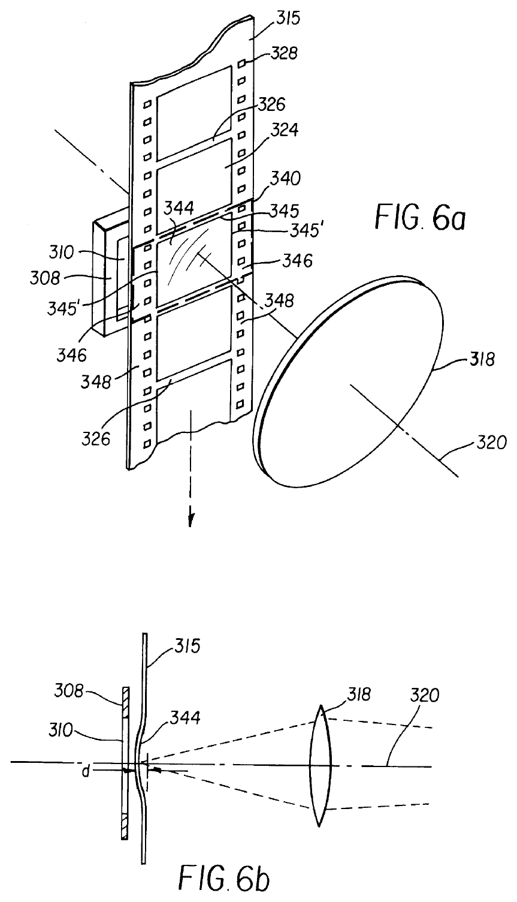
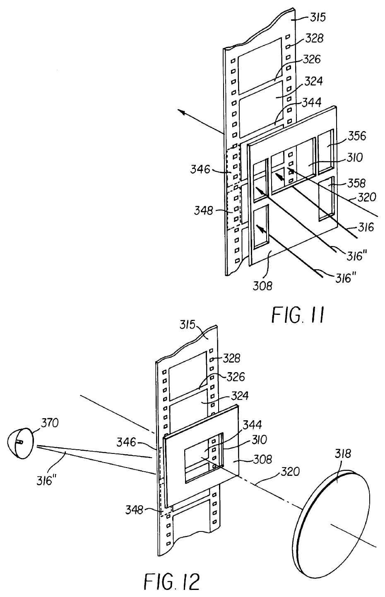

# Motion picture film projector illumination system for minimizing film buckle

Projector optics redirect unused light toward film margins to reduce heat-driven buckling.

[US6501530B2 · complete original PDF (21 pages)](../sources/US6501530B2.pdf) · [Archival PDF source](https://patentimages.storage.googleapis.com/02/4c/c7/13e27730286e74/US6501530.pdf) · [Searchable publication](https://patents.google.com/patent/US6501530B2/en) · [Espacenet](https://worldwide.espacenet.com/patent/search?q=pn%3DUS6501530B2)

## Original drawings

<figure>

<figcaption>Figs. 6A–6B. Exploded and side views of gate and film buckle. <a href="../sources/US6501530B2.pdf#page=7">US6501530B2, PDF p. 7</a>.</figcaption>
</figure>
<figure>

<figcaption>Figs. 11–12. Aperture alternatives and optical treatment of film edges. <a href="../sources/US6501530B2.pdf#page=12">US6501530B2, PDF p. 12</a>.</figcaption>
</figure>

## Publication

- **Publication** US6501530B2
- **Inventors** Andrew F. Kurtz, Joshua M. Cobb, Kenneth J. Repich
- **Original assignee** Eastman Kodak Company
- **Priority** 2000-10-19 · **Filing** 2000-11-30 · **Publication** 2002-12-31
- **Original application** Motion-picture camera and projector
- **Mechanisms** Thermal control, Combined mechanisms

## What the patent describes

**Original problem.** A projector's illumination could heat the image area more than adjacent film, causing the frame to buckle away from focus.

**Operating sequence.** With conventional film feed and frame dwell, a primary beam illuminates the image and secondary optics heat selected film edges outside the projection aperture. The gate must leave those regions optically accessible.

**Film contact.** The embodiment modifies illumination rather than adding gripping contact. Existing gate structures still guide the strip.

**Transverse control.** Reducing the thermal gradient between center and margins can reduce the tendency for transverse bow to grow during dwell.

**Longitudinal control.** The patent addresses whole-frame heat-driven buckling indirectly, with no independent longitudinal tensioning element.

## Engineering interpretation

**Advantages and limits.** Changing optical heat loading addresses the cause of one distortion mode. It does not correct pre-existing mechanical curl and changes gate and illumination requirements.

**Camera scanning.** A reminder to measure film shape before and during exposure and distinguish heat-induced drift from storage curl.

## Commercial evidence and sources

Commercial deployment of the disclosed mechanism is unverified in the sources reviewed.

## Related patents

[US2357707A · Film gate pressure pad](US2357707A.md) · [US5088813A · Film scanner](US5088813A.md) · [US5822045A · Filmstrip holding apparatus and method](US5822045A.md)

**Selected indexed prior references.** [US1750910A](https://patents.google.com/patent/US1750910A/en) · [US2183249A](https://patents.google.com/patent/US2183249A/en) · [US2186123A](https://patents.google.com/patent/US2186123A/en) · [US2326970A](https://patents.google.com/patent/US2326970A/en)

**Selected indexed later citations.** [CN108073026A](https://patents.google.com/patent/CN108073026A/en) · [CN108073026B](https://patents.google.com/patent/CN108073026B/en) · [US20020126262A1](https://patents.google.com/patent/US20020126262A1/en) · [US20060152686A1](https://patents.google.com/patent/US20060152686A1/en)

[Return to the archive](../index.md)
