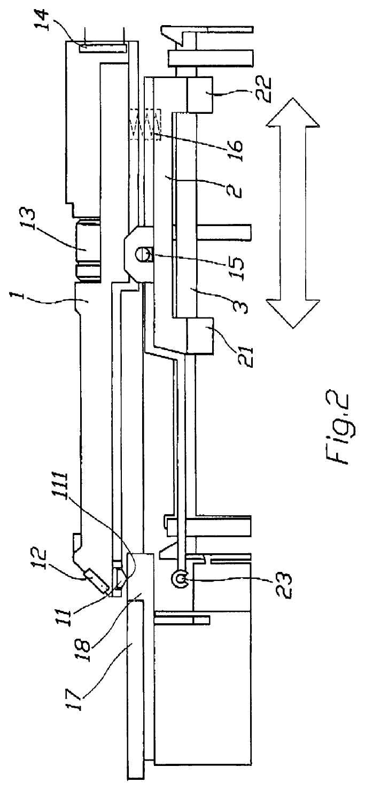
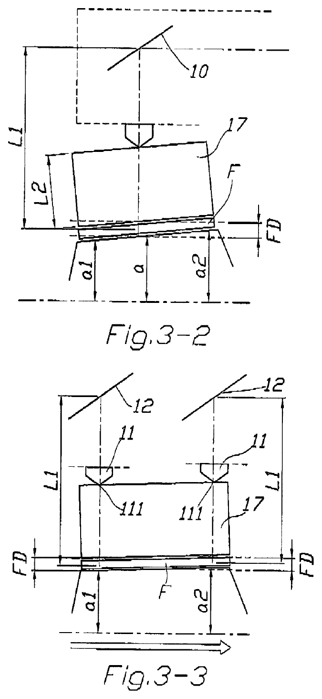

# Film scanning device

A spring-biased optical module keeps a pressure guide in contact with a moving media holder.

[US7106480B2 · complete original PDF (12 pages)](../sources/US7106480B2.pdf) · [Archival PDF source](https://patentimages.storage.googleapis.com/cc/df/2f/1bf63091b6cd52/US7106480.pdf) · [Searchable publication](https://patents.google.com/patent/US7106480B2/en) · [Espacenet](https://worldwide.espacenet.com/patent/search?q=pn%3DUS7106480B2)

## Original drawings

<figure>

<figcaption>Fig. 2. Scan module and pressure guide arrangement in section. <a href="../sources/US7106480B2.pdf#page=3">US7106480B2, PDF p. 3</a>.</figcaption>
</figure>
<figure>

<figcaption>Figs. 3-2–3-3. Two spring placements for maintaining pressure against the holder. <a href="../sources/US7106480B2.pdf#page=5">US7106480B2, PDF p. 5</a>.</figcaption>
</figure>

## Publication

- **Publication** US7106480B2
- **Inventors** Pin-Jui Huang
- **Original assignee** Pacific Image Electronics Co., Ltd.
- **Priority** 2002-08-23 · **Filing** 2002-08-23 · **Publication** 2006-09-12
- **Original application** Film scanner
- **Mechanisms** Mechanical clamping, Combined mechanisms

## What the patent describes

**Original problem.** A removable carrier scanner needed to hold the optical module at a repeatable distance from interchangeable media supports.

**Operating sequence.** Load a film holder or removable magazine. A screw drive moves the scan assembly relative to the media. Spring force around a fulcrum biases the windowed pressure guide against the holder. Remove the holder after capture.

**Film contact.** The guide bears principally on the media holder. The patent's arm tension loads the optical module against the holder, not the film in its own plane.

**Transverse control.** The guide-holder contact sets the distance from the film carrier to the optical line across the scan.

**Longitudinal control.** The biased module follows the holder while the screw drive spans its length. Film tension within the holder is a separate matter.

## Engineering interpretation

**Advantages and limits.** Maintaining an optical-to-holder distance is valuable for interchangeable carriers. Accuracy also depends on the geometry between carrier and film.

**Camera scanning.** Use a replaceable carrier as the optical datum and measure film-to-carrier flatness separately from carriage tolerances.

## Commercial evidence and sources

Commercial deployment of the disclosed mechanism is unverified in the sources reviewed.

## Related patents

[US5088813A · Film scanner](US5088813A.md) · [US5461492A · Film scanner with in-line dual scanning gates](US5461492A.md) · [US7210259B2 · Film holder](US7210259B2.md)

**Selected indexed prior references.** [US5251072A](https://patents.google.com/patent/US5251072A/en) · [US5381245A](https://patents.google.com/patent/US5381245A/en) · [US5432622A](https://patents.google.com/patent/US5432622A/en) · [US5589952A](https://patents.google.com/patent/US5589952A/en)

**Selected indexed later citations.** [US20040233483A1](https://patents.google.com/patent/US20040233483A1/en)

[Return to the archive](../index.md)
